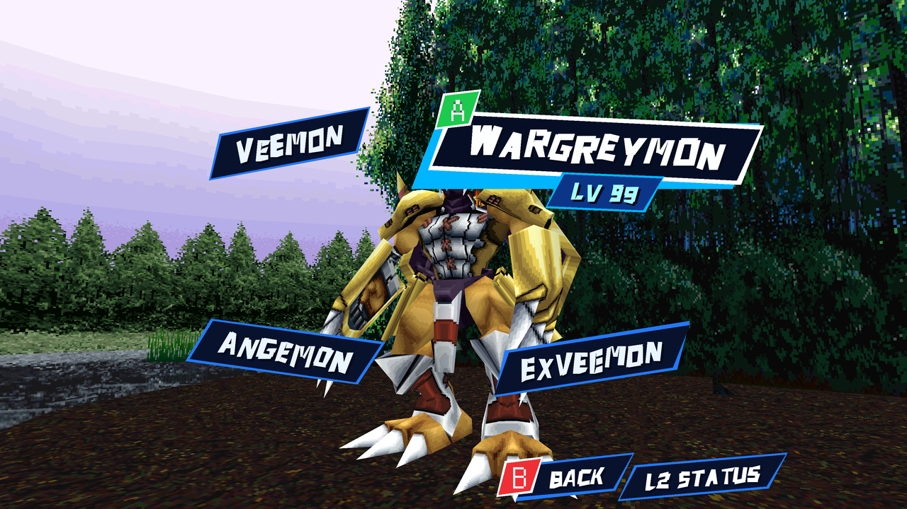
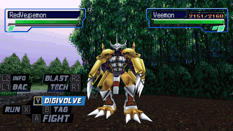
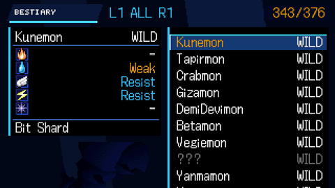
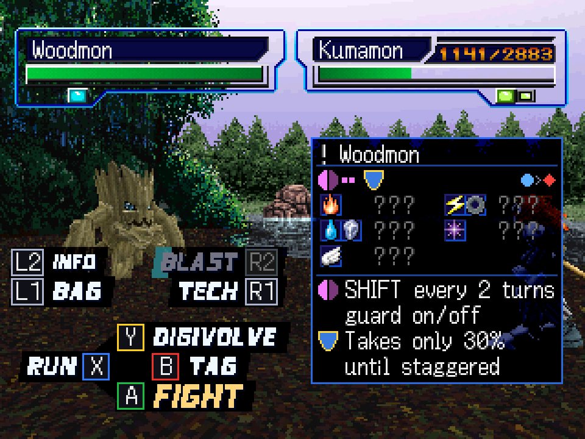
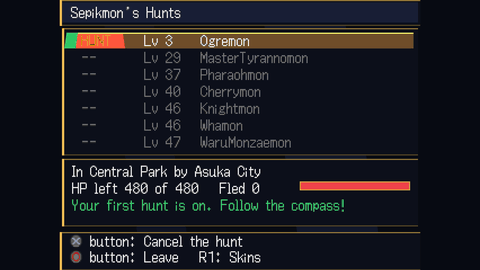

<a href="README.md">English</a> · <a href="README.pt-BR.md">Português (Brasil)</a> · <a href="README.fr.md">Français</a> · <b>Deutsch</b> · <a href="README.it.md">Italiano</a> · <a href="README.es.md">Español</a>

<a href="https://dw3-definitive.pages.dev/">Website zu Digimon World 3: Definitive Edition</a>

  <b>Digimon World 3, so wie es hätte sein können.</b> 
  Ein Fan-Remaster, das nativ und ohne Emulator auf RK3326-Handhelds, Android-Handys und dem PC läuft.

  <b>Kostenlos</b> · <b>ohne Emulator</b> · <b>bring deine eigene Disc mit</b> (das europäische <i>Digimon World 2003</i>) ·
  English, Português (Brasil), Français, Deutsch, Italiano, Español · PortMaster-Release im Test

  <a href="#los-gehts">Los geht's</a> ·
  <a href="#kämpfe-bei-denen-man-mitdenkt">Kampf</a> ·
  <a href="#eine-reise-die-deine-zeit-achtet">Fortschritt</a> ·
  <a href="#die-jagd">Die Jagd</a> ·
  <a href="#der-velvet-room">Velvet Room</a> ·
  <a href="#eine-geschichte-die-zuhört">Geschichte</a> ·
  <a href="#blast-und-die-chosen-evolution">Blast</a> ·
  <a href="#super-rare-jagden">Super Rares</a> ·
  <a href="#überall-spielen">Plattformen</a> ·
  <a href="#was-noch-fehlt">Was noch fehlt</a>

<a href="https://recomplauncher.com/game/digimon-world-3-definitive-edition"><picture><source media="(prefers-color-scheme: dark)" srcset="https://recomplauncher.com/assets/press/launcher/badge-light.svg"></picture></a>

---

2002 gab uns *Digimon World 3* eine ganze Digitale Welt zum Durchstreifen, ein Partnerteam zum Großziehen und ein
Kampfsystem, das meistens nur von dir verlangte, Fight zu drücken, bis der Grind vorbei war. Viele Spieler hörten um
Level 40 herum auf, lange vor dem Endspiel.

Die **Definitive Edition** behält die Reise und baut alles darum herum neu auf. Kämpfe drehen sich um elementare
Schwächen, im Geist von *Persona*: Finde die Lücke, bring den Gegner ins Wanken, nimm dir eine weitere Aktion, gib den
Staffelstab weiter. Das Endspiel beginnt dort, wo Spieler früher aufgegeben haben. Jede Region birgt Beute, die eine
Jagd wert ist, und was du mitbringst, bezahlt Ausrüstung, die nie ein Laden verkauft hat. Ein geheimnisvoller blauer
Raum öffnet sich im Verlauf der Geschichte in den Gasthäusern, mit Gästen, Träumen und der einen oder anderen
Entscheidung ganz für dich. Du kannst als **Kail** spielen. Und dein alter Spielstand funktioniert weiterhin.

Eine Thunder-Technik findet eine Schwäche: <b>WEAK!</b>, der Gegner gerät ins Wanken, und du bist wieder am Zug.

<table>
<tr>
<td width="50%" valign="top">

**⚔️ Kämpfe, bei denen man mitdenkt** 
Sieben Elemente in fünf Familien, getragen allein von Magie. Triff eine Schwäche, bring den Gegner ins Wanken, erhalte eine weitere Aktion, verkette sie.

</td>
<td width="50%" valign="top">

**⏳ Weniger Grind, dieselbe Reise** 
Das Endspiel beginnt etwa bei Level 40-50. Formen leveln 14× schneller, und das ganze Team wächst gemeinsam.

</td>
</tr>
<tr>
<td valign="top">

**🧭 Ein Grund zum Erkunden** 
Siegesserien locken das Rare Target jeder Region hervor. Materialien füttern die Schmiede, den Black Market und das DRI Gauntlet.

</td>
<td valign="top">

**🚪 Der Velvet Room** 
Ein Raum zwischen den Welten, der mit der Geschichte wächst: ein Gastgeber, der die Zukunft deiner Partner liest, ein Jagdmeister, ein Händler.

</td>
</tr>
<tr>
<td valign="top">

**🔥 Blast und die Chosen Evolution** 
Eine verfluchte Kraft mit ihrem Preis, eine Quest, sie zu läutern, und ein Partner, der sich eine eigene Mega-Form verdient.

</td>
<td valign="top">

**🎮 Überall spielen** 
Handhelds, Android und PC, 16:9-Widescreen, GPU-Renderer und Shader sowie kostenlose Cross-Play-Cloud-Spielstände.

</td>
</tr>
</table>

> [!IMPORTANT]
> **Dieses Repository enthält keine Spieldaten.** Du brauchst deine eigene Kopie von *Digimon World 2003 (Europe) (En,Fr,De,Es,It)*,
> als rohe `.bin` + `.cue`, MODE2/2352, 692,146,560 bytes, SHA-1 `457cb233349ba841e03b33d8060f8fbcadd45cb3`.
> Dieses Projekt steht in keiner Verbindung zu Bandai, Bandai Namco oder Sony und wird von ihnen nicht unterstützt.

## Los geht's

**Handhelds (PortMaster)**

> [!NOTE]
> **Das PortMaster-Release ist in Arbeit**: Der Port befindet sich in der Testphase auf dem PortMaster-Discord. Er ist
> noch nicht im PortMaster-Katalog, lief aber bereits unter Emulation auf jeder Custom Firmware der Testmatrix.

1. Lade `dw3.zip` von den [Releases](https://github.com/al4xdev/digimon-world-3-definitive-edition/releases) herunter
   und entpacke es in dein PortMaster-Verzeichnis `ports`.
2. Kopiere dein Disc-Image nach `ports/dw3/game/`.
3. Starte *Digimon World 3* über das Ports-Menü.

Getestete Geräte, Installationsdetails und bekannte Probleme: [`.ci-cd/portmaster/README.md`](.ci-cd/portmaster/README.md).

**Android (arm64, Android 7 oder neuer)**

1. Lade `dw2003-*-android-arm64-v8a.apk` aus den
   [Releases](https://github.com/al4xdev/digimon-world-3-definitive-edition/releases) herunter und installiere es
   (erlaube Installationen aus deinem Browser oder Dateimanager).
2. Tippe auf **SPIELEN** und wähle deine `.bin` (und die `.cue`) in der Dateiauswahl des Systems: die App kopiert sie.
3. Die Pfeile oben rechts verschieben und skalieren die Touch-Steuerung; der Knopf oben links blendet sie aus. Ein
   Gamepad funktioniert auch, und die Touch-Steuerung tritt zur Seite, solange es verbunden ist.

**PC (Linux und Windows)**

1. Entpacke das PC-Release (ein AppImage unter Linux, eine `.zip` unter Windows) oder starte
   `./launcher/dw3-launcher --sdl` aus einem gebauten Checkout.
2. Wähle beim ersten Start deine `.cue` / `.bin` (jederzeit änderbar unter `GAME > DISC IMAGE`).
3. Öffne `VIDEO` für **Widescreen** (folgt der Form deines Bildschirms, bis 16:9), **Fullscreen**, die Skalierung **`FILL` oder
   `INTEGER`**, die interne **Auflösung** (standardmäßig 3X), den **GPU**- oder Software-Renderer und die
   Bildschirm-**Filter**. Der Launcher aktualisiert sich selbst, sobald eine neue Version erscheint.

**Du kommst von einer älteren Version?** Dein Spielstand lässt sich öffnen und spielen. Um ihm die neuen MP- und
TP-Tabellen zu geben, führe einmal `tools/convert_save_mp.py card1.mcd` aus (es legt ein Backup an). Der Launcher bringt seine Einstellungen und den Erweiterungsspielstand neben der
Karte (`card1.def.json`) selbst auf den neuesten Stand und behält die alte Datei als Backup.

---

## Kämpfe, bei denen man mitdenkt

Jeder Gegner hat Schwächen und Resistenzen über **fünf Elementfamilien** hinweg: Fire, Water + Ice, Wind,
Thunder + Machine und Dark. Gepaarte Elemente teilen sich immer denselben Wert, eine Familie ist also als Ganzes
schwach, neutral oder resistent.

**Nur Magie trägt ein Element.** Physisch ist rein physisch: Eine physische Technik oder ein normaler Angriff trifft nie
eine Schwäche und bringt nie ONE MORE; gegen einen wankenden Gegner erhält er den festen Bonus für "irgendeinen anderen
Schlag" weiter unten (+0.2). Wenn du das Originalspiel kennst: Seine elementaren physischen Angriffe (Hot Head und Co.)
sind hier Elementmagie. Die Techniklisten zeigen es auf einen Blick: Wo das Spiel seine roten (physisch) und blauen
(Magie) Marken zeichnete, siehst du jetzt eine Faust für einen physischen Schlag und das Bild des Elements für Magie.

- **Triff eine Schwäche** mit Elementmagie: ein schräges **WEAK!**, der Gegner **gerät ins Wanken**, und du
  erhältst eine **ONE MORE**-Aktion. Jede schwache Familie zahlt einmal pro Runde aus, zwei Schwächen verketten sich
  also zu mehreren Aktionen hintereinander.
- **Solange er wankt**: Triff eine weitere Schwäche, wechsle mit einem kostenlosen **Baton Pass** den Partner und
  behalte deinen Zug (einmal pro Runde), oder führe irgendeinen anderen Schlag aus, für einen Bonus, der das Wanken
  beendet.
- **OVERFINISH**: Besiege einen Gegner mit einem Schlag, der eine weitere Aktion bringt, und er bleibt dafür am Boden.
  Jeder Treffer auf ihn zahlt Bits.
- **Du eröffnest den Kampf**, es sei denn, du wirst überfallen. Ein doppelt so schneller Gegner handelt zweimal, und
  die Zugfolge im INFO-Fenster zeigt es; deine Seite braucht das Vierfache seines Tempos, deine Extra-Aktionen kommen also von One More.
- **Du hörst es auch**: ein anderer Klang für eine Schwäche, einen neutralen und einen resistierten Treffer.

<table>
<tr>
<td width="50%" align="center"> <b>Baton Pass</b>: ein kostenloser Wechsel, der deinen Zug behält</td>
<td width="50%" align="center"> <b>OVERFINISH</b>: der Gegner bleibt am Boden, und jeder Treffer zahlt</td>
</tr>
<tr>
<td width="50%" align="center"> <b>Tag</b>: die Formen deines Partners, dann Switch oder Baton Pass</td>
<td width="50%" align="center"> <b>Digivolve</b>: die Formen im Ring, mit 3D-Vorschau</td>
</tr>
</table>

**Kenne deinen Gegner.** Nichts ist verborgen, aber du musst es herausfinden. **INFO** (`L2`) zeigt die fünf
Familien des Gegners, sobald du sie erfährst, bis dahin `???`, und wer als Nächstes handelt; **Libra** deckt alle auf
einmal auf; das **Bestiary**, ein eigener Bildschirm, auf dem sich jedes Digimon in 3D dreht, bewahrt auf, was du über
jede Art, jedes Rare Target, jeden Super Rare und jede DRI-Linie gelernt hast, samt ihren Hunt Materials. Jede Technikliste markiert jede Technik (eine Faust oder ihr Element), und jede Beschreibung wurde danach neu geschrieben, was die Technik wirklich tut ("Feuermagie. Chance auf
Schlaf.").

 Das Bestiary als eigener Bildschirm: Reiter nach Art, Schwächen, sobald du sie kennst, jedes Digimon dreht sich in 3D.

**Deine Werte haben neue Aufgaben.** Die alten elementaren "Toleranz"-Werte deines Digimon sind zur **Affinity**
geworden: Sie verteidigen nicht mehr, sondern verstärken deine Angriffe dieses Elements gegen eine Schwäche oder einen
wankenden Gegner. **Defense** schützt jetzt vor Magie, und **Spirit** ist rein dein magischer Angriff.

**Buffs, die einen Plan ergeben.** Buffs und Debuffs gibt es in drei festen Stufen, und sie stapeln sich nie: Die
stärkste gewinnt. Debuffs treffen Bosse voll: **Resist Down** und **Mega Break**
können eine Schwäche öffnen, die vorher nicht da war. Vier Techniken wurden dafür neu gemacht (Libra, Relay, Resist
Down, Mega Break), und die Rookies, die bisher an MP darbten, tun das nicht mehr.

**Statuseffekte, die einen Zug wert sind.** Poison, Sleep und Confusion greifen umso öfter, je weiter deine **Wisdom**
die des Ziels übertrifft, und viel öfter bei einem **wankenden** Ziel. Bosse sind nicht mehr immun: Sie bekommen sie mit
verringerter Chance ab (Paralysis greift bei einem Boss weiterhin nie). **Gift** beißt jetzt jede Runde mit einem festen
Betrag aus Technik, Wisdom, Spirit und deiner Wind-Affinity, bis zu 8% der maximalen HP eines Gegners pro Runde. Sleep
und Confusion halten einen Gegner zwei Runden fest: Nutze sie zum Heilen oder um das Wanken vorzubereiten. Regeln und
ein Rechenbeispiel stehen in [der Kampfreferenz](docs/definitive-edition/combat.md#status-and-poison-for-the-player).

**Gegner mit einer eigenen Regel.** Rare Targets, Super Rares, die DRI-Linien, einige Story-Bosse und ab Level 10 etwa
die Hälfte der gewöhnlichen Arten haben einen Kniff: eine **Wache**, die nur 30% deines Schadens durchlässt, bis du sie
ins Wanken bringst, eine **rote Wache**, die nur ein Treffer auf die Schwäche durchbricht, ein **SHIFT**, der Schwäche
(und Farben) alle paar Runden wechselt, ein **Tempo** zwei- oder dreimal so hoch wie deins, oder Resistenz gegen alles
bei weicher Defense. INFO markiert sie mit einem `!` und zeichnet ein Bild pro Regel, unten in einfachen Worten erklärt.
Was du über einen lernst, wird gespeichert, und beim nächsten Treffen erinnert sich INFO.

**Ein Kampf-HUD mit einer Taste pro Aktion**, gezeichnet wie dein Controller und im Launcher umbelegbar. Tech und Bag
klappen als Blatt neben dem INFO des Gegners auf, Tag und Digivolve öffnen eine Nahaufnahme deines Partners mit einem
Ring aus Optionen und einer 3D-Vorschau, die Blast-Taste ist die Leiste selbst, und Run fragt vor der Flucht nach. Es
merkt sich deine letzte Technik und deinen letzten Gegenstand, puffert zu frühe Tastendrücke, und Kampftext hält den
Kampf nie an.

<b>Die Zahlen, für Neugierige</b>

| Der Treffer | Multiplikator |
|---|---|
| Resistiertes Element | 0.5 |
| Neutrales Element | 1.0 |
| Schwäche | 1.5 + affinity |
| Neutrales Element, wankendes Ziel | 1.2 + affinity |
| Schwäche, wankendes Ziel | 1.7 + 2 × affinity |
| Kein Element, wankendes Ziel | 1.2 |

Die Affinity wächst mit dem Quadrat des Werts und erreicht 0.4 für Fire und Wind und 0.8 für die Paare und Dark, der
stärkste Treffer liegt also bei 2.5 oder 3.3. Die Buff-Stufen sind +20 / +35 / +50%, die Debuff-Stufen −15 / −25 / −35%. Die gesamte
Berechnung, Schritt für Schritt mit einem durchgerechneten Beispiel, steht in [der Kampfreferenz](docs/definitive-edition/combat.md).

## Eine Reise, die deine Zeit achtet

- **Mehr Trainingspunkte, früher.** Bis Level 50 hat ein Digimon mehr TP verdient, als das Original bis Level 99 gab
  (613 gegenüber 490), und die Level 41 bis 50 sind der Bereich, in dem du seine Werte formst.
- **Garantiertes Training.** Drei Einheiten ohne perfektes Ergebnis, und die vierte gelingt in jeder Runde.
  Resistenztraining kostet keinen Wert mehr.
- **Formen leveln 14× schneller**, sodass es Spaß statt Pflichtübung ist, eine neue Digivolution auszuprobieren.
- **Das Team wächst gemeinsam**: Ein Partner auf der Bank erhält dieselbe Erfahrung, und die drei gewählten Formen
  jedes Digimon sammeln Formerfahrung, ob sie gekämpft haben oder nicht.
- **Voraussetzungen auf dem Bildschirm**: Das Digi-Lab zeigt, was jede nächste Form braucht und wie weit du bist
  ("Greymon Lv 5 (3/5)"). Schnelle Formstufen überspringen den Weg nicht: Eine Perfect-Form wartet auf Level 20 deines
  Digimon, eine Mega auf Level 40. Die Digivolutionsanimation läuft einmal komplett, danach kurz; halte eine Taste gedrückt, um
  sie zu überspringen.
- **Card Booster fallen zu je 15**, sodass der Deckbau keinen zweiten Durchlauf braucht.
- **Hard Mode**, bei New Game gewählt: Dein Team besteht aus zwei Digimon statt drei, für das ganze Spiel.
- **Super Hard**, jederzeit: Trage den Demon Bell aus dem Velvet Room bei dir, und Gegner erhalten 50% mehr Tempo und
  treffen 25% härter, während deine Treffer nur halb so viel Schaden machen, zahlen dafür aber doppelt so viele Bits
  und Erfahrung und dreimal so viele gewöhnliche Materialien. Gib ihn zurück, um es auszuschalten.

## Die Jagd

Optional und das ganze Spiel über offen. Jeder gewonnene Zufallskampf zählt zur **Hunt Chain** der Region, in der du
dich befindest. Nach fünf Siegen kann die nächste Begegnung das **Rare Target** der Region sein: ein umgefärbter,
zäherer Boss, ganz allein, sicher beim zehnten Sieg. Jede der 71 Regionen hat ihre eigene Art, und jede lässt ihren
eigenen **Core** für deine Sammlung fallen.

- **Hunt Materials**: sechzehn gewöhnliche nach Levelbereich, vom Bit Shard bis zum Obsidian Digizoid, und 71 seltene
  Cores. Das Bestiary sagt dir, wer was fallen lässt.
- **Die Schmiede**: Waffen, Rüstungen und Accessoires jedes Ladens verlangen die Materialien der Regionen in der
  Umgebung. Die Beschreibung zeigt, was du hast und was dir fehlt.
- **41 Ausrüstungsvarianten**, um einen Stil herum gebaut: Speed-Waffen, Elemental-Ausrüstung, die deine Affinity
  erhöht, Tank-Rüstungen, Trade-off-Accessoires.
- **Der Black Market**: Tausche einen Core gegen zwölf gewöhnliche, oder die Cores zweier Bosse gegen eine von 32
  **Repliken**, die kein Laden verkauft, von den Power-S-Accessoires bis zu fünf ultimativen Waffen (und, ganz am Ende der Liste, ein Zeichen, das jeder Jäger will).
- **Das DRI Gauntlet**: Die DRI Agents spielen klassische Tamer-Kämpfe nach, insgesamt sechzehn Linien. Ein Kampf,
  vier Stufen, von Rookie über Champion und Ultimate zu Mega mit einem **DIGIVOLVE!** dazwischen, und ein
  Power-Accessoire für den Champion, den Ultimate und den Mega, die du bezwingst. Ein Power-Accessoire hebt den Wert
  seines Elements um 60, 120 oder 200: mehr Affinity.
- **Die Preise** fortgeschrittener Ausrüstung sind gestiegen und der Wiederverkauf gesunken, sodass ein Glücksfund
  nicht mehr ein Vermögen einbringt und die Bits aus OVERFINISH einen Verwendungszweck haben.

Die Repliken des Black Market: die Cores zweier Bosse und die Bits, und die Ausrüstung gehört dir.

<b>Die sechzehn Linien des DRI Gauntlet</b>

| Agent | Linie | Stufen und Level (von Rookie bis Mega) | Belohnungen |
|---|---|---|---|
| Ken | Kotemon | Kotemon 21, Dinohumon 24, Kyukimon 27, Marsmon 30 | Wind Power 1, 2, S |
| Yang | Monmon | Monmon 25, Hookmon 28, Armormon 31, GuardiAngemon 34 | Water Power 1, 2, S |
| Yuji | Kumamon | Kumamon 29, Grizzmon 32, GrapLeomon 35, Cannondramon 38 | Metal Power 1, 2, S |
| Bob | Veemon | Veemon 33, ExVeemon 36, Paildramon 39, Imperialdramon 42 | Bolt Power 1, 2, S |
| Kazuki | Patamon | Patamon 37, Angemon 40, MagnaAngemon 43, Seraphimon 46 | Wind Power 1, 2, S |
| Michael | Renamon | Renamon 41, Kyubimon 44, Taomon 47, Sakuyamon 50 | Ice Power 1, 2, S |
| Johann | Agumon | Agumon 45, Greymon 48, MetalGreymon 51, WarGreymon 54 | Fire Power 1, 2, S |
| Jimmy | Guilmon | Guilmon 49, Growlmon 52, WarGrowlmon 55, Gallantmon 58 | Dark Power 1, 2, S |
| Ken | Musyamon | Kotemon 53, Musyamon 56, Knightmon 59, MetalGarurumon 62 | Ice Power 1, 2, S |
| Yang | Terriermon | Hagurumon 57, Guardromon 60, Antylamon 63, MegaGargomon 66 | Metal Power 1, 2, S |
| Yuji | Kuwagamon | Kunemon 61, Kuwagamon 64, Okuwamon 67, GranKuwagamon 70 | Bolt Power 1, 2, S |
| Bob | Wormmon | Kunemon 65, Stingmon 68, Paildramon 71, Imperialdramon-F 74 | Bolt Power 1, 2, S |
| Kazuki | Devimon | DemiDevimon 69, Devimon 72, Myotismon 75, MaloMyotismon 78 | Dark Power 1, 2, S |
| Michael | Angewomon | Kiwimon 73, Angewomon 76, MagnaAngemon 79, Phoenixmon 82 | Water Power 1, 2, S |
| Johann | Agumon (dark) | Agumon 77, Greymon 80, SkullGreymon 83, BK WarGreymon 86 | Fire Power 1, 2, S |
| Jimmy | Impmon | Goburimon 81, Flarerizamon 84, Megadramon 87, Beelzemon 90 | Dark Power 1, 2, S |

Die Linien stehen von der leichtesten zur schwersten. Der Rookie gibt nichts; Power 1 kommt vom Champion, 2 vom
Ultimate und S vom Mega, jeweils beim ersten Mal, dass du die Stufe erreichst. Verlieren ist kein Game Over: Du stehst
wieder im Feld, so wie du warst, mit wiederhergestellten HP und MP (verbrauchte Items bleiben verbraucht).
Freischaltkosten, die Rezepte der Schmiede und jede Variante stehen in [der
Jagdreferenz](docs/definitive-edition/hunt-and-economy.md).

## Der Velvet Room

<table>
<tr>
<td width="50%" align="center"> Ein sanftes blaues Licht in einem Gasthaus, und der Weg öffnet sich</td>
<td width="50%" align="center"> Der Raum in voller Pracht, mit Kail als Held</td>
</tr>
</table>

Irgendwo in der Digitalen Welt wartet ein blauer Raum zwischen den Servern. Zuerst sind seine Türen verschlossen. Dann
geht in Seiryu City ein Gerücht um, und in jedem Gasthaus beginnt ein sanftes **blaues Licht** auf einem Stück der
Kulisse zu atmen. Stell dich hinein, drück Circle, und du bist drin.

Der Raum **wächst mit der Geschichte**. Seine Gäste treffen nach und nach ein:

| Gast | Was er tut |
|---|---|
| **Igor**, der Gastgeber | liest die DNA-Formen deiner Partner und was ihnen noch fehlt; ab und zu träumt er mit dir |
| **Der Sepikmon** | der Jagdmeister: Super-Rare-Jagden, ihre Kristalle und die Heldenskins, die sie freischalten |
| **Gennai** | die Blast-Quest und die Chosen Evolution |
| **Guilmon** | verwahrt den Demon Bell, Super Hard auf Wunsch |
| **Etemon** | am Klavier. Er hat diese Musik schon in einem anderen Spiel gehört, und er spielt deine eigenen MIDI-Dateien in Zufallskämpfen, jede in ihrer eigenen Lautstärke |
| **Das Schwein** | ein Darsteller, den das Spiel mitlieferte und nie einsetzte, endlich auf der Bühne; verschiebt 100 Punkte von einem Wert (oder einer Affinität) eines Partners auf einen anderen, zu einem Preis, der mit jedem Tausch steigt (1.000 Bits beim ersten, 100.000 ab dem zehnten) |
| **Oikawa** | hinter dem Tresen, sobald du es dir verdient hast: der Black Market |

Der Raum hat sein eigenes Arrangement der Musik, und ein **Guardromon-Netzwerk** verbindet die Gasthäuser: Speichere
oder teleportiere dich von jedem Guardromon zu denen, die du getroffen hast.

## Eine Geschichte, die zuhört

Die Definitive Edition ändert nicht, wohin die Geschichte führt. Sie ändert, wie sie erzählt wird, und gibt dir eine
Stimme darin.

- **Jeder hat seine eigene Zeit.** Die Menschen, denen du begegnest, leben ihre eigenen Geschichten, und die gehen
  mit der Hauptquest weiter, mit dir oder ohne dich. Nutze die Zeit mit ihnen, solange du kannst: Du wirst nicht mit
  allen eine Bindung eingehen, und das sollst du auch nicht. Wen du zurücklässt, macht ohne dich weiter, und du wirst
  sehen, wohin es ihn geführt hat.
- **Igors Träume.** An ein paar Wendepunkten zieht er dich allein in den Raum und stellt dir eine Frage. Es gibt keine
  falsche Antwort, und er merkt sich, was du gesagt hast.
- **Deine Entscheidungen und ihr Echo.** In 111 Szenen darf der Held jetzt mit eigenen Worten antworten, und rund 600
  spätere Zeilen ändern sich je nach deiner Wahl.
- **Ein neu geschriebenes Drehbuch** (auf Englisch und Portugiesisch, wie die Entscheidungen und ihre Echos; auf
  Deutsch läuft die Originalkampagne der Disc): die kindischen Zeilen erwachsen geworden, Reihenfolge und Quests unangetastet,
  und der Held so geschrieben, dass er zu jedem passt, der gerade spielt.
- **Eine Gestalt mit Kapuze** versperrt im Bug Maze den Weg, und **ein Raum, in dem die Zeit stillsteht**, wartet vor
  dem Point of no Return, um sicherzugehen, dass du bereit bist.
- **Der letzte Kampf endet nicht mehr dort, wo er endete.** Mehr wird hier nicht verraten.

## Blast und die Chosen Evolution

Gewinne die Super-Rare-Tutorialjagd, und eine neue Kraft erwacht. Gutes Kämpfen füllt das **Blast Gauge**: Schwächen,
Wanken, OVERFINISH. Ist es voll, entfesselt `R2` die **dunkle Form** deines Partners. Das ist Kraft, und sie hat einen
Preis: Der Kampf endet mit HP und MP bei 1, die Werte bleiben bis zum nächsten Gasthaus gesenkt, und der Partner ist zu
überhitzt, um zu digivolven. Jemand im Velvet Room weiß, wie man sie läutert, wenn du ihm vertrauen kannst. Am Ende
dieses Wegs verdient sich ein Partner die **Chosen Evolution**: eine eigene Mega-Form, ohne Fluch.

## Super-Rare-Jagden

Die Tafel des Sepikmon führt **zwölf Super-Rare**-Digimon auf (und einen Tutorial-Ogremon zum Üben), von Level 29 bis
61, nacheinander freigeschaltet. Jedes versteckt sich auf einer zufälligen Map seines Reviers, und ein
**Temperaturkompass** verrät dir, wann du näher kommst. Verletze es, und es rennt weg, behält den Schaden und kommt
stärker zurück. Jedes, das du erledigst, zahlt einen Kristall und schaltet einen **Heldenskin** frei.

 Die Jagdtafel und ein Target Dossier: wo das Ziel umherstreift, was sein Kristall bringt, welchen Skin es freischaltet.

## Dein Held, auf deine Art

**Girls Power**: Wähle bei New Game **Kail** oder **Junior** als Helden. Die Rollen tauschen sich in den
Feld-Sprites, Zwischensequenzen, Feldaktionen und Menüs, wobei jedes Frame, das Kail fehlte, von Hand gezeichnet
wurde, und der Text der Geschichte folgt dem Tausch. Dreizehn **Heldenskins** aus den Super-Rare-Jagden färben Haar
und Kleidung deines Helden um.

## Komfort und Lebensqualität

- **GUIDE**: dein aktueller Hauptquest-Schritt, die offenen Nebenmissionen und alle sechzehn Asuka-Auktionen, mit einem
  Sprung direkt zu einer offenen. Ein Banner gleitet ein, wenn sich ein Ziel ändert.
- **Overlevel Rush**: Wenn dein stärkstes Digimon 3 oder mehr Level über jedem Gegner eines Zufallskampfs liegt, bietet
  das Spiel an, ihn zu überspringen, während du weiterläufst, und die Belohnungen gleiten oben im Bild ein.
- **Kampftext, der den Kampf nicht anhält**, eine Zielmarkierung auf der Karte, Vorspulen (auf Android auch als Taste im Touch-Pad), Tastensymbole passend zu
  deinem Controller (Xbox, Nintendo, PS1) und vollständige Tastenbelegung.
- **60 Hz als Standard**: Die europäische Disc läuft mit 50 Hz; der spieleigene, geschwindigkeitskompensierte
  60-Hz-Modus ist von Anfang an aktiv (`GAME > REFRESH RATE` holt 50 Hz zurück).

<table>
<tr>
<td width="50%" align="center"> <b>Overlevel Rush</b>: überspring den leichten Kampf, behalte die Belohnungen</td>
<td width="50%" align="center"> <b>GUIDE</b>: wohin als Nächstes, in einem Satz</td>
</tr>
</table>

## Überall spielen

| Wo | Was du bekommst |
|---|---|
| **RK3326-Handhelds** über PortMaster (der XF35H, der R36S und ähnliche Geräte) | von Anfang bis Ende auf einem echten XF35H abgestimmt: direkte Framebuffer-Ausgabe, ein GLES-Renderer, Videos in voller Geschwindigkeit, die LED-Leiste. Jede Custom Firmware der Testmatrix lief unter Emulation; Berichte von echten Geräten sind willkommen |
| **Linux- und Windows-PC** | SDL3-GPU-Renderer (Vulkan, D3D12), **Widescreen** in Kämpfen und im Feld, das deinem Bildschirm folgt (16:10 oder 16:9), interne Auflösung von 1X (PS1) bis 8X (standardmäßig 3X) mit glatten 3D-Vertices, HighDPI-Vollbild mit `FILL`-Skalierung, Filter `SHARP` / `SCANLINES` / `CRT` / `SMOOTH`, Vorspulen bis 8× und ein Launcher, der sich selbst aktualisiert |
| **Android** (arm64) | ein APK mit **16:9-Breitbild**, großen Touch-Steuerelementen, die du auf dem Bildschirm verschieben und skalieren (oder ausblenden) kannst, jedem USB- oder Bluetooth-Gamepad und einer Disc-Auswahl, die dein Image in die App kopiert |

**Cross-Play-Spielstände.** Der kostenlose **Cloud Sync** hält deine Memory Card zwischen Handheld, Android-Handy und PC auf dem
gleichen Stand: Koppele ein Gerät mit einem 6-stelligen Code, löse Konflikte, sperre ein verlorenes Gerät und behalte
bis zu 100 lokale Snapshots mit Wiederherstellung per Tastendruck. Ein konsolenorientierter Launcher kümmert sich um
Disc, Video, Steuerung, das Kampf-HUD und die Spielstände und spielt ein kleines Runner-Spiel mit Kumamon, Guilmon und
Agumon, während deine Disc geprüft wird.

Wenn du es auf einem anderen Gerät ausprobierst, hilft ein Bericht im
[Issue Tracker](https://github.com/al4xdev/digimon-world-3-definitive-edition/issues) sehr.

## Was noch fehlt

Das Spiel ist von Anfang bis Ende spielbar, und jedes oben beschriebene System ist umgesetzt. Es ist aber auch jung:
Manches wurde erst ein paar Mal durchgespielt, rechne also mit Ecken und Kanten und häufigen Hotfixes. Was bleibt:

- **Durchsicht der Übersetzungen.** Der neue Text ist auf Englisch geschrieben; brasilianisches Portugiesisch,
  Französisch, Deutsch, Italienisch und Spanisch decken die eigenen Texte der Definitive Edition ab (maschinengestützt
  übersetzt, noch nicht von Muttersprachlern im Spiel gelesen: rechne mit holprigen Sätzen und ein paar Beschriftungen,
  die zu breit für ihr Feld sind). Die neu geschriebene Story gibt es nur auf Englisch und Portugiesisch; in den anderen
  vier Sprachen läuft die Originalkampagne der Disc.
- **Die allgemeine Spielbalance.** Bisher wurde sie nur rechnerisch ausbalanciert. Ich spiele es parallel durch und
  liefere Hotfixes nach, sobald sie fertig sind, die Chosen Evolution und die geheimen Endgame-Kämpfe eingeschlossen.

Sonst ist nichts geplant: ab jetzt besteht die Arbeit aus Hotfixes. Fehler gehören in den
[Issue Tracker](https://github.com/al4xdev/digimon-world-3-definitive-edition/issues).

## Unter der Haube

Dies baut auf der [Dekompilierung von Digimon World 2003](https://github.com/gascarcella/dw2003recomp) und ihrem
PC-Port auf, die Arbeit des Upstream-Projekts sind: Jede Spieldatei lässt sich byte-identisch aus passendem C neu
bauen. Dieser Fork ergänzt den Handheld-Pfad und die Definitive Edition.

- **Wie die Definitive Edition funktioniert**, jede Regel, Zahl, Datei und Designentscheidung:
  [`docs/definitive-edition/`](docs/definitive-edition/README.md).
- **Die Dekompilierung und der Port**, Formate, Performance, die GPU-Arbeit: [`docs/`](docs/README.md).

| Wofür | Befehl | Details |
|---|---|---|
| Das ARM-Handheld-Binary und -Paket | `.ci-cd/portmaster/build_arm.sh` | [`docs/HANDHELD.md`](docs/HANDHELD.md#building) |
| Das PortMaster-Zip | `.ci-cd/portmaster/make_release.sh` | [`.ci-cd/portmaster/PUBLISHING.md`](.ci-cd/portmaster/PUBLISHING.md) |
| Der PC-Port und die Tests | siehe die Anleitung | [`docs/BUILDING.md`](docs/BUILDING.md) |

## Mitmachen und Support

Lies zuerst [`docs/CONTRIBUTING.md`](docs/CONTRIBUTING.md). Stelle Fragen im
[Issue Tracker](https://github.com/al4xdev/digimon-world-3-definitive-edition/issues).

**Einen Bug melden:** Im Launcher DEBUG öffnen, LOGS auf VOLL stellen, das Problem nachstellen, dann DEBUG > LOGS SENDEN. Logs und Spielstand (RPG-Daten) werden hochgeladen und ein Report-Code erscheint; eröffne einen [Bug Report](https://github.com/al4xdev/digimon-world-3-definitive-edition/issues/new?template=bug_report.yml) und tippe den Code ein (oder fotografiere ihn). Das Formular verlangt ihn. Details: [`docs/CONTRIBUTING.md`](docs/CONTRIBUTING.md#reporting-issues).

## Credits und Lizenz

Die Dekompilierung und der PC-Port sind das Werk des [Upstream-Projekts](https://github.com/gascarcella/dw2003recomp).
Dieser Fork ergänzt die Definitive Edition und den Handheld-Pfad: die direkte Framebuffer-Ausgabe, die
Cortex-A35-Codegenerierung, die Arbeit an den Vector Spans, das VRAM-Zeilenlayout, den Frame-Meter und die
Handheld-Extras, den GLES-Renderer, die Audioarbeit und das Paket. Die eigene Arbeit des Projekts steht unter der
[MIT-Lizenz](LICENSE); das Spiel bleibt Eigentum seines Publishers.

Danke an juandav und [ReGame-Labs/dw3_decomp](https://github.com/ReGame-Labs/dw3_decomp), die andere Digimon-World-3-Dekompilierung, deren Namen und
Funktionsformen geholfen haben, die letzten Funktionen abzuschließen; jede übernommene Idee steht in
[`docs/THIRD_PARTY.md`](docs/THIRD_PARTY.md).

Der Velvet Room ist eine Hommage an Atlus' *Persona*-Reihe, die Jagden (Rare Targets, Materialien, die Schmiede) an
Capcoms *Monster Hunter*. *Digimon* gehört Bandai / Bandai Namco, *Persona* Atlus und *Monster Hunter* Capcom; dieses
Fanprojekt ist mit keinem von ihnen verbunden und wird von keinem unterstützt.
