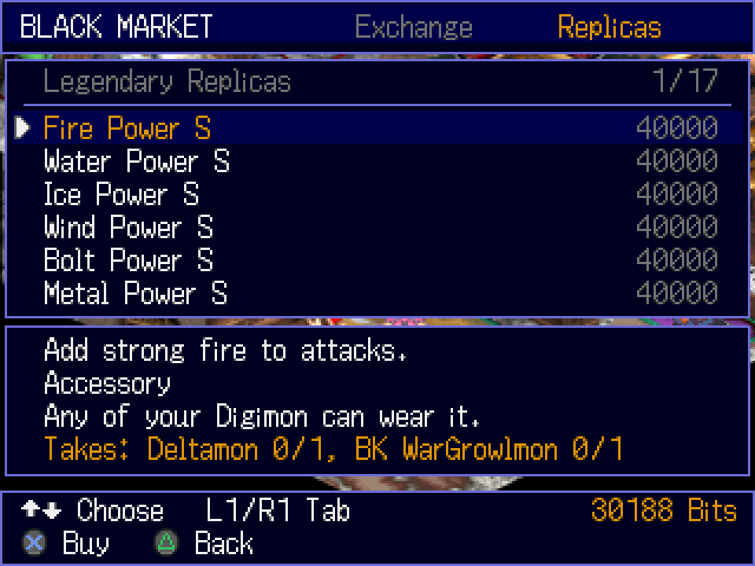
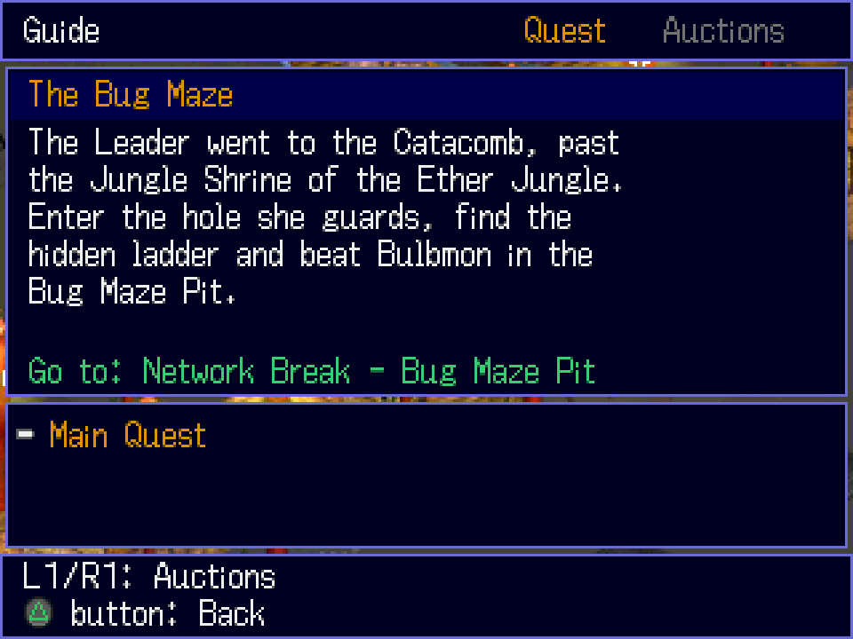

<a href="README.md">English</a> · <a href="README.pt-BR.md">Português (Brasil)</a> · <a href="README.fr.md">Français</a> · <a href="README.de.md">Deutsch</a> · <a href="README.it.md">Italiano</a> · <b>Español</b>

<a href="https://dw3-definitive.pages.dev/">Sitio de Digimon World 3: Definitive Edition</a>

  <b>Digimon World 3, como podría haber sido.</b> 
  Un remaster hecho por un fan que funciona de forma nativa, sin emulador, en portátiles RK3326, móviles Android y PC.

  <b>Gratis</b> · <b>sin emulador</b> · <b>trae tu propio disco</b> (el <i>Digimon World 2003</i> europeo) ·
  English, Português (Brasil), Français, Deutsch, Italiano, Español · versión de PortMaster en pruebas

  <a href="#cómo-empezar">Cómo empezar</a> ·
  <a href="#combates-para-pensar">Combate</a> ·
  <a href="#una-aventura-que-respeta-tu-tiempo">Progresión</a> ·
  <a href="#la-caza">La caza</a> ·
  <a href="#la-velvet-room">Velvet Room</a> ·
  <a href="#una-historia-que-escucha">Historia</a> ·
  <a href="#blast-y-la-chosen-evolution">Blast</a> ·
  <a href="#cacerías-super-rare">Super Rares</a> ·
  <a href="#juega-donde-quieras">Plataformas</a> ·
  <a href="#lo-que-falta">Lo que falta</a>

<a href="https://recomplauncher.com/game/digimon-world-3-definitive-edition"><picture><source media="(prefers-color-scheme: dark)" srcset="https://recomplauncher.com/assets/press/launcher/badge-light.svg"></picture></a>

---

En 2002, *Digimon World 3* nos dio un Mundo Digital entero que recorrer, un equipo de compañeros que criar y un sistema
de combate que, casi siempre, solo te pedía pulsar Fight hasta que el grind se acababa. Muchos jugadores lo dejaron
hacia el nivel 40, mucho antes del final del juego.

La **Definitive Edition** conserva el viaje y reconstruye todo lo que lo rodea. Los combates giran en torno a las
debilidades elementales, con el espíritu de *Persona*: encuentra el hueco, aturde al enemigo, consigue una acción más,
pasa el testigo. El final del juego llega justo donde los jugadores solían rendirse. Cada región esconde presas que
merecen la caza, y lo que traes de vuelta paga equipo que ninguna tienda vendió jamás. Una misteriosa sala azul se
abre en las posadas a medida que avanza la historia, con invitados, sueños y una decisión o dos solo tuyas. Puedes
jugar como **Kail**. Y tu partida guardada de antes sigue funcionando.

Una técnica Thunder encuentra una debilidad: <b>WEAK!</b>, el enemigo queda aturdido y el turno vuelve a ser tuyo.

<table>
<tr>
<td width="50%" valign="top">

**⚔️ Combates para pensar** 
Siete elementos en cinco familias. Golpea una debilidad, aturde, consigue una acción más y encadénalo.

</td>
<td width="50%" valign="top">

**⏳ Menos grind, el mismo viaje** 
El final del juego llega hacia el nivel 40-50. Las formas suben de nivel 14× más rápido y todo el grupo crece a la vez.

</td>
</tr>
<tr>
<td valign="top">

**🧭 Un motivo para explorar** 
Las rachas de victorias hacen aparecer el Rare Target de cada región. Los materiales alimentan la forja, el Black Market y el DRI Gauntlet.

</td>
<td valign="top">

**🚪 La Velvet Room** 
Una sala entre mundos que crece con la historia: un anfitrión que lee el futuro de tus compañeros, un maestro de caza, un vendedor.

</td>
</tr>
<tr>
<td valign="top">

**🔥 Blast y la Chosen Evolution** 
Un poder maldito con su precio, una misión para purificarlo y un compañero que se gana una forma Mega propia.

</td>
<td valign="top">

**🎮 Juega donde quieras** 
Portátiles, Android y PC, pantalla panorámica 16:9, renderizador por GPU y shaders, y partidas guardadas en la nube con cross-play y gratis.

</td>
</tr>
</table>

> [!IMPORTANT]
> **Este repositorio no contiene ningún dato del juego.** Necesitas tu propia copia de *Digimon World 2003 (Europe) (En,Fr,De,Es,It)*,
> en `.bin` + `.cue` sin procesar, MODE2/2352, 692,146,560 bytes, SHA-1 `457cb233349ba841e03b33d8060f8fbcadd45cb3`.
> Este proyecto no está afiliado a Bandai, Bandai Namco ni Sony, ni cuenta con su respaldo.

## Cómo empezar

**Portátiles (PortMaster)**

> [!NOTE]
> **La versión de PortMaster está en marcha**: el port está en fase de pruebas en el Discord de PortMaster. Todavía no
> está en el catálogo de PortMaster, pero ya se ejecutó, bajo emulación, en todos los custom firmware de la matriz de pruebas.

1. Descarga `dw3.zip` desde las [releases](https://github.com/al4xdev/digimon-world-3-definitive-edition/releases) y
   descomprímelo en el directorio `ports` de tu PortMaster.
2. Copia la imagen de tu disco en `ports/dw3/game/`.
3. Inicia *Digimon World 3* desde el menú de ports.

Dispositivos probados, detalles de instalación y problemas conocidos: [`.ci-cd/portmaster/README.md`](.ci-cd/portmaster/README.md).

**Android (arm64, Android 7 o más reciente)**

1. Descarga `dw2003-*-android-arm64-v8a.apk` de las
   [releases](https://github.com/al4xdev/digimon-world-3-definitive-edition/releases) e instálalo (permite instalar
   desde tu navegador o gestor de archivos).
2. Toca **JUGAR** y elige tu `.bin` (y el `.cue`) en el selector de archivos del sistema: la app los copia.
3. Las flechas de la esquina superior derecha mueven y redimensionan los controles táctiles; el botón de la esquina
   izquierda los oculta. Un mando también funciona, y los controles táctiles se apartan mientras está conectado.

**PC (Linux y Windows)**

1. Descomprime la versión para PC (un AppImage en Linux, un `.zip` en Windows), o ejecuta
   `./launcher/dw3-launcher --sdl` desde un checkout ya compilado.
2. Elige tu `.cue` / `.bin` en el primer arranque (puedes cambiarlo cuando quieras en `GAME > DISC IMAGE`).
3. Abre `VIDEO` para activar **Widescreen (16:9)**, **Fullscreen**, el escalado **`FILL` o `INTEGER`**, el renderizador
   por **GPU** o por software y los **filtros** de pantalla.

**¿Vienes de una versión anterior?** Tu partida guardada se abre y se juega. Para darle las nuevas tablas de MP y TP,
ejecuta una vez `tools/convert_save_mp.py card1.mcd` (guarda una copia de seguridad).

---

## Combates para pensar

Cada enemigo tiene debilidades y resistencias repartidas en **cinco familias de elementos**: Fire, Water + Ice, Wind,
Thunder + Machine y Dark. Los elementos emparejados siempre comparten el mismo valor, así que una familia es débil,
neutra o resistente en su conjunto.

- **Golpea una debilidad** con una técnica elemental: un **WEAK!** inclinado, el enemigo queda **aturdido** y ganas una
  acción **ONE MORE**. Cada familia débil rinde una vez por ronda, así que dos debilidades encadenan varias acciones
  seguidas.
- **Mientras está aturdido**: golpea otra debilidad, cambia de compañero con un **Baton Pass** gratuito y conserva tu
  turno (una vez por ronda), o asesta cualquier otro golpe para un bonus que pone fin al aturdimiento.
- **OVERFINISH**: derriba a un enemigo con un golpe que da una acción más y se queda en el suelo para recibirla. Cada
  golpe que reciba paga Bits.
- **Tú abres el combate**, salvo que te tiendan una emboscada. Un bando mucho más rápido actúa dos veces, y el HUD te
  lo dice ("Enemy x2").
- **También se oye**: un sonido distinto para una debilidad, un golpe neutro y uno resistido.

<table>
<tr>
<td width="50%" align="center"> <b>Baton Pass</b>: un cambio gratuito que conserva tu turno</td>
<td width="50%" align="center"> <b>OVERFINISH</b>: el enemigo se queda en el suelo, y cada golpe paga</td>
</tr>
</table>

**Conoce a tu enemigo.** Nada está oculto, pero tienes que descubrirlo. **Inspect** (`L2`) muestra las cinco familias
del enemigo a medida que las vas conociendo, `???` hasta entonces; **Libra** las revela todas de golpe; el **Bestiary**
guarda lo que has aprendido de cada especie, con sus Hunt Materials. Cada lista de técnicas muestra el elemento de
cada técnica, y cada descripción se reescribió a partir de lo que la técnica hace de verdad ("Magia de fuego.
Probabilidad de sueño.").

**Tus estadísticas han cambiado de oficio.** Las antiguas estadísticas de "tolerancia" elemental de tu Digimon son
ahora **affinity**: ya no defienden, potencian tus ataques de ese elemento contra una debilidad o un enemigo aturdido.
La **Defense** ahora protege de la magia, y el **Spirit** es puramente tu ataque mágico.

**Buffs que forman un plan.** Los buffs y debuffs vienen en tres niveles fijos y nunca se acumulan: gana el más fuerte.
Los jefes son inmunes a los estados, **no** a los debuffs: **Resist Down** y **Mega Break** pueden abrir una debilidad
que no existía. Se rehicieron cuatro técnicas para esto (Libra, Relay, Resist Down, Mega Break), y los rookies que se
quedaban sin MP ya no pasan hambre.

**Un HUD de combate con un botón por acción**, con una disposición en forma de mando y reasignable desde el launcher.
Recuerda tu última técnica y tu último objeto, guarda en búfer las pulsaciones anticipadas, y el texto de combate ya
no detiene la pelea.

<b>Los números, para los curiosos</b>

| El golpe | Multiplicador |
|---|---|
| Elemento resistido | 0.5 |
| Elemento neutro | 1.0 |
| Debilidad | 1.5 + affinity |
| Elemento neutro, objetivo aturdido | 1.2 + affinity |
| Debilidad, objetivo aturdido | 1.7 + 2 × affinity |
| Sin elemento, objetivo aturdido | 1.2 |

La affinity llega hasta 0.3 para Fire y Wind y hasta 0.6 para los pares y Dark, así que el golpe más fuerte es 2.3 o
2.9. Los niveles de buff son +20 / +35 / +50% y los de debuff −15 / −25 / −35%. Todo el cálculo, paso a paso y con un
ejemplo resuelto, está en [la referencia de combate](docs/definitive-edition/combat.md).

## Una aventura que respeta tu tiempo

- **Más puntos de entrenamiento, antes.** Al nivel 50, un Digimon ha ganado más TP de los que daba el original al nivel
  99 (613 frente a 490), y los niveles 41 a 50 son donde moldeas sus estadísticas.
- **Entrenamiento garantizado.** Tres sesiones sin un resultado perfecto y la cuarta sale bien en cada ronda.
  El entrenamiento de resistencia ya no cuesta una estadística.
- **Las formas suben de nivel 14× más rápido**, así que probar una nueva digievolución es divertido en vez de una
  tarea pesada.
- **El grupo crece a la vez**: un compañero en el banquillo gana la misma experiencia, y las tres formas elegidas de
  cada Digimon ganan experiencia de forma hayan luchado o no.
- **Requisitos en pantalla**: el Digi-Lab muestra lo que necesita cada forma siguiente y cuánto te falta ("Greymon Lv 5 (3/5)").
  La animación de digievolución se reproduce completa una vez, luego en versión corta; mantén un botón para saltarla.
- **Los card boosters caen de 15 en 15**, así que montar un mazo no exige una segunda partida completa.
- **Hard Mode**, elegido en New Game: tu grupo es de dos Digimon en lugar de tres, durante todo el juego.
- **Super Hard**, en cualquier momento: lleva contigo el Demon Bell de la Velvet Room y los enemigos tendrán un 50% más
  de HP y velocidad, pero pagarán el doble en Bits y materiales. Devuélvelo para desactivarlo.

## La caza

Opcional y abierta durante todo el juego. Cada combate aleatorio que ganas suma a la **hunt chain** de la región en la
que estás. Pasadas cinco victorias, el siguiente encuentro puede ser el **Rare Target** de la región: un jefe
recoloreado y más duro, solo, seguro a la décima victoria. Cada una de las 71 regiones tiene su propia especie, y cada
una suelta su propio **Core** para tu colección.

- **Hunt Materials**: dieciséis comunes por tramo de nivel, desde el Bit Shard hasta el Obsidian Digizoid, y 71 Cores
  raros. El Bestiary te dice quién suelta qué.
- **La forja**: las armas, armaduras y accesorios de cada tienda piden los materiales de las regiones de alrededor. La
  descripción muestra lo que tienes y lo que te falta.
- **41 variantes de equipo** construidas en torno a un estilo: armas de Speed, equipo Elemental que sube tu affinity,
  armaduras Tank, accesorios Trade-off.
- **El Black Market**: cambia un Core por doce comunes, o los Cores de dos jefes por una de las dieciséis **réplicas**
  que ninguna tienda vende (y, al final de la lista, una marca que todo cazador desea).
- **El DRI Gauntlet**: los DRI Agents reviven combates clásicos de Tamers, dieciséis líneas en total. Un combate,
  cuatro etapas, de Rookie a Champion a Ultimate y a Mega con un **DIGIVOLVE!** entre medias, y un accesorio Power por
  el Champion, el Ultimate y el Mega que derrotes.
- **Los precios** del equipo avanzado subieron y la reventa bajó, así que un hallazgo afortunado ya no se vende por una
  fortuna y los Bits del OVERFINISH tienen adónde ir.

Las réplicas del Black Market: los Cores de dos jefes y los Bits, y el equipo es tuyo.

<b>Las dieciséis líneas del DRI Gauntlet</b>

| Agente | Línea | Etapas y niveles (de Rookie a Mega) | Recompensas |
|---|---|---|---|
| Ken | Kotemon | Kotemon 21, Dinohumon 24, Kyukimon 27, Marsmon 30 | Wind Power 1, 2, S |
| Yang | Monmon | Monmon 25, Hookmon 28, Armormon 31, GuardiAngemon 34 | Water Power 1, 2, S |
| Yuji | Kumamon | Kumamon 29, Grizzmon 32, GrapLeomon 35, Cannondramon 38 | Metal Power 1, 2, S |
| Bob | Veemon | Veemon 33, ExVeemon 36, Paildramon 39, Imperialdramon 42 | Bolt Power 1, 2, S |
| Kazuki | Patamon | Patamon 37, Angemon 40, MagnaAngemon 43, Seraphimon 46 | Wind Power 1, 2, S |
| Michael | Renamon | Renamon 41, Kyubimon 44, Taomon 47, Sakuyamon 50 | Ice Power 1, 2, S |
| Johann | Agumon | Agumon 45, Greymon 48, MetalGreymon 51, WarGreymon 54 | Fire Power 1, 2, S |
| Jimmy | Guilmon | Guilmon 49, Growlmon 52, WarGrowlmon 55, Gallantmon 58 | Dark Power 1, 2, S |
| Ken | Musyamon | Kotemon 53, Musyamon 56, Knightmon 59, MetalGarurumon 62 | Ice Power 1, 2, S |
| Yang | Terriermon | Hagurumon 57, Guardromon 60, Antylamon 63, MegaGargomon 66 | Metal Power 1, 2, S |
| Yuji | Kuwagamon | Kunemon 61, Kuwagamon 64, Okuwamon 67, GranKuwagamon 70 | Bolt Power 1, 2, S |
| Bob | Wormmon | Kunemon 65, Stingmon 68, Paildramon 71, Imperialdramon-F 74 | Bolt Power 1, 2, S |
| Kazuki | Devimon | DemiDevimon 69, Devimon 72, Myotismon 75, MaloMyotismon 78 | Dark Power 1, 2, S |
| Michael | Angewomon | Kiwimon 73, Angewomon 76, MagnaAngemon 79, Phoenixmon 82 | Water Power 1, 2, S |
| Johann | Agumon (dark) | Agumon 77, Greymon 80, SkullGreymon 83, BK WarGreymon 86 | Fire Power 1, 2, S |
| Jimmy | Impmon | Goburimon 81, Flarerizamon 84, Megadramon 87, Beelzemon 90 | Dark Power 1, 2, S |

Las líneas van de la más fácil a la más difícil. El Rookie no da nada; el Power 1 viene del Champion, el 2 del
Ultimate y la S del Mega, cada uno la primera vez que lo alcanzas. Perder no es un game over: vuelves al campo tal
como estabas, con HP y MP restaurados (los objetos gastados siguen gastados). Los costes de desbloqueo, las recetas de
la forja y cada variante están en [la referencia de la caza](docs/definitive-edition/hunt-and-economy.md).

## La Velvet Room

<table>
<tr>
<td width="50%" align="center"> Una suave luz azul en una posada, y el camino se abre</td>
<td width="50%" align="center"> La sala en su apogeo, con Kail como héroe</td>
</tr>
</table>

En algún lugar del Mundo Digital, una sala azul espera entre los servidores. Al principio sus puertas están cerradas.
Luego empieza a correr un rumor por Seiryu City y, en cada posada, una suave **luz azul** comienza a latir sobre un
trozo del decorado. Plántate en ella, pulsa Circle, y ya estás dentro.

La sala **crece con la historia**. Sus invitados van llegando uno a uno:

| Invitado | Qué hace |
|---|---|
| **Igor**, el anfitrión | lee las formas de ADN de tus compañeros y lo que aún les falta; de vez en cuando, sueña contigo |
| **El Sepikmon** | el maestro de las cacerías: cacerías Super Rare, sus cristales y las skins de héroe que desbloquean |
| **Gennai** | la misión del Blast y la Chosen Evolution |
| **Guilmon** | guarda el Demon Bell, Super Hard a demanda |
| **Etemon** | al piano. Ya ha oído esta música en otro juego |
| **El cerdo** | un actor que el juego incluyó y nunca usó, por fin sobre el escenario |
| **Oikawa** | tras el mostrador, cuando te lo hayas ganado: el Black Market |

La sala tiene su propio arreglo de la música, y una **red de Guardromon** une las posadas: guarda la partida o
teletranspórtate desde cualquier Guardromon a los que ya has conocido.

## Una historia que escucha

La Definitive Edition no cambia adónde va la historia. Cambia cómo se cuenta, y te da voz en ella.

- **Los sueños de Igor.** En unos pocos puntos de giro te arrastra a solas a la sala y te pregunta algo. No hay
  respuesta incorrecta, y él recuerda lo que dijiste.
- **Tus decisiones, y sus ecos.** 111 escenas dejan ahora que el héroe responda con sus propias palabras, y unas 600
  líneas posteriores cambian según lo que elegiste.
- **Un guion reescrito**: las frases infantiles se han hecho adultas, el orden y las misiones no se tocan, y el héroe
  está escrito para quien esté jugando.
- **Una figura encapuchada** corta el paso en el Bug Maze, y **una sala donde el tiempo se detiene** espera antes del
  punto sin retorno, para asegurarse de que estás listo.

## Blast y la Chosen Evolution

Gana la cacería Super Rare del tutorial y despierta un nuevo poder. Luchar bien llena el **Blast Gauge**: debilidades,
aturdimientos, OVERFINISH. Cuando está lleno, `R2` libera la **forma oscura** de tu compañero. Es poder, y tiene un
precio: el combate termina con HP y MP en 1, estadísticas reducidas hasta la próxima posada y un compañero demasiado
sobrecalentado para digievolucionar. Alguien en la Velvet Room sabe cómo purificarla, si puedes fiarte de esa persona.
Al final de ese camino, un compañero se gana la **Chosen Evolution**: una forma Mega propia, sin maldición.

## Cacerías Super Rare

El tablón del Sepikmon enumera **doce Digimon Super Rare** (y un Ogremon de tutorial para aprender), del nivel 29 al 61,
desbloqueados uno tras otro. Cada uno se esconde en un mapa aleatorio de su territorio, y una **brújula de temperatura**
te avisa cuando te estás calentando. Hiérelo y huye, conservando el daño y volviendo más fuerte. Cada uno que derribas
paga un cristal y desbloquea una **skin de héroe**.

## Tu héroe, a tu manera

**Girls Power**: en New Game, elige **Kail** o **Junior** como héroe. Los papeles se intercambian en los sprites del
campo, las escenas, las acciones de campo y los menús, con cada fotograma que le faltaba a Kail dibujado a mano, y el
texto de la historia sigue el intercambio. Trece **skins de héroe** de las cacerías Super Rare recolorean el pelo y la
ropa de tu héroe.

## Comodidad y calidad de vida

- **GUIDE**: el paso actual de la misión principal, las misiones secundarias abiertas y las dieciséis subastas de
  Asuka, con un salto directo a una abierta. Un banner se desliza cuando cambia un objetivo.
- **Overlevel Rush**: cuando tu Digimon más fuerte tiene 8 o más niveles por encima de todos los enemigos de un
  combate aleatorio, el juego te ofrece saltártelo mientras sigues caminando, y las recompensas se deslizan en la parte
  superior de la pantalla.
- **Texto de combate que no detiene la pelea**, un marcador de objetivo en el mapa, avance rápido, glifos de botones
  que coinciden con tu mando (Xbox, Nintendo, PS1) y reasignación completa.
- **Modo 60 Hz**: el disco europeo va a 50 Hz; el modo de 60 Hz del propio juego, con la velocidad compensada, está a
  un ajuste de distancia.

<table>
<tr>
<td width="50%" align="center"> <b>Overlevel Rush</b>: sáltate el combate fácil, quédate con las recompensas</td>
<td width="50%" align="center"> <b>GUIDE</b>: adónde ir ahora, en una frase</td>
</tr>
</table>

## Juega donde quieras

| Dónde | Qué obtienes |
|---|---|
| **Portátiles RK3326** con PortMaster (la XF35H, la R36S y dispositivos similares) | ajustado de principio a fin en una XF35H real: presentación directa del framebuffer, un renderizador GLES, vídeos a velocidad completa, la barra LED. Cada custom firmware de la matriz de pruebas se ejecutó bajo emulación; los informes de dispositivos reales son bienvenidos |
| **PC Linux y Windows** | renderizador por GPU SDL3 (Vulkan, D3D12), **panorámico 16:9** en combates y en el campo, pantalla completa HighDPI con escalado `FILL`, filtros `SHARP` / `SCANLINES` / `CRT` / `SMOOTH`, avance rápido de hasta 8× |
| **Android** (arm64) | un APK con **pantalla panorámica 16:9**, controles táctiles grandes que puedes mover y redimensionar en pantalla (u ocultar), cualquier mando USB o Bluetooth, y un selector de disco que copia tu imagen dentro de la app |

**Partidas guardadas con cross-play.** El **Cloud Sync** gratuito mantiene tu memory card al día entre un portátil, un móvil Android y un
PC: empareja un dispositivo con un código de 6 dígitos, resuelve conflictos, revoca un dispositivo perdido y conserva
hasta 100 snapshots locales con restauración en un botón. Un launcher pensado primero para consola se encarga del
disco, el vídeo, los controles, el HUD de combate y las partidas guardadas, y reproduce un pequeño juego de carreras
con Kumamon, Guilmon y Agumon mientras se comprueba tu disco.

Si lo pruebas en otro dispositivo, un informe en el
[issue tracker](https://github.com/al4xdev/digimon-world-3-definitive-edition/issues) ayuda mucho.

## Lo que falta

El juego se puede jugar de principio a fin, y todos los sistemas descritos arriba están implementados. También es
joven: parte de él solo se ha jugado unas pocas veces, así que cuenta con asperezas y hotfixes frecuentes. Lo que queda:

- **El equilibrio general del juego.** Hasta ahora se equilibró solo por cálculo. Lo estoy jugando en paralelo y
  publicando hotfixes sobre la marcha.

La lista detallada de puntos abiertos está en [la hoja de ruta](docs/definitive-edition/roadmap.md).

## Bajo el capó

Esto se construye sobre la [descompilación de Digimon World 2003](https://github.com/gascarcella/dw2003recomp) y su
port para PC, que son obra del proyecto original: cada archivo del juego se reconstruye idéntico byte a byte a partir
de C equivalente. Este fork añade la vía para portátiles y la Definitive Edition.

- **Cómo funciona la Definitive Edition**, cada regla, número, archivo y decisión de diseño:
  [`docs/definitive-edition/`](docs/definitive-edition/README.md).
- **La descompilación y el port**, formatos, rendimiento, el trabajo con la GPU: [`docs/`](docs/README.md).

| Para | Comando | Detalles |
|---|---|---|
| El binario y el paquete para portátiles ARM | `.ci-cd/portmaster/build_arm.sh` | [`docs/HANDHELD.md`](docs/HANDHELD.md#building) |
| El zip de PortMaster | `.ci-cd/portmaster/make_release.sh` | [`.ci-cd/portmaster/PUBLISHING.md`](.ci-cd/portmaster/PUBLISHING.md) |
| El port para PC y las pruebas | consulta la guía | [`docs/BUILDING.md`](docs/BUILDING.md) |

## Contribuir y soporte

Lee primero [`docs/CONTRIBUTING.md`](docs/CONTRIBUTING.md). Informa de errores y haz preguntas en el
[issue tracker](https://github.com/al4xdev/digimon-world-3-definitive-edition/issues).

## Créditos y licencia

La descompilación y el port para PC son obra del [proyecto original](https://github.com/gascarcella/dw2003recomp).
Este fork añade la Definitive Edition y la vía para portátiles: la presentación directa del framebuffer, la generación
de código para Cortex-A35, el trabajo con los vector spans, la disposición de filas de la VRAM, el medidor de frames y
los extras para portátiles, el renderizador GLES, el trabajo de audio y el paquete. El trabajo propio del proyecto está
bajo la [licencia MIT](LICENSE); el juego sigue siendo propiedad de su publisher.

Gracias a juandav y a [ReGame-Labs/dw3_decomp](https://github.com/ReGame-Labs/dw3_decomp), la otra descompilación de Digimon World 3, cuyos nombres y
formas de función ayudaron a cerrar las últimas funciones; cada idea aprovechada está en
[`docs/THIRD_PARTY.md`](docs/THIRD_PARTY.md).

La Velvet Room es un homenaje a la serie *Persona* de Atlus, y las cacerías (Rare Targets, materiales, la forja) a
*Monster Hunter* de Capcom. *Digimon* pertenece a Bandai / Bandai Namco, *Persona* a Atlus y *Monster Hunter* a
Capcom; este proyecto de fans no está afiliado a ninguno de ellos ni cuenta con su respaldo.
