

<a href="README.md">English</a> · <a href="README.pt-BR.md">Português (Brasil)</a> · <b>Français</b> · <a href="README.de.md">Deutsch</a> · <a href="README.it.md">Italiano</a> · <a href="README.es.md">Español</a>

<a href="https://dw3-definitive.pages.dev/">Site de Digimon World 3: Definitive Edition</a>

  <b>Digimon World 3, tel qu'il aurait pu être.</b> 
  Un remaster de fan qui tourne en natif, sans émulateur, sur les consoles portables RK3326, les téléphones Android et sur PC.

  <b>Gratuit</b> · <b>sans émulateur</b> · <b>apportez votre propre disque</b> (le <i>Digimon World 2003</i> européen) ·
  English, Português (Brasil), Français, Deutsch, Italiano, Español · version PortMaster en phase de test

  <a href="#pour-commencer">Pour commencer</a> ·
  <a href="#les-combats-où-lon-réfléchit">Combat</a> ·
  <a href="#une-aventure-qui-respecte-votre-temps">Progression</a> ·
  <a href="#la-chasse">La chasse</a> ·
  <a href="#la-velvet-room">Velvet Room</a> ·
  <a href="#une-histoire-à-lécoute">Histoire</a> ·
  <a href="#blast-et-la-chosen-evolution">Blast</a> ·
  <a href="#les-chasses-super-rare">Super Rares</a> ·
  <a href="#jouez-partout">Plateformes</a> ·
  <a href="#ce-quil-reste-à-faire">Ce qu'il reste à faire</a>

<a href="https://recomplauncher.com/game/digimon-world-3-definitive-edition"><picture><source media="(prefers-color-scheme: dark)" srcset="https://recomplauncher.com/assets/press/launcher/badge-light.svg"></picture></a>

---

En 2002, *Digimon World 3* nous offrait un Monde Digital entier à parcourir, une équipe de partenaires à élever et un
système de combat qui se contentait le plus souvent de vous demander d'appuyer sur Fight jusqu'à la fin du grind.
Beaucoup de joueurs ont lâché vers le niveau 40, bien avant la fin du jeu.

La **Definitive Edition** garde le voyage et reconstruit tout ce qui l'entoure. Les combats reposent sur les faiblesses
élémentaires, dans l'esprit de *Persona* : trouvez la faille, étourdissez l'ennemi, gagnez une action de plus, passez
le relais. La fin du jeu arrive là où les joueurs avaient l'habitude d'abandonner. Chaque région cache des proies qui
valent la chasse, et ce que vous en rapportez paie un équipement qu'aucune boutique n'a jamais vendu. Une mystérieuse
pièce bleue s'ouvre dans les auberges à mesure que l'histoire avance, avec des invités, des rêves et un choix ou deux
rien qu'à vous. Vous pouvez jouer **Kail**. Et votre ancienne sauvegarde fonctionne toujours.

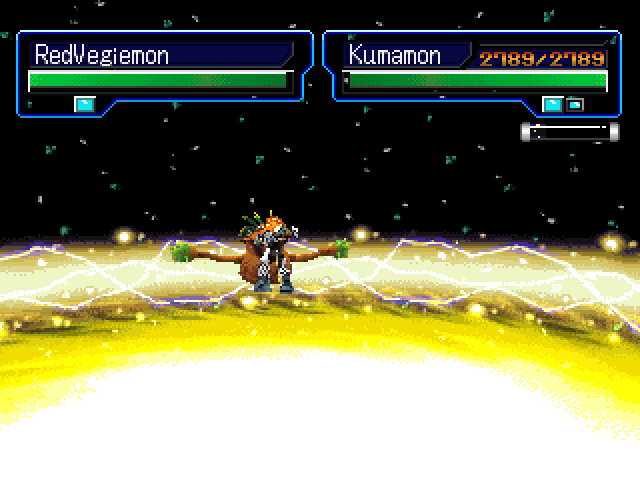

Une technique Thunder touche une faiblesse : <b>WEAK!</b>, l'ennemi est étourdi et la main vous revient.

<table>
<tr>
<td width="50%" valign="top">

**⚔️ Des combats où l'on réfléchit** 
Sept éléments répartis en cinq familles, portés par la seule magie. Touchez une faiblesse, étourdissez, gagnez une action de plus, enchaînez.

</td>
<td width="50%" valign="top">

**⏳ Moins de grind, le même voyage** 
La fin du jeu arrive vers le niveau 40-50. Les formes montent de niveau 14× plus vite et toute l'équipe progresse ensemble.

</td>
</tr>
<tr>
<td valign="top">

**🧭 Une raison d'explorer** 
Les séries de victoires font surgir le Rare Target de chaque région. Les matériaux alimentent la forge, le Black Market et le DRI Gauntlet.

</td>
<td valign="top">

**🚪 La Velvet Room** 
Une pièce entre deux mondes qui grandit avec l'histoire : un hôte qui lit l'avenir de vos partenaires, un maître des chasses, un marchand.

</td>
</tr>
<tr>
<td valign="top">

**🔥 Blast et la Chosen Evolution** 
Un pouvoir maudit qui a un prix, une quête pour le purifier, et un partenaire qui mérite une forme Mega bien à lui.

</td>
<td valign="top">

**🎮 Jouez partout** 
Portables, Android et PC, écran large 16:9, rendu GPU et shaders, et sauvegardes cloud cross-play gratuites.

</td>
</tr>
</table>

> [!IMPORTANT]
> **Ce dépôt ne contient aucune donnée du jeu.** Il vous faut votre propre copie de *Digimon World 2003 (Europe) (En,Fr,De,Es,It)*,
> en `.bin` + `.cue` bruts, MODE2/2352, 692,146,560 bytes, SHA-1 `457cb233349ba841e03b33d8060f8fbcadd45cb3`.
> Ce projet n'est ni affilié à Bandai, Bandai Namco ou Sony, ni approuvé par ces sociétés.

## Pour commencer

**Consoles portables (PortMaster)**

> [!NOTE]
> **La version PortMaster est en cours** : le port est en phase de test sur le Discord de PortMaster. Il n'est pas
> encore dans le catalogue PortMaster, mais il a déjà tourné, sous émulation, sur chaque custom firmware de la matrice de test.

1. Téléchargez `dw3.zip` depuis les [releases](https://github.com/al4xdev/digimon-world-3-definitive-edition/releases)
   et décompressez-le dans le dossier `ports` de votre PortMaster.
2. Copiez l'image de votre disque dans `ports/dw3/game/`.
3. Lancez *Digimon World 3* depuis le menu des ports.

Appareils testés, détails d'installation et problèmes connus : [`.ci-cd/portmaster/README.md`](.ci-cd/portmaster/README.md).

**Android (arm64, Android 7 ou plus récent)**

1. Téléchargez `dw2003-*-android-arm64-v8a.apk` depuis les
   [releases](https://github.com/al4xdev/digimon-world-3-definitive-edition/releases) et installez-le (autorisez les
   installations depuis votre navigateur ou votre gestionnaire de fichiers).
2. Touchez **JOUER**, puis choisissez votre `.bin` (et le `.cue`) dans le sélecteur de fichiers du système : l'appli
   les copie.
3. Les flèches du coin supérieur droit déplacent et redimensionnent les commandes tactiles ; le bouton du coin gauche
   les masque. Une manette fonctionne aussi, et les commandes tactiles s'effacent tant qu'elle est branchée.

**PC (Linux et Windows)**

1. Décompressez la version PC (un AppImage sous Linux, un `.zip` sous Windows), ou lancez
   `./launcher/dw3-launcher --sdl` depuis une copie du dépôt déjà compilée.
2. Choisissez votre `.cue` / `.bin` au premier lancement (modifiable à tout moment dans `GAME > DISC IMAGE`).
3. Ouvrez `VIDEO` pour activer **Widescreen** (il suit la forme de votre écran, jusqu'au 16:9), **Fullscreen**, la mise à
   l'échelle **`FILL` ou `INTEGER`**, la **résolution** interne (3X par défaut), le rendu **GPU** ou logiciel et les
   **filtres** d'écran. Le launcher se met à jour tout seul quand une nouvelle version sort.

**Vous venez d'une ancienne version ?** Les sauvegardes de la **0.9.1 ou plus récente** s'ouvrent et se jouent : le
launcher met à jour tout seul ses réglages et la sauvegarde d'extension à côté de la carte (`card1.def.json`), en
gardant une copie de secours. Les sauvegardes **antérieures à la 0.9.1** ne sont pas migrées (commencez une nouvelle
partie). Les sauvegardes PS1 d'origine s'ouvrent et se jouent aussi — lancez une fois `tools/convert_save_mp.py card1.mcd`
pour les nouvelles tables de MP et de TP (une copie de secours est conservée).

---

## Les combats où l'on réfléchit

Chaque ennemi a des faiblesses et des résistances réparties sur **cinq familles d'éléments** : Fire, Water + Ice, Wind,
Thunder + Machine et Dark. Les éléments associés partagent toujours la même valeur : une famille est donc faible,
neutre ou résistante dans son ensemble.

**Seule la magie porte un élément.** Le physique est purement physique : une technique physique ou une attaque normale
ne touche jamais une faiblesse et ne donne jamais de ONE MORE ; contre un ennemi étourdi, elle reçoit le bonus fixe de «
n'importe quel autre coup » ci-dessous (+0.2). Si vous connaissez le jeu d'origine, ses coups physiques élémentaires
(Hot Head et compagnie) sont ici de la magie élémentaire. Les listes de techniques le montrent d'un coup d'œil : là où
le jeu dessinait ses marques rouge (physique) et bleue (magie), vous voyez désormais un poing pour un coup physique et
l'image de l'élément pour la magie.

- **Touchez une faiblesse** avec de la magie élémentaire : un **WEAK!** en biais, l'ennemi est **étourdi** et vous
  gagnez une action **ONE MORE**. Chaque famille faible rapporte une fois par tour, si bien que deux faiblesses
  enchaînent plusieurs actions de suite.
- **Tant qu'il est étourdi** : touchez une autre faiblesse, changez de partenaire avec un **Baton Pass** gratuit en
  gardant votre tour (une fois par tour), ou portez n'importe quel autre coup pour un bonus qui met fin à l'étourdissement.
- **OVERFINISH** : mettez un ennemi K.O. avec un coup qui offre une action de plus, et il reste à terre pour la
  subir. Chaque coup porté rapporte des Bits.
- **C'est vous qui ouvrez le combat**, sauf embuscade. Un ennemi deux fois plus rapide agit deux fois, et la file
  des tours du panneau INFO le montre ; votre camp doit être quatre fois plus rapide, vos actions en plus viennent donc du One More.
- **Cela s'entend aussi** : un son différent pour une faiblesse, un coup neutre et un coup résisté.

<table>
<tr>
<td width="50%" align="center"> <b>Baton Pass</b> : un changement gratuit qui garde votre tour</td>
<td width="50%" align="center"> <b>OVERFINISH</b> : l'ennemi reste à terre, et chaque coup rapporte</td>
</tr>
<tr>
<td width="50%" align="center">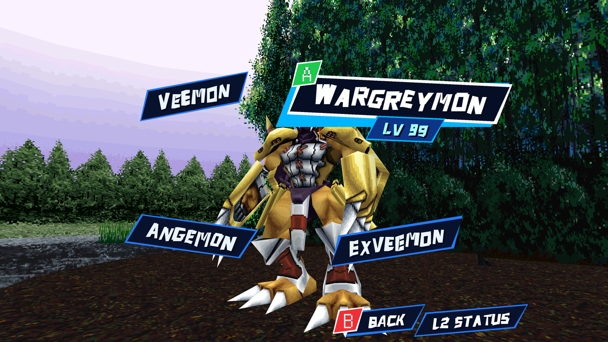 <b>Tag</b> : les formes de votre partenaire, puis Switch ou Baton Pass</td>
<td width="50%" align="center">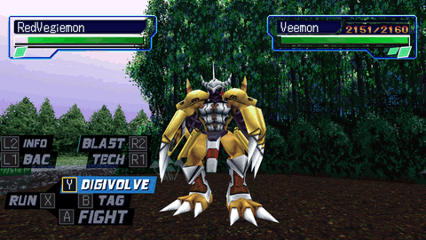 <b>Digivolve</b> : les formes en anneau, avec un aperçu 3D en direct</td>
</tr>
</table>

**Connaître son ennemi.** Rien n'est caché, mais il faut le découvrir. **INFO** (`L2`) affiche les cinq familles de
l'ennemi à mesure que vous les apprenez, `???` d'ici là, et qui agit ensuite ; **Libra** les révèle toutes d'un coup ;
le **Bestiary**, un écran à part où chaque Digimon tourne en 3D, garde ce que vous avez appris sur chaque espèce, Rare
Target, Super Rare et lignée DRI, avec ses Hunt Materials. Chaque liste de techniques marque chaque technique (un poing, ou son élément), et chaque description a été réécrite d'après ce que la technique fait vraiment (« Magie de feu.
Chance d'endormir. »).

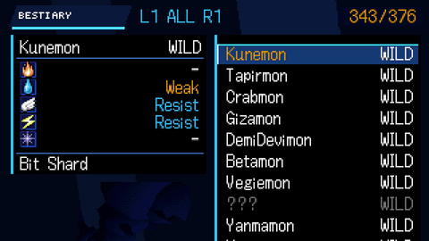 Le Bestiary, sur un écran à lui : onglets par type, faiblesses au fil des découvertes, chaque Digimon tournant en 3D.

**Vos statistiques ont changé de métier.** Les anciennes statistiques de « tolérance » élémentaire de votre Digimon
sont devenues l'**affinity** : elles ne défendent plus, elles renforcent vos attaques de cet élément contre une
faiblesse ou un ennemi étourdi. La **Defense** protège désormais de la magie, et le **Spirit** est purement votre
attaque magique.

**Des buffs qui font un plan.** Les buffs et les debuffs existent en trois paliers fixes et ne se cumulent jamais : le
plus fort l'emporte. Les debuffs frappent les boss de plein fouet : **Resist Down** et
**Mega Break** peuvent ouvrir une faiblesse qui n'existait pas. Quatre techniques ont été refaites pour cela (Libra,
Relay, Resist Down, Mega Break), et les rookies qui manquaient cruellement de MP n'en manquent plus.

**Des statuts qui valent un tour.** Poison, Sleep et Confusion passent d'autant plus que votre **Wisdom** dépasse celle de
la cible, et bien plus sur une cible **étourdie**. Les boss ne sont plus immunisés : ils les subissent avec une chance
réduite (Paralysis ne passe toujours jamais sur un boss). Le **poison** mord désormais chaque tour d'une quantité fixe,
faite de la technique, de votre Wisdom, de votre Spirit et de votre affinity de Wind, jusqu'à 8% des HP max d'un ennemi
par tour. Sleep et Confusion retiennent un ennemi deux tours : profitez-en pour soigner ou préparer l'étourdissement. Les
règles et un exemple chiffré sont dans [la référence du combat](docs/definitive-edition/combat.md#status-and-poison-for-the-player).

**Des ennemis avec leur propre règle.** Les Rare Targets, les Super Rare, les lignées DRI, quelques boss de l'histoire
et, dès le niveau 10, environ la moitié des espèces communes ont une particularité : une **garde** qui ne laisse passer
que 30% de vos dégâts tant que vous ne l'avez pas étourdi, une **garde rouge** que seul un coup sur sa faiblesse
traverse, un **SHIFT** qui change sa faiblesse (et ses couleurs) tous les quelques tours, une **vitesse** deux ou trois
fois la vôtre, ou une résistance à tout avec une Defense molle. INFO les marque d'un `!` et dessine une image par règle,
expliquée en mots simples en bas. Ce que vous apprenez de l'un est sauvegardé, et la prochaine fois, INFO s'en
souvient.

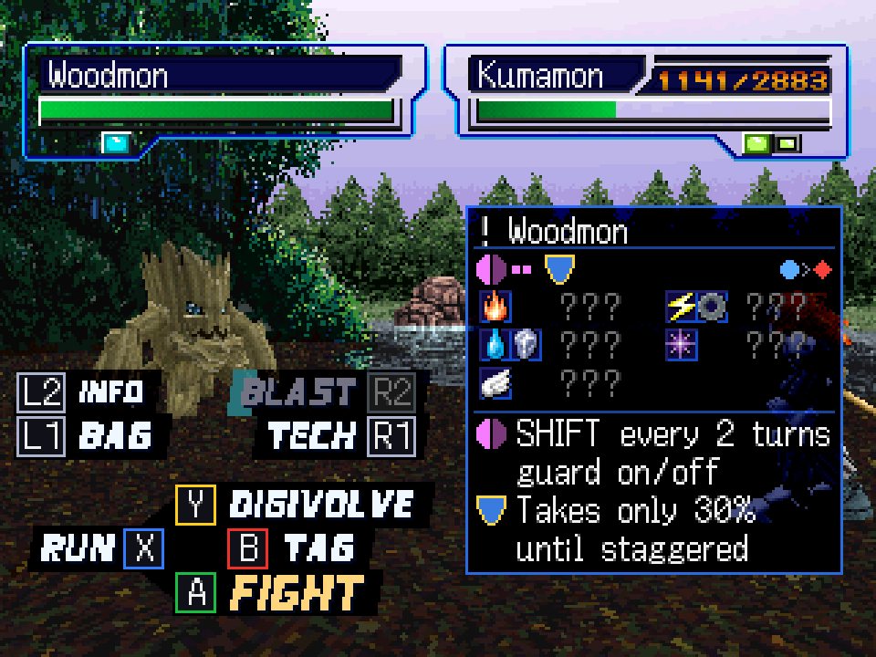

**Un HUD de combat avec un bouton par action**, dessiné comme votre manette et réassignable depuis le launcher. Tech et
Bag se déplient en feuille à côté de l'INFO de l'ennemi, Tag et Digivolve ouvrent un gros plan de votre partenaire avec
un anneau de choix et un aperçu en 3D, le bouton du Blast est la jauge elle-même, et Run demande confirmation avant de
fuir. Il retient votre dernière technique et votre dernier objet, mémorise les appuis trop précoces, et le texte de
combat n'interrompt jamais le combat.

<b>Les chiffres, pour les curieux</b>

| Le coup | Multiplicateur |
|---|---|
| Élément résisté | 0.5 |
| Élément neutre | 1.0 |
| Faiblesse | 1.5 + affinity |
| Élément neutre, cible étourdie | 1.2 + affinity |
| Faiblesse, cible étourdie | 1.7 + 2 × affinity |
| Sans élément, cible étourdie | 1.2 |

L'affinity croît avec le carré de la stat et va jusqu'à 0.4 pour Fire et Wind et jusqu'à 0.8 pour les paires et Dark ;
le coup le plus fort atteint donc 2.5 ou 3.3. Les paliers de buff sont +20 / +35 / +50% et ceux de debuff −15 / −25 / −35%. Le calcul complet, pas à pas
avec un exemple, se trouve dans [la référence du combat](docs/definitive-edition/combat.md).

## Une aventure qui respecte votre temps

- **Plus de points d'entraînement, plus tôt.** Au niveau 50, un Digimon a gagné plus de TP que l'original n'en donnait
  au niveau 99 (613 contre 490), et les niveaux 41 à 50 sont ceux où l'on façonne ses statistiques.
- **Entraînement garanti.** Trois séances sans résultat parfait, et la quatrième réussit à chaque tour.
  L'entraînement de résistance ne coûte plus de statistique.
- **Les formes montent de niveau 14× plus vite**, si bien qu'essayer une nouvelle digivolution est un plaisir et non
  une corvée.
- **L'équipe progresse ensemble** : un partenaire sur le banc gagne la même expérience, et les trois formes choisies de
  chaque Digimon gagnent de l'expérience de forme, qu'elles aient combattu ou non.
- **Les prérequis à l'écran** : le Digi-Lab montre ce qu'exige chaque forme suivante et où vous en êtes (« Greymon Lv 5 (3/5) »).
  Monter vite en forme ne saute pas les étapes : une forme Perfect attend le niveau 20 de votre Digimon, une Mega le 40.
  L'animation de digivolution est jouée en entier une fois, puis en version courte ; maintenez un bouton pour la passer.
- **Les card boosters tombent par lots de 15**, si bien que constituer un deck n'exige pas une seconde partie.
- **Hard Mode**, choisi à la New Game : votre équipe compte deux Digimon au lieu de trois, pour tout le jeu.
- **Super Hard**, à tout moment : portez le Demon Bell de la Velvet Room et les ennemis gagnent 50% de vitesse et frappent
  25% plus fort, et vos coups font moitié moins, mais ils paient le double en Bits et en expérience,
  et le triple en matériaux communs. Rendez-le pour désactiver le mode.

## La chasse

Facultative et ouverte pendant tout le jeu. Chaque combat aléatoire que vous gagnez s'ajoute à la **hunt chain** de la
région où vous êtes. Passé cinq victoires, la prochaine rencontre peut être le **Rare Target** de la région : un boss
recoloré et plus coriace, seul face à vous, certain à la dixième victoire. Chacune des 71 régions a sa propre espèce, et
chacune laisse tomber son propre **Core** pour votre collection.

- **Hunt Materials** : seize communs par tranche de niveaux, du Bit Shard à l'Obsidian Digizoid, et 71 Cores rares. Le
  Bestiary vous dit qui laisse tomber quoi.
- **La forge** : les armes, armures et accessoires de chaque boutique demandent les matériaux des régions
  alentour. La description montre ce que vous avez et ce qui vous manque.
- **41 variantes d'équipement** bâties autour d'un style : armes de Speed, équipement Elemental qui augmente votre
  affinity, armures Tank, accessoires Trade-off.
- **Le Black Market** : échangez un Core contre douze communs, ou les Cores de deux boss contre l'une des 32
  **répliques** qu'aucune boutique ne vend, des accessoires Power S à cinq armes ultimes (et, tout en bas de la liste, une marque que tout chasseur convoite).
- **Le DRI Gauntlet** : les DRI Agents rejouent des combats classiques de Tamers, seize lignées en tout. Un combat,
  quatre étapes, de Rookie à Champion puis Ultimate puis Mega avec un **DIGIVOLVE!** entre chacune, et un accessoire
  Power pour le Champion, l'Ultimate et le Mega terrassés. Un accessoire Power ajoute 60, 120 ou 200 à la stat de son
  élément : plus d'affinity.
- **Les prix** de l'équipement avancé ont augmenté et la revente a baissé : une trouvaille chanceuse ne se vend plus une
  fortune, et les Bits de l'OVERFINISH ont de quoi être dépensés.

Les répliques du Black Market : les Cores de deux boss et les Bits, et l'équipement est à vous.

<b>Les seize lignées du DRI Gauntlet</b>

| Agent | Lignée | Étapes et niveaux (de Rookie à Mega) | Récompenses |
|---|---|---|---|
| Ken | Kotemon | Kotemon 21, Dinohumon 24, Kyukimon 27, Marsmon 30 | Wind Power 1, 2, S |
| Yang | Monmon | Monmon 25, Hookmon 28, Armormon 31, GuardiAngemon 34 | Water Power 1, 2, S |
| Yuji | Kumamon | Kumamon 29, Grizzmon 32, GrapLeomon 35, Cannondramon 38 | Metal Power 1, 2, S |
| Bob | Veemon | Veemon 33, ExVeemon 36, Paildramon 39, Imperialdramon 42 | Bolt Power 1, 2, S |
| Kazuki | Patamon | Patamon 37, Angemon 40, MagnaAngemon 43, Seraphimon 46 | Wind Power 1, 2, S |
| Michael | Renamon | Renamon 41, Kyubimon 44, Taomon 47, Sakuyamon 50 | Ice Power 1, 2, S |
| Johann | Agumon | Agumon 45, Greymon 48, MetalGreymon 51, WarGreymon 54 | Fire Power 1, 2, S |
| Jimmy | Guilmon | Guilmon 49, Growlmon 52, WarGrowlmon 55, Gallantmon 58 | Dark Power 1, 2, S |
| Ken | Musyamon | Kotemon 53, Musyamon 56, Knightmon 59, MetalGarurumon 62 | Ice Power 1, 2, S |
| Yang | Terriermon | Hagurumon 57, Guardromon 60, Antylamon 63, MegaGargomon 66 | Metal Power 1, 2, S |
| Yuji | Kuwagamon | Kunemon 61, Kuwagamon 64, Okuwamon 67, GranKuwagamon 70 | Bolt Power 1, 2, S |
| Bob | Wormmon | Kunemon 65, Stingmon 68, Paildramon 71, Imperialdramon-F 74 | Bolt Power 1, 2, S |
| Kazuki | Devimon | DemiDevimon 69, Devimon 72, Myotismon 75, MaloMyotismon 78 | Dark Power 1, 2, S |
| Michael | Angewomon | Kiwimon 73, Angewomon 76, MagnaAngemon 79, Phoenixmon 82 | Water Power 1, 2, S |
| Johann | Agumon (dark) | Agumon 77, Greymon 80, SkullGreymon 83, BK WarGreymon 86 | Fire Power 1, 2, S |
| Jimmy | Impmon | Goburimon 81, Flarerizamon 84, Megadramon 87, Beelzemon 90 | Dark Power 1, 2, S |

Les lignées vont de la plus facile à la plus difficile. Le Rookie ne donne rien ; le Power 1 vient du Champion, le 2
de l'Ultimate et le S du Mega, chacun la première fois que vous l'atteignez. Perdre n'est pas un game over : vous
revenez sur le terrain comme vous étiez, PV et PM rétablis (les objets utilisés restent utilisés). Les coûts de
déblocage, les recettes de la forge et chaque variante sont détaillés dans [la référence de la
chasse](docs/definitive-edition/hunt-and-economy.md).

## La Velvet Room

<table>
<tr>
<td width="50%" align="center"> Une douce lueur bleue dans une auberge, et le passage s'ouvre</td>
<td width="50%" align="center"> La pièce à son apogée, avec Kail pour héros</td>
</tr>
</table>

Quelque part dans le Monde Digital, une pièce bleue attend entre les serveurs. Au début, ses portes sont closes. Puis
une rumeur court dans Seiryu City et, dans chaque auberge, une douce **lueur bleue** se met à palpiter sur un morceau
du décor. Placez-vous dedans, appuyez sur Circle, et vous voilà à l'intérieur.

La pièce **grandit avec l'histoire**. Ses invités arrivent un à un :

| Invité | Ce qu'il fait |
|---|---|
| **Igor**, l'hôte | lit les formes ADN de vos partenaires et ce qu'il leur manque encore ; de temps en temps, il rêve avec vous |
| **Le Sepikmon** | le maître des chasses : chasses Super Rare, leurs cristaux et les skins de héros qu'ils débloquent |
| **Gennai** | la quête du Blast et la Chosen Evolution |
| **Guilmon** | garde le Demon Bell, le Super Hard à la demande |
| **Etemon** | au piano. Il a déjà entendu cette musique dans un autre jeu, et il joue vos propres fichiers MIDI dans les combats aléatoires, chacun à son volume |
| **Le cochon** | un acteur que le jeu avait livré sans jamais l'employer, enfin sur scène ; transfère 100 points d'une stat (ou Affinité) d'un partenaire à une autre, pour un prix qui grimpe à chaque échange (1 000 Bits la première fois, 100 000 dès la dixième) |
| **Oikawa** | derrière le comptoir, quand vous l'aurez mérité : le Black Market |

La pièce a son propre arrangement de la musique, et un **réseau de Guardromon** relie les auberges : sauvegardez ou
téléportez-vous depuis n'importe quel Guardromon vers ceux que vous avez rencontrés.

## Une histoire à l'écoute

La Definitive Edition ne change pas la destination de l'histoire. Elle change la façon de la raconter, et vous y donne
une voix.


- **Chacun a son temps.** Les gens que vous rencontrez vivent leurs propres histoires, et elles avancent avec la
  campagne principale, avec ou sans vous. Profitez du temps passé avec eux tant que vous le pouvez : vous ne vous lierez
  pas avec tout le monde, et ce n'est pas le but. Ceux que vous laissez derrière continuent sans vous, et vous verrez
  où cela les a menés.
- **Les rêves d'Igor.** À quelques tournants, il vous attire seul dans la pièce et vous pose une question. Il n'y a pas
  de mauvaise réponse, et il se souvient de ce que vous avez dit.
- **Vos choix, et leurs échos.** Plus de 135 scènes et 27 mini-arcs de PNJ laissent le héros répondre avec ses propres
  mots, et des centaines de répliques changent selon vos décisions. Chaque choix est retenu — façonnant liens,
  réputation et 10 combats de boss, rendant l'aventure plus facile ou plus difficile.
- **Un script réécrit** (écrit, relu et soigné personnellement en portugais du Brésil dans l'esprit et l'argot des
  doublages d'anime classiques des années 80/90, puis traduit à partir de lui en anglais, français, allemand, italien et
 espagnol) : les répliques puériles ont mûri, l'ordre et les quêtes sont intacts, et le héros
  est écrit pour qui tient la manette.
- **Une silhouette encapuchonnée** barre la route dans le Bug Maze, et **une pièce où le temps s'arrête** attend avant
  le point de non-retour, pour s'assurer que vous êtes prêt.
- **Le dernier combat ne s'arrête plus là où il s'arrêtait.** Nous n'en dirons pas plus.

## Blast et la Chosen Evolution


Remportez la chasse Super Rare du tutoriel et un nouveau pouvoir s'éveille. Bien combattre remplit la **Blast Gauge** :
faiblesses, étourdissements, OVERFINISH. Quand elle est pleine, `R2` libère la **forme sombre** de votre partenaire.
C'est de la puissance, et elle a un prix : le combat s'achève avec HP et MP à 1, des statistiques en baisse jusqu'à la
prochaine auberge, et un partenaire trop en surchauffe pour digivolver. Quelqu'un dans la Velvet Room sait comment la
purifier, si vous pouvez lui faire confiance. Au bout de ce chemin, un partenaire obtient la **Chosen Evolution** : une
forme Mega bien à lui, sans malédiction.

## Les chasses Super Rare

Le tableau du Sepikmon liste **douze Digimon Super Rare** (et un Ogremon de tutoriel pour s'entraîner), du niveau 29 au
61, débloqués l'un après l'autre. Chacun se cache sur une carte aléatoire de son territoire, et une **boussole de
température** vous dit quand vous vous rapprochez. Blessez-le et il s'enfuit, en gardant les dégâts et en revenant plus
fort. Chacun que vous abattez rapporte un cristal et débloque un **skin de héros**.

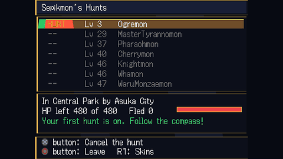 Le tableau des chasses et un Target Dossier : où rôde la cible, ce que vaut son cristal, le skin qu'elle débloque.

## Votre héros, à votre façon

**Girls Power** : à la New Game, choisissez **Kail** ou **Junior** comme héros. Les rôles s'échangent dans les sprites
de terrain, les cinématiques, les actions de terrain et les menus, avec chaque image qui manquait à Kail dessinée pixel par
pixel, et le texte de l'histoire suit l'échange. Treize **skins de héros** issus des chasses Super Rare recolorent les
cheveux et les vêtements de votre héros.

## Confort et qualité de vie

- **GUIDE** : l'étape actuelle de la quête principale, les missions annexes ouvertes et les seize enchères d'Asuka,
  avec un saut direct vers une enchère ouverte. Une bannière glisse à l'écran quand un objectif change.
- **Overlevel Rush** : quand votre Digimon le plus fort a 3 niveaux ou plus d'avance sur tous les ennemis d'un combat
  aléatoire, le jeu propose de l'expédier pendant que vous continuez à marcher, et les récompenses glissent en haut de l'écran.
- **Un texte de combat qui n'interrompt pas le combat**, un marqueur d'objectif sur la carte, l'avance rapide (aussi un bouton sur la manette tactile Android), des
  glyphes de boutons adaptés à votre manette (Xbox, Nintendo, PS1) et un remappage complet.
- **60 Hz par défaut** : le disque européen tourne à 50 Hz ; le mode 60 Hz du jeu lui-même, à vitesse compensée, est
  actif d'emblée (`GAME > REFRESH RATE` rétablit le 50 Hz).

<table>
<tr>
<td width="50%" align="center">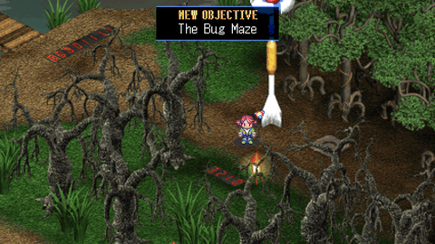 <b>Overlevel Rush</b> : passez le combat facile, gardez les récompenses</td>
<td width="50%" align="center"> <b>GUIDE</b> : où aller ensuite, en une phrase</td>
</tr>
</table>

## Jouez partout

| Où | Ce que vous obtenez |
|---|---|
| **Consoles portables RK3326** via PortMaster (la XF35H, la R36S et appareils similaires) | optimisé de bout en bout sur une vraie XF35H : affichage direct du framebuffer, rendu GLES, vidéos à pleine vitesse, la barre LED. Chaque custom firmware de la matrice de test a tourné sous émulation ; les retours sur de vrais appareils sont les bienvenus |
| **PC Linux et Windows** | rendu GPU SDL3 (Vulkan, D3D12), **écran large** en combat et sur le terrain qui suit votre écran (16:10 ou 16:9), résolution interne de 1X (PS1) à 8X (3X par défaut) avec sommets 3D lissés, plein écran HighDPI avec mise à l'échelle `FILL`, filtres `SHARP` / `SCANLINES` / `CRT` / `SMOOTH`, avance rapide jusqu'à 8×, et un launcher qui se met à jour tout seul |
| **Android** (arm64) | un APK avec **écran large 16:9**, de grandes commandes tactiles que vous déplacez et redimensionnez à l'écran (ou masquez), n'importe quelle manette USB ou Bluetooth, et un sélecteur de disque qui copie votre image dans l'appli |


**Des sauvegardes cross-play.** Le **Cloud Sync** gratuit garde votre memory card à jour entre une console portable, un téléphone
Android et un PC : associez un appareil avec un code à 6 chiffres, résolvez les conflits, révoquez un appareil perdu et conservez
jusqu'à 100 snapshots locaux, avec restauration en un bouton. Un launcher pensé d'abord pour console gère le disque, la
vidéo, les commandes, le HUD de combat et les sauvegardes, et lance un petit jeu de course avec Kumamon, Guilmon et
Agumon pendant que votre disque est vérifié.

Si vous l'essayez sur un autre appareil, un retour dans le
[issue tracker](https://github.com/al4xdev/digimon-world-3-definitive-edition/issues) aide beaucoup.

## Ce qu'il reste à faire

Le jeu est jouable du début à la fin, et chaque système décrit plus haut est implémenté. Il est aussi tout jeune :
certaines parties n'ont été jouées que quelques fois, alors attendez-vous à des aspérités et à des hotfixes fréquents.
Ce qui reste :

- **Relecture des traductions.** L'histoire réécrite a été entièrement écrite, relue et soignée personnellement en
  portugais du Brésil (argot et ton des anime classiques des années 80/90), puis traduite à partir de là en anglais,
  français, allemand, italien et espagnol. Les quatre dernières versions n'ont pas encore été relues en jeu par des
  locuteurs natifs : attendez-vous à des phrases maladroites et à quelques libellés trop larges pour leur cadre.
- **L'équilibrage général du jeu.** Jusqu'ici, il n'a été équilibré que par le calcul. Je le joue en parallèle et
  je publie des hotfixes au fur et à mesure, Chosen Evolution et combats secrets de fin de jeu compris.
- **Plantages connus.** Certains joueurs ont des plantages que nous ne savons pas encore reproduire, surtout sous
  Windows (code `0xC0000005`). Si cela vous arrive, mettez DEBUG > JOURNAUX sur COMPLET (ou LÉGER, pour envoyer moins), jouez
  jusqu'à ce que cela se reproduise, puis DEBUG > ENVOYER : le journal du jeu et son rapport de plantage sont ce qui
  rend une correction possible. L'envoi suffit ; une issue avec le code du rapport nous permet de vous répondre.

Rien d'autre n'est prévu : désormais, le travail se résume à des hotfixes. Les bugs vont dans l'
[issue tracker](https://github.com/al4xdev/digimon-world-3-definitive-edition/issues).

### Rythme des mises à jour

- **0.9.3 – 0.9.5** (après la 0.9.2) : mises à jour hebdomadaires.
- **0.9.6 – 0.9.9** : mises à jour toutes les deux semaines. À la 0.9.9, l'état du projet sera évalué, avec jusqu'à cinq mises à jour supplémentaires si nécessaire avant la 1.0.
- **1.0 et après** : hotfixes mensuels regroupés, sans calendrier fixe pour de nouvelles fonctionnalités.

**Suivi des issues :** les nouvelles issues sont généralement examinées sous 1 à 4 jours et marquées `next-release` lorsqu'elles sont prévues pour la prochaine fenêtre de mise à jour, ou `help wanted` si je ne peux pas les résoudre seul. Le projet n'ayant qu'un seul mainteneur, il est difficile de répondre sur tous les canaux — suivez plutôt l'avancement via les issues et leurs étiquettes.

## Sous le capot

Ce projet repose sur la [décompilation de Digimon World 2003](https://github.com/gascarcella/dw2003recomp) et son port
PC, qui sont le travail du projet d'origine : chaque fichier du jeu se reconstruit à l'identique, octet pour octet, à
partir d'un C équivalent. Ce fork ajoute la voie vers les consoles portables et la Definitive Edition.

- **Comment fonctionne la Definitive Edition**, chaque règle, chiffre, fichier et décision de conception :
  [`docs/definitive-edition/`](docs/definitive-edition/README.md).
- **La décompilation et le port**, formats, performances, le travail sur le GPU : [`docs/`](docs/README.md).

| Pour | Commande | Détails |
|---|---|---|
| Le binaire et le paquet pour consoles portables ARM | `.ci-cd/portmaster/build_arm.sh` | [`docs/HANDHELD.md`](docs/HANDHELD.md#building) |
| Le zip PortMaster | `.ci-cd/portmaster/make_release.sh` | [`.ci-cd/portmaster/PUBLISHING.md`](.ci-cd/portmaster/PUBLISHING.md) |
| Le port PC et les tests | voir le guide | [`docs/BUILDING.md`](docs/BUILDING.md) |

## Contribuer et obtenir de l'aide

Lisez d'abord [`docs/CONTRIBUTING.md`](docs/CONTRIBUTING.md). Posez vos questions dans le
[issue tracker](https://github.com/al4xdev/digimon-world-3-definitive-edition/issues).

**Pour signaler un bug :** dans le launcher, ouvrez DEBUG, mettez JOURNAUX sur COMPLET, reproduisez le problème puis DEBUG > ENVOYER. Les journaux et votre sauvegarde (données RPG) sont envoyés et un code de rapport s'affiche ; ouvrez un [bug report](https://github.com/al4xdev/digimon-world-3-definitive-edition/issues/new?template=bug_report.yml) et saisissez ce code (ou photographiez-le). Le formulaire l'exige. Détails : [`docs/CONTRIBUTING.md`](docs/CONTRIBUTING.md#reporting-issues).

## Crédits et licence

La décompilation et le port PC sont l'œuvre du [projet d'origine](https://github.com/gascarcella/dw2003recomp).
Ce fork ajoute la Definitive Edition et la voie vers les consoles portables : l'affichage direct du framebuffer, la
génération de code pour Cortex-A35, le travail sur les vector spans, la disposition des lignes de la VRAM, le
compteur de frames et les extras pour portables, le rendu GLES, le travail audio et le paquet. Le travail propre du
projet est placé sous [licence MIT](LICENSE) ; le jeu reste la propriété de son éditeur.

Merci à juandav et à [ReGame-Labs/dw3_decomp](https://github.com/ReGame-Labs/dw3_decomp), l'autre décompilation de Digimon World 3, dont les noms et les
formes de fonctions ont aidé à boucler les dernières fonctions ; chaque idée reprise est listée dans
[`docs/THIRD_PARTY.md`](docs/THIRD_PARTY.md).

La Velvet Room est un hommage à la série *Persona* d'Atlus, et les chasses (Rare Targets, matériaux, la forge) à
*Monster Hunter* de Capcom. *Digimon* appartient à Bandai / Bandai Namco, *Persona* à Atlus et *Monster Hunter* à
Capcom ; ce projet de fan n'est ni affilié à aucun d'eux ni approuvé par eux.
