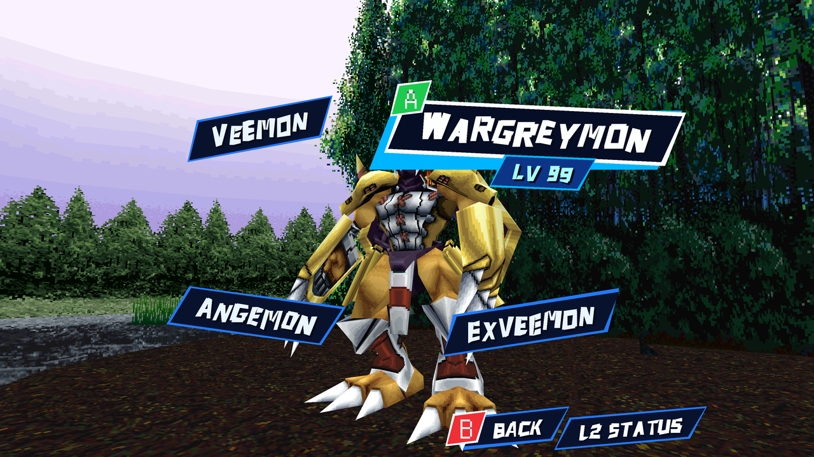
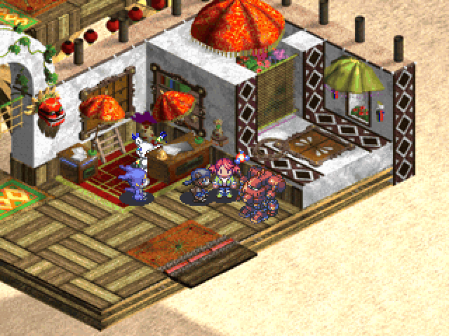
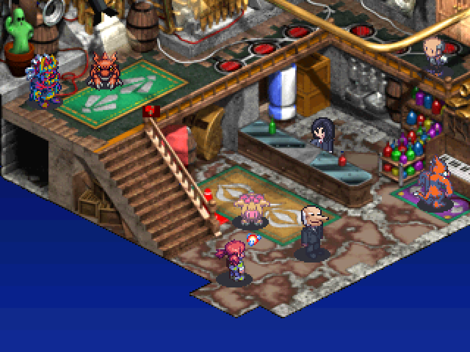

<a href="README.md">English</a> · <a href="README.pt-BR.md">Português (Brasil)</a> · <a href="README.fr.md">Français</a> · <a href="README.de.md">Deutsch</a> · <b>Italiano</b> · <a href="README.es.md">Español</a>

<a href="https://dw3-definitive.pages.dev/">Sito di Digimon World 3: Definitive Edition</a>

  <b>Digimon World 3, come avrebbe potuto essere.</b> 
  Un remaster fatto da un fan che gira in nativo, senza emulatore, sulle console portatili RK3326, sui telefoni Android e su PC.

  <b>Gratis</b> · <b>senza emulatore</b> · <b>porta il tuo disco</b> (il <i>Digimon World 2003</i> europeo) ·
  English, Português (Brasil), Français, Deutsch, Italiano, Español · versione PortMaster in fase di test

  <a href="#per-iniziare">Per iniziare</a> ·
  <a href="#battaglie-su-cui-ragionare">Combattimento</a> ·
  <a href="#un-viaggio-che-rispetta-il-tuo-tempo">Progressione</a> ·
  <a href="#la-caccia">La caccia</a> ·
  <a href="#la-velvet-room">Velvet Room</a> ·
  <a href="#una-storia-che-ascolta">Storia</a> ·
  <a href="#blast-e-la-chosen-evolution">Blast</a> ·
  <a href="#le-cacce-super-rare">Super Rare</a> ·
  <a href="#gioca-ovunque">Piattaforme</a> ·
  <a href="#cosa-manca-ancora">Cosa manca ancora</a>

<a href="https://recomplauncher.com/game/digimon-world-3-definitive-edition"><picture><source media="(prefers-color-scheme: dark)" srcset="https://recomplauncher.com/assets/press/launcher/badge-light.svg"></picture></a>

---

Nel 2002, *Digimon World 3* ci regalava un intero Mondo Digitale da attraversare, una squadra di partner da far
crescere e un sistema di battaglia che, il più delle volte, ti chiedeva solo di premere Fight finché il grind non
finiva. Molti giocatori si fermarono intorno al livello 40, ben prima del finale.

La **Definitive Edition** conserva il viaggio e ricostruisce tutto ciò che lo circonda. Le battaglie ruotano attorno
alle debolezze elementali, nello spirito di *Persona*: trova la falla, stordisci il nemico, guadagna un'azione in più,
passa il testimone. Il finale di gioco arriva proprio dove i giocatori solitamente mollavano. Ogni regione nasconde
prede che valgono la caccia, e ciò che riporti indietro paga equipaggiamenti che nessun negozio ha mai venduto. Una
misteriosa stanza blu si apre nelle locande man mano che la storia procede, con ospiti, sogni e una scelta o due solo
tue. Puoi giocare come **Kail**. E il tuo vecchio salvataggio funziona ancora.

Una tecnica Thunder trova un punto debole: <b>WEAK!</b>, il nemico è stordito e il turno torna a te.

<table>
<tr>
<td width="50%" valign="top">

**⚔️ Scontri su cui ragionare** 
Sette elementi in cinque famiglie, portati solo dalla magia. Colpisci un punto debole, stordisci, ottieni un'azione in più, concatena.

</td>
<td width="50%" valign="top">

**⏳ Meno grind, lo stesso viaggio** 
Il finale di gioco arriva intorno al livello 40-50. Le forme salgono di livello 14× più in fretta e tutto il gruppo cresce insieme.

</td>
</tr>
<tr>
<td valign="top">

**🧭 Un motivo per esplorare** 
Le serie di vittorie fanno uscire il Rare Target di ogni regione. I materiali alimentano la fucina, il Black Market e il DRI Gauntlet.

</td>
<td valign="top">

**🚪 La Velvet Room** 
Una stanza tra due mondi che cresce con la storia: un padrone di casa che legge il futuro dei tuoi partner, un maestro di caccia, un mercante.

</td>
</tr>
<tr>
<td valign="top">

**🔥 Blast e la Chosen Evolution** 
Un potere maledetto con il suo prezzo, una missione per purificarlo e un partner che si guadagna una forma Mega tutta sua.

</td>
<td valign="top">

**🎮 Gioca ovunque** 
Portatili, Android e PC, widescreen 16:9, renderer GPU e shader, e salvataggi cloud cross-play gratuiti.

</td>
</tr>
</table>

> [!IMPORTANT]
> **Questo repository non contiene alcun dato del gioco.** Ti serve la tua copia di *Digimon World 2003 (Europe) (En,Fr,De,Es,It)*,
> in `.bin` + `.cue` grezzi, MODE2/2352, 692,146,560 bytes, SHA-1 `457cb233349ba841e03b33d8060f8fbcadd45cb3`.
> Questo progetto non è affiliato né approvato da Bandai, Bandai Namco o Sony.

## Per iniziare

**Portatili (PortMaster)**

> [!NOTE]
> **La versione PortMaster è in corso**: il port è in fase di test sul Discord di PortMaster. Non è ancora nel catalogo
> di PortMaster, ma è già stato eseguito, sotto emulazione, su ogni custom firmware della matrice di test.

1. Scarica `dw3.zip` dalle [release](https://github.com/al4xdev/digimon-world-3-definitive-edition/releases) e
   decomprimilo nella cartella `ports` di PortMaster.
2. Copia l'immagine del tuo disco in `ports/dw3/game/`.
3. Avvia *Digimon World 3* dal menu dei port.

Dispositivi testati, dettagli di installazione e problemi noti: [`.ci-cd/portmaster/README.md`](.ci-cd/portmaster/README.md).

**Android (arm64, Android 7 o più recente)**

1. Scarica `dw2003-*-android-arm64-v8a.apk` dalle
   [release](https://github.com/al4xdev/digimon-world-3-definitive-edition/releases) e installalo (consenti le
   installazioni dal browser o dal gestore file).
2. Tocca **GIOCA** e scegli il tuo `.bin` (e il `.cue`) nel selettore di file del sistema: l'app li copia.
3. Le frecce nell'angolo in alto a destra spostano e ridimensionano i controlli touch; il pulsante nell'angolo sinistro
   li nasconde. Funziona anche un controller, e i controlli touch si fanno da parte finché è collegato.

**PC (Linux e Windows)**

1. Decomprimi la versione per PC (un AppImage su Linux, un `.zip` su Windows), oppure esegui
   `./launcher/dw3-launcher --sdl` da un checkout già compilato.
2. Scegli il tuo `.cue` / `.bin` al primo avvio (lo cambi quando vuoi in `GAME > DISC IMAGE`).
3. Apri `VIDEO` per **Widescreen** (segue la forma del tuo schermo, fino a 16:9), **Fullscreen**, il ridimensionamento **`FILL` o
   `INTEGER`**, la **risoluzione** interna (3X di default), il renderer **GPU** o software e i **filtri** dello schermo. Il
   launcher si aggiorna da solo quando esce una nuova versione.

**Vieni da una versione precedente?** Il tuo salvataggio si apre e funziona. Per dargli le nuove tabelle di MP e TP,
esegui una volta `tools/convert_save_mp.py card1.mcd` (ne conserva un backup). Il launcher aggiorna da solo le sue impostazioni e il salvataggio di
espansione accanto alla card (`card1.def.json`), tenendo il file vecchio come backup.

---

## Battaglie su cui ragionare

Ogni nemico ha debolezze e resistenze su **cinque famiglie di elementi**: Fire, Water + Ice, Wind,
Thunder + Machine e Dark. Gli elementi in coppia condividono sempre lo stesso valore, quindi una famiglia è debole,
neutra o resistente nel suo insieme.

**Solo la magia ha un elemento.** Il fisico è solo fisico: una tecnica fisica o un attacco normale non colpisce mai un
punto debole e non dà mai ONE MORE; contro un nemico stordito riceve il bonus fisso di "un altro colpo qualsiasi" qui
sotto (+0.2). Se conosci il gioco originale, i suoi colpi fisici elementali (Hot Head e simili) qui sono magia
elementale. Gli elenchi delle tecniche lo mostrano a colpo d'occhio: dove il gioco disegnava i segni rosso (fisico) e
blu (magia), ora vedi un pugno per un colpo fisico e l'immagine dell'elemento per la magia.

- **Colpisci un punto debole** con la magia elementale: un **WEAK!** inclinato, il nemico è **stordito** e ottieni
  un'azione **ONE MORE**. Ogni famiglia debole paga una volta per round, quindi due debolezze concatenano diverse
  azioni di fila.
- **Finché è stordito**: colpisci un'altra debolezza, cambia partner con un **Baton Pass** gratuito mantenendo il tuo
  turno (una volta per round), oppure assesta un altro colpo qualsiasi per un bonus che pone fine allo stordimento.
- **OVERFINISH**: manda KO un nemico con un colpo che dà un'azione in più, e lui resta a terra per subirla. Ogni colpo
  che lo raggiunge paga Bits.
- **Sei tu ad aprire lo scontro**, a meno che tu non venga colto di sorpresa. Un nemico due volte più veloce agisce due
  volte, e la coda dei turni del pannello INFO lo mostra; la tua parte ha bisogno di quattro volte la sua velocità, quindi le tue azioni extra vengono dal One More.
- **Lo senti anche**: un suono diverso per una debolezza, un colpo neutro e un colpo resistito.

<table>
<tr>
<td width="50%" align="center"> <b>Baton Pass</b>: un cambio gratuito che mantiene il tuo turno</td>
<td width="50%" align="center"> <b>OVERFINISH</b>: il nemico resta a terra, e ogni colpo paga</td>
</tr>
<tr>
<td width="50%" align="center"> <b>Tag</b>: le forme del tuo compagno, poi Switch o Baton Pass</td>
<td width="50%" align="center"> <b>Digivolve</b>: le forme in un anello, con anteprima 3D dal vivo</td>
</tr>
</table>

**Conosci il tuo nemico.** Nulla è nascosto, ma devi scoprirlo. **INFO** (`L2`) mostra le cinque famiglie del
nemico man mano che le impari, `???` fino ad allora, e chi agisce dopo; **Libra** le rivela tutte in un colpo; il
**Bestiary**, una schermata a sé con ogni Digimon che ruota in 3D, conserva ciò che hai imparato su ogni specie, Rare
Target, Super Rare e linea DRI, con i suoi Hunt Materials. Ogni elenco di tecniche segna ciascuna tecnica (un pugno, o il suo elemento), e ogni descrizione è stata riscritta in base a ciò che la tecnica fa davvero ("Magia di fuoco. Probabilità di
sonno.").

 Il Bestiary, in una schermata tutta sua: schede per tipo, debolezze man mano che le scopri, ogni Digimon che ruota in 3D.

**Le tue statistiche hanno cambiato mestiere.** Le vecchie statistiche di "tolleranza" elementale del tuo Digimon sono
diventate **affinity**: non difendono più, potenziano i tuoi attacchi di quell'elemento contro una debolezza o un
nemico stordito. La **Defense** ora protegge dalla magia, e lo **Spirit** è puramente il tuo attacco magico.

**Buff che fanno un piano.** Buff e debuff sono a tre livelli fissi e non si sommano mai: vince il più forte. I debuff
colpiscono i boss in pieno: **Resist Down** e **Mega Break** possono aprire una debolezza che prima non
c'era. Quattro tecniche sono state rifatte per questo (Libra, Relay, Resist Down, Mega Break), e i rookie a corto di MP
non lo sono più.

**Status che valgono un turno.** Poison, Sleep e Confusion entrano più spesso quanto più la tua **Wisdom** supera quella
del bersaglio, e molto più spesso su un bersaglio **stordito**. I boss non sono più immuni: li subiscono con una
probabilità ridotta (Paralysis continua a non entrare mai su un boss). Il **veleno** ora morde ogni turno una quantità
fissa, fatta dalla tecnica, dalla tua Wisdom, dal tuo Spirit e dalla tua affinity di Wind, fino all'8% degli HP massimi
di un nemico per turno. Sleep e Confusion bloccano un nemico per due turni: usali per curarti o preparare lo
stordimento. Regole ed esempio con i numeri sono nel [riferimento sul combattimento](docs/definitive-edition/combat.md#status-and-poison-for-the-player).

**Nemici con una regola tutta loro.** I Rare Target, i Super Rare, le linee DRI, alcuni boss della storia e, dal livello
10, circa metà delle specie comuni hanno un asso nella manica: una **guardia** che lascia passare solo il 30% dei tuoi
danni finché non lo stordisci, una **guardia rossa** che solo un colpo sulla debolezza attraversa, uno **SHIFT** che
cambia debolezza (e colori) ogni pochi turni, una **velocità** due o tre volte la tua, o resistenza a tutto con una
Defense morbida. INFO li segna con un `!` e disegna una figura per regola, spiegata in parole semplici in fondo. Ciò che
impari su uno viene salvato, e la prossima volta che lo incontri INFO se lo ricorda.

**Un HUD di battaglia con un tasto per ogni azione**, disegnato come il tuo pad e riassegnabile dal launcher. Tech e Bag
si aprono come un foglio accanto all'INFO del nemico, Tag e Digivolve aprono un primo piano del tuo partner con un anello
di scelte e un'anteprima in 3D, il tasto del Blast è l'indicatore stesso, e Run chiede conferma prima della fuga.
Ricorda l'ultima tecnica e l'ultimo oggetto, memorizza le pressioni anticipate, e il testo di battaglia non ferma mai lo
scontro.

<b>I numeri, per i curiosi</b>

| Il colpo | Moltiplicatore |
|---|---|
| Elemento resistito | 0.5 |
| Elemento neutro | 1.0 |
| Debolezza | 1.5 + affinity |
| Elemento neutro, bersaglio stordito | 1.2 + affinity |
| Debolezza, bersaglio stordito | 1.7 + 2 × affinity |
| Nessun elemento, bersaglio stordito | 1.2 |

L'affinity cresce con il quadrato della statistica e arriva a 0.4 per Fire e Wind e a 0.8 per le coppie e Dark, quindi
il colpo più forte vale 2.5 o 3.3. I
livelli di buff sono +20 / +35 / +50% e quelli di debuff −15 / −25 / −35%. L'intero calcolo, passo per passo con un
esempio svolto, è nel [riferimento sul combattimento](docs/definitive-edition/combat.md).

## Un viaggio che rispetta il tuo tempo

- **Più punti addestramento, prima.** Al livello 50 un Digimon ha guadagnato più TP di quanti l'originale ne desse al
  livello 99 (613 contro 490), e i livelli dal 41 al 50 sono quelli in cui ne modelli le statistiche.
- **Addestramento garantito.** Tre sessioni senza un risultato perfetto e la quarta riesce a ogni round.
  L'addestramento di resistenza non costa più una statistica.
- **Le forme salgono di livello 14× più in fretta**, così provare una nuova digivoluzione è un piacere e non una
  seccatura.
- **Il gruppo cresce insieme**: un partner in panchina guadagna la stessa esperienza, e le tre forme scelte di ogni
  Digimon guadagnano esperienza di forma, che abbiano combattuto o no.
- **Requisiti a schermo**: il Digi-Lab mostra cosa serve a ogni forma successiva e a che punto sei ("Greymon Lv 5 (3/5)").
  Le forme che salgono in fretta non saltano il percorso: una forma Perfect aspetta il livello 20 del tuo Digimon, una Mega il 40.
  L'animazione di digivoluzione viene riprodotta per intero una volta, poi in versione breve; tieni premuto un tasto per
  saltarla.
- **I card booster cadono a 15 alla volta**, così costruire un mazzo non richiede una seconda partita completa.
- **Hard Mode**, scelta a New Game: il tuo gruppo è di due Digimon invece di tre, per tutto il gioco.
- **Super Hard**, in qualsiasi momento: porta con te il Demon Bell della Velvet Room e i nemici ottengono il 50% in più
  di velocità e colpiscono il 25% più forte, e i tuoi colpi fanno metà danno, ma pagano il doppio di Bits ed esperienza e il triplo dei
  materiali comuni. Riconsegnalo per disattivarla.

## La caccia

Facoltativa e aperta per tutto il gioco. Ogni battaglia casuale che vinci si aggiunge alla **hunt chain** della regione
in cui ti trovi. Dopo cinque vittorie, il prossimo incontro può essere il **Rare Target** della regione: un boss
ricolorato e più tosto, da solo, certo alla decima vittoria. Ognuna delle 71 regioni ha la sua specie, e ognuna lascia
cadere il proprio **Core** per la tua collezione.

- **Hunt Materials**: sedici comuni per fascia di livello, dal Bit Shard all'Obsidian Digizoid, e 71 Core rari. Il
  Bestiary ti dice chi lascia cadere cosa.
- **La fucina**: armi, armature e accessori di ogni negozio chiedono i materiali delle regioni circostanti. La
  descrizione mostra cosa hai e cosa ti manca.
- **41 varianti di equipaggiamento** costruite attorno a uno stile: armi Speed, equipaggiamento Elemental che alza la
  tua affinity, armature Tank, accessori Trade-off.
- **Il Black Market**: scambia un Core con dodici comuni, oppure i Core di due boss con una delle 32 **repliche**
  che nessun negozio vende, dagli accessori Power S a cinque armi supreme (e, in fondo alla lista, un segno che ogni cacciatore desidera).
- **Il DRI Gauntlet**: i DRI Agents rigiocano battaglie classiche dei Tamer, sedici linee in tutto. Uno scontro,
  quattro fasi, da Rookie a Champion a Ultimate a Mega con un **DIGIVOLVE!** in mezzo, e un accessorio Power per il
  Champion, l'Ultimate e il Mega che abbatti. Un accessorio Power aggiunge 60, 120 o 200 alla statistica del suo
  elemento: più affinity.
- **I prezzi** dell'equipaggiamento avanzato sono saliti e la rivendita è scesa, così un colpo di fortuna non si vende
  più a peso d'oro e i Bits dell'OVERFINISH hanno dove andare.

Le repliche del Black Market: i Core di due boss e i Bits, e l'equipaggiamento è tuo.

<b>Le sedici linee del DRI Gauntlet</b>

| Agente | Linea | Fasi e livelli (da Rookie a Mega) | Ricompense |
|---|---|---|---|
| Ken | Kotemon | Kotemon 21, Dinohumon 24, Kyukimon 27, Marsmon 30 | Wind Power 1, 2, S |
| Yang | Monmon | Monmon 25, Hookmon 28, Armormon 31, GuardiAngemon 34 | Water Power 1, 2, S |
| Yuji | Kumamon | Kumamon 29, Grizzmon 32, GrapLeomon 35, Cannondramon 38 | Metal Power 1, 2, S |
| Bob | Veemon | Veemon 33, ExVeemon 36, Paildramon 39, Imperialdramon 42 | Bolt Power 1, 2, S |
| Kazuki | Patamon | Patamon 37, Angemon 40, MagnaAngemon 43, Seraphimon 46 | Wind Power 1, 2, S |
| Michael | Renamon | Renamon 41, Kyubimon 44, Taomon 47, Sakuyamon 50 | Ice Power 1, 2, S |
| Johann | Agumon | Agumon 45, Greymon 48, MetalGreymon 51, WarGreymon 54 | Fire Power 1, 2, S |
| Jimmy | Guilmon | Guilmon 49, Growlmon 52, WarGrowlmon 55, Gallantmon 58 | Dark Power 1, 2, S |
| Ken | Musyamon | Kotemon 53, Musyamon 56, Knightmon 59, MetalGarurumon 62 | Ice Power 1, 2, S |
| Yang | Terriermon | Hagurumon 57, Guardromon 60, Antylamon 63, MegaGargomon 66 | Metal Power 1, 2, S |
| Yuji | Kuwagamon | Kunemon 61, Kuwagamon 64, Okuwamon 67, GranKuwagamon 70 | Bolt Power 1, 2, S |
| Bob | Wormmon | Kunemon 65, Stingmon 68, Paildramon 71, Imperialdramon-F 74 | Bolt Power 1, 2, S |
| Kazuki | Devimon | DemiDevimon 69, Devimon 72, Myotismon 75, MaloMyotismon 78 | Dark Power 1, 2, S |
| Michael | Angewomon | Kiwimon 73, Angewomon 76, MagnaAngemon 79, Phoenixmon 82 | Water Power 1, 2, S |
| Johann | Agumon (dark) | Agumon 77, Greymon 80, SkullGreymon 83, BK WarGreymon 86 | Fire Power 1, 2, S |
| Jimmy | Impmon | Goburimon 81, Flarerizamon 84, Megadramon 87, Beelzemon 90 | Dark Power 1, 2, S |

Le linee vanno dalla più facile alla più difficile. Il Rookie non dà nulla; il Power 1 viene dal Champion, il 2
dall'Ultimate e la S dal Mega, ciascuno la prima volta che lo raggiungi. Perdere non è un game over: torni sul campo
com'eri, con HP e MP ripristinati (gli oggetti usati restano usati). I costi di sblocco, le ricette della fucina e
ogni variante sono nel [riferimento sulla caccia](docs/definitive-edition/hunt-and-economy.md).

## La Velvet Room

<table>
<tr>
<td width="50%" align="center"> Una morbida luce blu in una locanda, e la strada si apre</td>
<td width="50%" align="center"> La stanza al suo massimo, con Kail come eroe</td>
</tr>
</table>

Da qualche parte nel Mondo Digitale, una stanza blu aspetta tra i server. All'inizio le sue porte sono chiuse. Poi
una voce comincia a circolare a Seiryu City e, in ogni locanda, una morbida **luce blu** inizia a pulsare su un pezzo
della scenografia. Mettiti lì dentro, premi Circle, e sei dentro.

La stanza **cresce con la storia**. I suoi ospiti arrivano uno alla volta:

| Ospite | Cosa fa |
|---|---|
| **Igor**, il padrone di casa | legge le forme DNA dei tuoi partner e ciò che ancora serve loro; ogni tanto sogna insieme a te |
| **Il Sepikmon** | il maestro delle cacce: le cacce Super Rare, i loro cristalli e le skin da eroe che sbloccano |
| **Gennai** | la missione del Blast e la Chosen Evolution |
| **Guilmon** | custodisce il Demon Bell, Super Hard su richiesta |
| **Etemon** | al pianoforte. Ha già sentito questa musica in un altro gioco, e suona i tuoi file MIDI nelle battaglie casuali, ognuno al suo volume |
| **Il maiale** | un attore che il gioco includeva e non ha mai usato, finalmente sul palco; sposta 100 punti da una statistica (o Affinità) di un partner a un'altra, a un prezzo che sale a ogni scambio (1.000 Bits il primo, 100.000 dal decimo) |
| **Oikawa** | dietro il bancone, quando te lo sarai guadagnato: il Black Market |

La stanza ha un suo arrangiamento della musica, e una **rete di Guardromon** collega le locande: salva o teletrasportati
da qualsiasi Guardromon verso quelli che hai incontrato.

## Una storia che ascolta

La Definitive Edition non cambia dove va la storia. Cambia come viene raccontata, e ti dà una voce al suo interno.

- **Ognuno ha il suo tempo.** Le persone che incontri vivono le proprie storie, e quelle storie vanno avanti con la
  campagna principale, con te o senza di te. Passa del tempo con loro finché puoi: non stringerai un legame con tutti, e
  non è previsto che tu lo faccia. Chi lasci indietro va avanti senza di te, e vedrai dove l'ha portato.
- **I sogni di Igor.** In alcuni punti di svolta ti trascina da solo nella stanza e ti pone una domanda. Non esiste una
  risposta sbagliata, e lui ricorda quello che hai detto.
- **Le tue scelte e i loro echi.** 111 scene ora lasciano che l'eroe risponda con parole proprie, e circa 600 battute
  successive cambiano in base a ciò che hai scelto.
- **Una sceneggiatura riscritta** (in inglese e portoghese, come le scelte e i loro echi; in italiano si gioca la
  campagna originale del disco): le battute infantili sono cresciute, l'ordine e le missioni sono intatti, e l'eroe è
  scritto per chiunque stia giocando.
- **Una figura incappucciata** sbarra la strada nel Bug Maze, e **una stanza in cui il tempo si ferma** aspetta prima
  del punto di non ritorno, per assicurarsi che tu sia pronto.
- **L'ultima battaglia non finisce più dove finiva.** Qui non diciamo altro.

## Blast e la Chosen Evolution

Vinci la caccia Super Rare del tutorial e si risveglia un nuovo potere. Combattere bene riempie il **Blast Gauge**:
debolezze, stordimenti, OVERFINISH. Quando è pieno, `R2` scatena la **forma oscura** del tuo partner. È potenza, e ha un
prezzo: lo scontro finisce con HP e MP a 1, statistiche ridotte fino alla prossima locanda e un partner troppo
surriscaldato per digivolvere. Qualcuno nella Velvet Room sa come purificarla, se ti puoi fidare. In fondo a quella
strada, un partner si guadagna la **Chosen Evolution**: una forma Mega tutta sua, senza maledizione.

## Le cacce Super Rare

La bacheca del Sepikmon elenca **dodici Digimon Super Rare** (e un Ogremon tutorial su cui fare pratica), dal livello 29
al 61, sbloccati uno dopo l'altro. Ognuno si nasconde su una mappa casuale del suo territorio, e una **bussola della
temperatura** ti dice quando ti stai scaldando. Feriscilo e scappa, mantenendo il danno e tornando più forte. Ognuno che
abbatti paga un cristallo e sblocca una **skin da eroe**.

 La bacheca delle cacce e un Target Dossier: dove si aggira il bersaglio, quanto vale il suo cristallo, la skin che sblocca.

## Il tuo eroe, a modo tuo

**Girls Power**: a New Game, scegli **Kail** o **Junior** come eroe. I ruoli si scambiano negli sprite sul campo, nei
filmati, nelle azioni sul campo e nei menu, con ogni frame che mancava a Kail disegnato a mano, e il testo della storia
segue lo scambio. Tredici **skin da eroe** delle cacce Super Rare ricolorano i capelli e i vestiti del tuo eroe.

## Comfort e qualità della vita

- **GUIDE**: il passo attuale della missione principale, le missioni secondarie aperte e tutte e sedici le aste di
  Asuka, con un salto diretto a una aperta. Un banner scorre quando un obiettivo cambia.
- **Overlevel Rush**: quando il tuo Digimon più forte ha 3 o più livelli sopra tutti i nemici di una battaglia casuale,
  il gioco ti offre di saltarla mentre continui a camminare, e le ricompense scorrono in alto sullo schermo.
- **Testo di battaglia che non ferma lo scontro**, un indicatore di obiettivo sulla mappa, avanzamento rapido (anche un tasto sul pad touch di Android), glifi dei
  tasti che corrispondono al tuo pad (Xbox, Nintendo, PS1) e rimappatura completa.
- **60 Hz di default**: il disco europeo gira a 50 Hz; la modalità a 60 Hz del gioco stesso, con velocità compensata, è
  attiva fin dall'inizio (`GAME > REFRESH RATE` riporta i 50 Hz).

<table>
<tr>
<td width="50%" align="center"> <b>Overlevel Rush</b>: salta lo scontro facile, tieni le ricompense</td>
<td width="50%" align="center"> <b>GUIDE</b>: dove andare dopo, in una frase</td>
</tr>
</table>

## Gioca ovunque

| Dove | Cosa ottieni |
|---|---|
| **Portatili RK3326** tramite PortMaster (l'XF35H, l'R36S e dispositivi simili) | ottimizzato da cima a fondo su un vero XF35H: presentazione diretta del framebuffer, un renderer GLES, filmati a piena velocità, la barra LED. Ogni custom firmware della matrice di test è stato eseguito sotto emulazione; le segnalazioni da dispositivi reali sono benvenute |
| **PC Linux e Windows** | renderer GPU SDL3 (Vulkan, D3D12), **widescreen** in battaglia e sul campo che segue il tuo schermo (16:10 o 16:9), risoluzione interna da 1X (PS1) a 8X (3X di default) con vertici 3D fluidi, schermo intero HighDPI con ridimensionamento `FILL`, filtri `SHARP` / `SCANLINES` / `CRT` / `SMOOTH`, avanzamento rapido fino a 8×, e un launcher che si aggiorna da solo |
| **Android** (arm64) | un APK con **widescreen 16:9**, grandi controlli touch che puoi spostare e ridimensionare sullo schermo (o nascondere), qualsiasi controller USB o Bluetooth, e un selettore del disco che copia la tua immagine dentro l'app |

**Salvataggi cross-play.** Il **Cloud Sync** gratuito tiene allineata la tua memory card tra un portatile, un telefono Android e un PC:
abbina un dispositivo con un codice a 6 cifre, risolvi i conflitti, revoca un dispositivo perso e conserva fino a 100
snapshot locali con ripristino a un tasto. Un launcher pensato prima di tutto per console gestisce il disco, il video,
i comandi, l'HUD di battaglia e i salvataggi, e fa partire un piccolo gioco di corsa con Kumamon, Guilmon e Agumon
mentre il tuo disco viene verificato.

Se lo provi su un altro dispositivo, una segnalazione nell'
[issue tracker](https://github.com/al4xdev/digimon-world-3-definitive-edition/issues) aiuta molto.

## Cosa manca ancora

Il gioco è giocabile dall'inizio alla fine, e ogni sistema descritto sopra è implementato. È anche giovane: una parte è
stata giocata solo poche volte, quindi aspettati qualche spigolo e hotfix frequenti. Ciò che resta:

- **Il bilanciamento generale del gioco.** Finora è stato bilanciato solo a calcolo. Lo sto giocando in parallelo e
  rilascio hotfix man mano, Chosen Evolution e battaglie segrete di fine gioco comprese.

Nient'altro è in programma: da qui in avanti il lavoro sono hotfix. I bug vanno nell'
[issue tracker](https://github.com/al4xdev/digimon-world-3-definitive-edition/issues).

## Sotto il cofano

Si basa sulla [decompilazione di Digimon World 2003](https://github.com/gascarcella/dw2003recomp) e sul suo port per
PC, che sono opera del progetto originale: ogni file del gioco si ricostruisce identico byte per byte da C
corrispondente. Questo fork aggiunge il percorso per i portatili e la Definitive Edition.

- **Come funziona la Definitive Edition**, ogni regola, numero, file e decisione di progetto:
  [`docs/definitive-edition/`](docs/definitive-edition/README.md).
- **La decompilazione e il port**, formati, prestazioni, il lavoro sulla GPU: [`docs/`](docs/README.md).

| Per | Comando | Dettagli |
|---|---|---|
| Il binario e il pacchetto per portatili ARM | `.ci-cd/portmaster/build_arm.sh` | [`docs/HANDHELD.md`](docs/HANDHELD.md#building) |
| Lo zip di PortMaster | `.ci-cd/portmaster/make_release.sh` | [`.ci-cd/portmaster/PUBLISHING.md`](.ci-cd/portmaster/PUBLISHING.md) |
| Il port per PC e i test | vedi la guida | [`docs/BUILDING.md`](docs/BUILDING.md) |

## Contribuire e supporto

Leggi prima [`docs/CONTRIBUTING.md`](docs/CONTRIBUTING.md). Fai domande nell'
[issue tracker](https://github.com/al4xdev/digimon-world-3-definitive-edition/issues).

**Per segnalare un bug:** nel launcher apri DEBUG, imposta LOG su COMPLETO, riproduci il problema, poi DEBUG > INVIA LOG. Invia i log e il tuo salvataggio (dati RPG) e mostra un codice di report; apri un [bug report](https://github.com/al4xdev/digimon-world-3-definitive-edition/issues/new?template=bug_report.yml) e scrivi il codice (o fotografalo). Il modulo lo richiede. Dettagli: [`docs/CONTRIBUTING.md`](docs/CONTRIBUTING.md#reporting-issues).

## Crediti e licenza

La decompilazione e il port per PC sono opera del [progetto originale](https://github.com/gascarcella/dw2003recomp).
Questo fork aggiunge la Definitive Edition e il percorso per i portatili: la presentazione diretta del framebuffer, la
generazione di codice per Cortex-A35, il lavoro sui vector span, il layout delle righe della VRAM, il misuratore di
frame e gli extra per i portatili, il renderer GLES, il lavoro sull'audio e il pacchetto. Il lavoro proprio del progetto
è sotto [licenza MIT](LICENSE); il gioco resta di proprietà del suo publisher.

Grazie a juandav e a [ReGame-Labs/dw3_decomp](https://github.com/ReGame-Labs/dw3_decomp), l'altra decompilazione di Digimon World 3, i cui nomi e le cui
forme di funzione hanno aiutato a chiudere le ultime funzioni; ogni idea ripresa è elencata in
[`docs/THIRD_PARTY.md`](docs/THIRD_PARTY.md).

La Velvet Room è un omaggio alla serie *Persona* di Atlus, e le cacce (Rare Target, materiali, la forgia) a
*Monster Hunter* di Capcom. *Digimon* appartiene a Bandai / Bandai Namco, *Persona* ad Atlus e *Monster Hunter* a
Capcom; questo progetto amatoriale non è affiliato né approvato da nessuno di loro.
