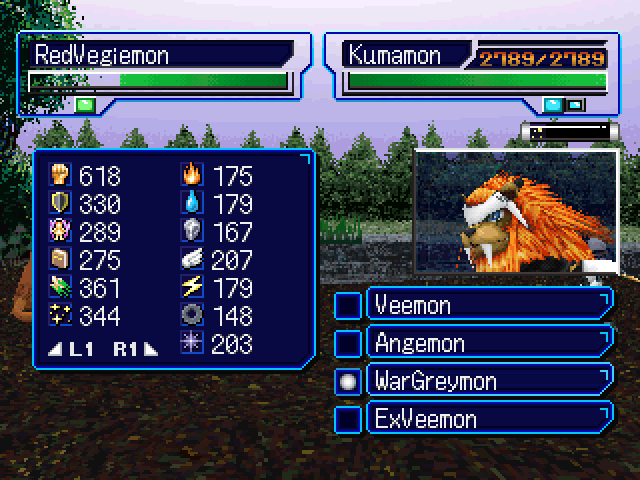
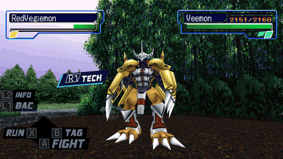
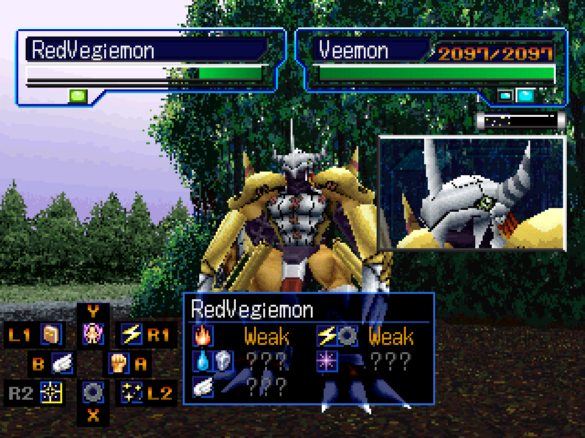

<a href="README.md">English</a> · <a href="README.pt-BR.md">Português (Brasil)</a> · <a href="README.fr.md">Français</a> · <a href="README.de.md">Deutsch</a> · <b>Italiano</b> · <a href="README.es.md">Español</a>

  <b>Digimon World 3, come avrebbe potuto essere.</b> 
  Un remaster fatto da un fan che gira in nativo, senza emulatore, sulle console portatili RK3326 e su PC.

  <b>Gratis</b> · <b>senza emulatore</b> · <b>porta il tuo disco</b> (il <i>Digimon World 2003</i> europeo) ·
  English, Português (Brasil), Français, Deutsch, Italiano, Español · versione PortMaster in fase di test

  <a href="#per-iniziare">Per iniziare</a> ·
  <a href="#battaglie-su-cui-ragionare">Combattimento</a> ·
  <a href="#un-viaggio-che-rispetta-il-tuo-tempo">Progressione</a> ·
  <a href="#la-caccia">La caccia</a> ·
  <a href="#la-velvet-room">Velvet Room</a> ·
  <a href="#una-storia-che-ascolta">Storia</a> ·
  <a href="#blast-e-la-chosen-evolution">Blast</a> ·
  <a href="#le-cacce-super-rare">Super Rare</a> ·
  <a href="#gioca-ovunque">Piattaforme</a> ·
  <a href="#cosa-manca-ancora">Cosa manca ancora</a>

<a href="https://recomplauncher.com"><picture><source media="(prefers-color-scheme: dark)" srcset="https://recomplauncher.com/assets/press/launcher/badge-light.svg"></picture></a>

---

Nel 2002, *Digimon World 3* ci regalava un intero Mondo Digitale da attraversare, una squadra di partner da far
crescere e un sistema di battaglia che, il più delle volte, ti chiedeva solo di premere Fight finché il grind non
finiva. Molti giocatori si fermarono intorno al livello 40, ben prima del finale.

La **Definitive Edition** conserva il viaggio e ricostruisce tutto ciò che lo circonda. Le battaglie ruotano attorno
alle debolezze elementali, nello spirito di *Persona*: trova la falla, stordisci il nemico, guadagna un'azione in più,
passa il testimone. Il finale di gioco arriva proprio dove i giocatori solitamente mollavano. Ogni regione nasconde
prede che valgono la caccia, e ciò che riporti indietro paga equipaggiamenti che nessun negozio ha mai venduto. Una
misteriosa stanza blu si apre nelle locande man mano che la storia procede, con ospiti, sogni e una scelta o due solo
tue. Puoi giocare come **Kail**. E il tuo vecchio salvataggio funziona ancora.

Una tecnica Thunder trova un punto debole: <b>WEAK!</b>, il nemico è stordito e il turno torna a te.

<table>
<tr>
<td width="50%" valign="top">

**⚔️ Scontri su cui ragionare** 
Sette elementi in cinque famiglie. Colpisci un punto debole, stordisci, ottieni un'azione in più, concatena.

</td>
<td width="50%" valign="top">

**⏳ Meno grind, lo stesso viaggio** 
Il finale di gioco arriva intorno al livello 40-50. Le forme salgono di livello 14× più in fretta e tutto il gruppo cresce insieme.

</td>
</tr>
<tr>
<td valign="top">

**🧭 Un motivo per esplorare** 
Le serie di vittorie fanno uscire il Rare Target di ogni regione. I materiali alimentano la fucina, il Black Market e il DRI Gauntlet.

</td>
<td valign="top">

**🚪 La Velvet Room** 
Una stanza tra due mondi che cresce con la storia: un padrone di casa che legge il futuro dei tuoi partner, un maestro di caccia, un mercante.

</td>
</tr>
<tr>
<td valign="top">

**🔥 Blast e la Chosen Evolution** 
Un potere maledetto con il suo prezzo, una missione per purificarlo e un partner che si guadagna una forma Mega tutta sua.

</td>
<td valign="top">

**🎮 Gioca ovunque** 
Portatili e PC, widescreen 16:9, renderer GPU e shader, e salvataggi cloud cross-play gratuiti.

</td>
</tr>
</table>

> [!IMPORTANT]
> **Questo repository non contiene alcun dato del gioco.** Ti serve la tua copia di *Digimon World 2003 (Europe) (En,Fr,De,Es,It)*,
> in `.bin` + `.cue` grezzi, MODE2/2352, 692,146,560 bytes, SHA-1 `457cb233349ba841e03b33d8060f8fbcadd45cb3`.
> Questo progetto non è affiliato né approvato da Bandai, Bandai Namco o Sony.

## Per iniziare

**Portatili (PortMaster)**

> [!NOTE]
> **La versione PortMaster è in corso**: il port è in fase di test sul Discord di PortMaster. Non è ancora nel catalogo
> di PortMaster, ma è già stato eseguito, sotto emulazione, su ogni custom firmware della matrice di test.

1. Scarica `dw3.zip` dalle [release](https://github.com/al4xdev/digimon-world-3-definitive-edition/releases) e
   decomprimilo nella cartella `ports` di PortMaster.
2. Copia l'immagine del tuo disco in `ports/dw3/game/`.
3. Avvia *Digimon World 3* dal menu dei port.

Dispositivi testati, dettagli di installazione e problemi noti: [`.ci-cd/portmaster/README.md`](.ci-cd/portmaster/README.md).

**PC (Linux e Windows)**

1. Decomprimi la versione per PC (un AppImage su Linux, un `.zip` su Windows), oppure esegui
   `./launcher/dw3-launcher --sdl` da un checkout già compilato.
2. Scegli il tuo `.cue` / `.bin` al primo avvio (lo cambi quando vuoi in `GAME > DISC IMAGE`).
3. Apri `VIDEO` per **Widescreen (16:9)**, **Fullscreen**, il ridimensionamento **`FILL` o `INTEGER`**, il renderer
   **GPU** o software e i **filtri** dello schermo.

**Vieni da una versione precedente?** Il tuo salvataggio si apre e funziona. Per dargli le nuove tabelle di MP e TP,
esegui una volta `tools/convert_save_mp.py card1.mcd` (ne conserva un backup).

---

## Battaglie su cui ragionare

Ogni nemico ha debolezze e resistenze su **cinque famiglie di elementi**: Fire, Water + Ice, Wind,
Thunder + Machine e Dark. Gli elementi in coppia condividono sempre lo stesso valore, quindi una famiglia è debole,
neutra o resistente nel suo insieme.

- **Colpisci un punto debole** con una tecnica elementale: un **WEAK!** inclinato, il nemico è **stordito** e ottieni
  un'azione **ONE MORE**. Ogni famiglia debole paga una volta per round, quindi due debolezze concatenano diverse
  azioni di fila.
- **Finché è stordito**: colpisci un'altra debolezza, cambia partner con un **Baton Pass** gratuito mantenendo il tuo
  turno (una volta per round), oppure assesta un altro colpo qualsiasi per un bonus che pone fine allo stordimento.
- **OVERFINISH**: manda KO un nemico con un colpo che dà un'azione in più, e lui resta a terra per subirla. Ogni colpo
  che lo raggiunge paga Bits.
- **Sei tu ad aprire lo scontro**, a meno che tu non venga colto di sorpresa. Una parte molto più veloce agisce due
  volte, e l'HUD te lo dice ("Enemy x2").
- **Lo senti anche**: un suono diverso per una debolezza, un colpo neutro e un colpo resistito.

<table>
<tr>
<td width="50%" align="center"> <b>Baton Pass</b>: un cambio gratuito che mantiene il tuo turno</td>
<td width="50%" align="center"> <b>OVERFINISH</b>: il nemico resta a terra, e ogni colpo paga</td>
</tr>
</table>

**Conosci il tuo nemico.** Nulla è nascosto, ma devi scoprirlo. **Inspect** (`L2`) mostra le cinque famiglie del
nemico man mano che le impari, `???` fino ad allora; **Libra** le rivela tutte in un colpo; il **Bestiary** conserva
ciò che hai imparato su ogni specie, con i suoi Hunt Materials. Ogni elenco di tecniche mostra l'elemento di ciascuna
tecnica, e ogni descrizione è stata riscritta in base a ciò che la tecnica fa davvero ("Magia di fuoco. Probabilità di
sonno.").

**Le tue statistiche hanno cambiato mestiere.** Le vecchie statistiche di "tolleranza" elementale del tuo Digimon sono
diventate **affinity**: non difendono più, potenziano i tuoi attacchi di quell'elemento contro una debolezza o un
nemico stordito. La **Defense** ora protegge dalla magia, e lo **Spirit** è puramente il tuo attacco magico.

**Buff che fanno un piano.** Buff e debuff sono a tre livelli fissi e non si sommano mai: vince il più forte. I boss
sono immuni agli status, **non** ai debuff: **Resist Down** e **Mega Break** possono aprire una debolezza che prima non
c'era. Quattro tecniche sono state rifatte per questo (Libra, Relay, Resist Down, Mega Break), e i rookie a corto di MP
non lo sono più.

**Un HUD di battaglia con un tasto per ogni azione**, in una disposizione a forma di pad e riassegnabile dal launcher.
Ricorda l'ultima tecnica e l'ultimo oggetto, memorizza le pressioni anticipate, e il testo di battaglia non ferma più
lo scontro.

<b>I numeri, per i curiosi</b>

| Il colpo | Moltiplicatore |
|---|---|
| Elemento resistito | 0.5 |
| Elemento neutro | 1.0 |
| Debolezza | 1.5 + affinity |
| Elemento neutro, bersaglio stordito | 1.2 + affinity |
| Debolezza, bersaglio stordito | 1.7 + 2 × affinity |
| Nessun elemento, bersaglio stordito | 1.2 |

L'affinity arriva a 0.3 per Fire e Wind e a 0.6 per le coppie e Dark, quindi il colpo più forte vale 2.3 o 2.9. I
livelli di buff sono +20 / +35 / +50% e quelli di debuff −15 / −25 / −35%. L'intero calcolo, passo per passo con un
esempio svolto, è nel [riferimento sul combattimento](docs/definitive-edition/combat.md).

## Un viaggio che rispetta il tuo tempo

- **Più punti addestramento, prima.** Al livello 50 un Digimon ha guadagnato più TP di quanti l'originale ne desse al
  livello 99 (613 contro 490), e i livelli dal 41 al 50 sono quelli in cui ne modelli le statistiche.
- **Addestramento garantito.** Tre sessioni senza un risultato perfetto e la quarta riesce a ogni round.
  L'addestramento di resistenza non costa più una statistica.
- **Le forme salgono di livello 14× più in fretta**, così provare una nuova digivoluzione è un piacere e non una
  seccatura.
- **Il gruppo cresce insieme**: un partner in panchina guadagna la stessa esperienza, e le tre forme scelte di ogni
  Digimon guadagnano esperienza di forma, che abbiano combattuto o no.
- **Requisiti a schermo**: il Digi-Lab mostra cosa serve a ogni forma successiva e a che punto sei ("Greymon Lv 5 (3/5)").
  L'animazione di digivoluzione viene riprodotta per intero una volta, poi in versione breve; tieni premuto un tasto per
  saltarla.
- **I card booster cadono a 15 alla volta**, così costruire un mazzo non richiede una seconda partita completa.
- **Hard Mode**, scelta a New Game: il tuo gruppo è di due Digimon invece di tre, per tutto il gioco.
- **Super Hard**, in qualsiasi momento: porta con te il Demon Bell della Velvet Room e i nemici ottengono il 50% in più
  di HP e velocità, ma pagano il doppio di Bits e materiali. Riconsegnalo per disattivarla.

## La caccia

Facoltativa e aperta per tutto il gioco. Ogni battaglia casuale che vinci si aggiunge alla **hunt chain** della regione
in cui ti trovi. Dopo cinque vittorie, il prossimo incontro può essere il **Rare Target** della regione: un boss
ricolorato e più tosto, da solo, certo alla decima vittoria. Ognuna delle 71 regioni ha la sua specie, e ognuna lascia
cadere il proprio **Core** per la tua collezione.

- **Hunt Materials**: sedici comuni per fascia di livello, dal Bit Shard all'Obsidian Digizoid, e 71 Core rari. Il
  Bestiary ti dice chi lascia cadere cosa.
- **La fucina**: armi, armature e accessori di ogni negozio chiedono i materiali delle regioni circostanti. La
  descrizione mostra cosa hai e cosa ti manca.
- **41 varianti di equipaggiamento** costruite attorno a uno stile: armi Speed, equipaggiamento Elemental che alza la
  tua affinity, armature Tank, accessori Trade-off.
- **Il Black Market**: scambia un Core con dodici comuni, oppure i Core di due boss con una delle sedici **repliche**
  che nessun negozio vende (e, in fondo alla lista, un segno che ogni cacciatore desidera).
- **Il DRI Gauntlet**: i DRI Agents rigiocano battaglie classiche dei Tamer. Uno scontro, tre fasi, da Champion a
  Ultimate a Mega con un **DIGIVOLVE!** in mezzo, e un accessorio Power per ogni fase che abbatti.
- **I prezzi** dell'equipaggiamento avanzato sono saliti e la rivendita è scesa, così un colpo di fortuna non si vende
  più a peso d'oro e i Bits dell'OVERFINISH hanno dove andare.

Le repliche del Black Market: i Core di due boss e i Bits, e l'equipaggiamento è tuo.

<b>Le cinque linee del DRI Gauntlet</b>

| Linea | Fasi e livelli | Ricompense |
|---|---|---|
| Terriermon (Guardromon) | Guardromon 24, Andromon 27, BK MegaGargomon 30 | Metal Power 1, 2, S |
| Veemon | Devidramon 32, Paildramon 35, BK Imperialdramon 38 | Bolt Power 1, 2, S |
| Patamon | Airdramon 40, MagnaAngemon 43, BK Seraphimon 46 | Wind Power 1, 2, S |
| Agumon | Tyrannomon 48, MetalGreymon 51, BK WarGreymon 54 | Fire Power 1, 2, S |
| Guilmon | Flarerizamon 56, WarGrowlmon 59, BK WarGrowlmon 62 | Dark Power 1, 2, S |

Perdere non è un game over: torni sul campo com'eri. I costi di sblocco, le ricette della fucina e ogni variante sono
nel [riferimento sulla caccia](docs/definitive-edition/hunt-and-economy.md).

## La Velvet Room

<table>
<tr>
<td width="50%" align="center"> Una morbida luce blu in una locanda, e la strada si apre</td>
<td width="50%" align="center"> La stanza al suo massimo, con Kail come eroe</td>
</tr>
</table>

Da qualche parte nel Mondo Digitale, una stanza blu aspetta tra i server. All'inizio le sue porte sono chiuse. Poi
una voce comincia a circolare a Seiryu City e, in ogni locanda, una morbida **luce blu** inizia a pulsare su un pezzo
della scenografia. Mettiti lì dentro, premi Circle, e sei dentro.

La stanza **cresce con la storia**. I suoi ospiti arrivano uno alla volta:

| Ospite | Cosa fa |
|---|---|
| **Igor**, il padrone di casa | legge le forme DNA dei tuoi partner e ciò che ancora serve loro; ogni tanto sogna insieme a te |
| **Il Sepikmon** | il maestro delle cacce: le cacce Super Rare, i loro cristalli e le skin da eroe che sbloccano |
| **Gennai** | la missione del Blast e la Chosen Evolution |
| **Guilmon** | custodisce il Demon Bell, Super Hard su richiesta |
| **Etemon** | al pianoforte. Ha già sentito questa musica in un altro gioco |
| **Il maiale** | un attore che il gioco includeva e non ha mai usato, finalmente sul palco |
| **Oikawa** | dietro il bancone, quando te lo sarai guadagnato: il Black Market |

La stanza ha un suo arrangiamento della musica, e una **rete di Guardromon** collega le locande: salva o teletrasportati
da qualsiasi Guardromon verso quelli che hai incontrato.

## Una storia che ascolta

La Definitive Edition non cambia dove va la storia. Cambia come viene raccontata, e ti dà una voce al suo interno.

- **I sogni di Igor.** In alcuni punti di svolta ti trascina da solo nella stanza e ti pone una domanda. Non esiste una
  risposta sbagliata, e lui ricorda quello che hai detto.
- **Le tue scelte e i loro echi.** 111 scene ora lasciano che l'eroe risponda con parole proprie, e circa 600 battute
  successive cambiano in base a ciò che hai scelto.
- **Una sceneggiatura riscritta**: le battute infantili sono cresciute, l'ordine e le missioni sono intatti, e l'eroe è
  scritto per chiunque stia giocando.
- **Una figura incappucciata** sbarra la strada nel Bug Maze, e **una stanza in cui il tempo si ferma** aspetta prima
  del punto di non ritorno, per assicurarsi che tu sia pronto.

## Blast e la Chosen Evolution

Vinci la caccia Super Rare del tutorial e si risveglia un nuovo potere. Combattere bene riempie il **Blast Gauge**:
debolezze, stordimenti, OVERFINISH. Quando è pieno, `R2` scatena la **forma oscura** del tuo partner. È potenza, e ha un
prezzo: lo scontro finisce con HP e MP a 1, statistiche ridotte fino alla prossima locanda e un partner troppo
surriscaldato per digivolvere. Qualcuno nella Velvet Room sa come purificarla, se ti puoi fidare. In fondo a quella
strada, un partner si guadagna la **Chosen Evolution**: una forma Mega tutta sua, senza maledizione.

## Le cacce Super Rare

La bacheca del Sepikmon elenca **dodici Digimon Super Rare** (e un Ogremon tutorial su cui fare pratica), dal livello 29
al 61, sbloccati uno dopo l'altro. Ognuno si nasconde su una mappa casuale del suo territorio, e una **bussola della
temperatura** ti dice quando ti stai scaldando. Feriscilo e scappa, mantenendo il danno e tornando più forte. Ognuno che
abbatti paga un cristallo e sblocca una **skin da eroe**.

## Il tuo eroe, a modo tuo

**Girls Power**: a New Game, scegli **Kail** o **Junior** come eroe. I ruoli si scambiano negli sprite sul campo, nei
filmati, nelle azioni sul campo e nei menu, con ogni frame che mancava a Kail disegnato a mano, e il testo della storia
segue lo scambio. Tredici **skin da eroe** delle cacce Super Rare ricolorano i capelli e i vestiti del tuo eroe.

## Comfort e qualità della vita

- **GUIDE**: il passo attuale della missione principale, le missioni secondarie aperte e tutte e sedici le aste di
  Asuka, con un salto diretto a una aperta. Un banner scorre quando un obiettivo cambia.
- **Overlevel Rush**: quando il tuo Digimon più forte ha 8 o più livelli sopra tutti i nemici di una battaglia casuale,
  il gioco ti offre di saltarla mentre continui a camminare, e le ricompense scorrono in alto sullo schermo.
- **Testo di battaglia che non ferma lo scontro**, un indicatore di obiettivo sulla mappa, avanzamento rapido, glifi dei
  tasti che corrispondono al tuo pad (Xbox, Nintendo, PS1) e rimappatura completa.
- **Modalità 60 Hz**: il disco europeo gira a 50 Hz; la modalità a 60 Hz del gioco stesso, con velocità compensata, è a
  una sola impostazione di distanza.

<table>
<tr>
<td width="50%" align="center"> <b>Overlevel Rush</b>: salta lo scontro facile, tieni le ricompense</td>
<td width="50%" align="center"> <b>GUIDE</b>: dove andare dopo, in una frase</td>
</tr>
</table>

## Gioca ovunque

| Dove | Cosa ottieni |
|---|---|
| **Portatili RK3326** tramite PortMaster (l'XF35H, l'R36S e dispositivi simili) | ottimizzato da cima a fondo su un vero XF35H: presentazione diretta del framebuffer, un renderer GLES, filmati a piena velocità, la barra LED. Ogni custom firmware della matrice di test è stato eseguito sotto emulazione; le segnalazioni da dispositivi reali sono benvenute |
| **PC Linux e Windows** | renderer GPU SDL3 (Vulkan, D3D12), **widescreen 16:9** in battaglia e sul campo, schermo intero HighDPI con ridimensionamento `FILL`, filtri `SHARP` / `SCANLINES` / `CRT` / `SMOOTH`, avanzamento rapido fino a 8× |
| **Android** (arm64) | esiste un APK con **widescreen 16:9**, un touch pad flottante che sta accanto all'immagine sui telefoni larghi e si fa da parte finché è collegato un controller, e un selettore del disco che copia la tua immagine dentro l'app |

**Salvataggi cross-play.** Il **Cloud Sync** gratuito tiene allineata la tua memory card tra un portatile e un PC:
abbina un dispositivo con un codice a 6 cifre, risolvi i conflitti, revoca un dispositivo perso e conserva fino a 100
snapshot locali con ripristino a un tasto. Un launcher pensato prima di tutto per console gestisce il disco, il video,
i comandi, l'HUD di battaglia e i salvataggi, e fa partire un piccolo gioco di corsa con Kumamon, Guilmon e Agumon
mentre il tuo disco viene verificato.

Se lo provi su un altro dispositivo, una segnalazione nell'
[issue tracker](https://github.com/al4xdev/digimon-world-3-definitive-edition/issues) aiuta molto.

## Cosa manca ancora

Il gioco è giocabile dall'inizio alla fine, e ogni sistema descritto sopra è implementato. È anche giovane: una parte è
stata giocata solo poche volte, quindi aspettati qualche spigolo e hotfix frequenti. Ciò che resta:

- **Il bilanciamento generale del gioco.** Finora è stato bilanciato solo a calcolo. Lo sto giocando in parallelo e
  rilascio hotfix man mano.
- **La Velvet Room** sembra ancora un po' scarna in certi punti (alcuni ospiti e momenti hanno bisogno di più cose da
  dire e da fare); gli hotfix sono in arrivo.
- **Lo scontro finale** riceverà un'estensione. Non cambia la storia, e ogni altro sistema è già implementato.
- **L'ottimizzazione per altre piattaforme e dispositivi**, oltre all'XF35H e al PC su cui è stato calibrato.

L'elenco dettagliato dei punti aperti è nella [roadmap](docs/definitive-edition/roadmap.md).

## Sotto il cofano

Si basa sulla [decompilazione di Digimon World 2003](https://github.com/gascarcella/dw2003recomp) e sul suo port per
PC, che sono opera del progetto originale: ogni file del gioco si ricostruisce identico byte per byte da C
corrispondente. Questo fork aggiunge il percorso per i portatili e la Definitive Edition.

- **Come funziona la Definitive Edition**, ogni regola, numero, file e decisione di progetto:
  [`docs/definitive-edition/`](docs/definitive-edition/README.md).
- **La decompilazione e il port**, formati, prestazioni, il lavoro sulla GPU: [`docs/`](docs/README.md).

| Per | Comando | Dettagli |
|---|---|---|
| Il binario e il pacchetto per portatili ARM | `.ci-cd/portmaster/build_arm.sh` | [`docs/HANDHELD.md`](docs/HANDHELD.md#building) |
| Lo zip di PortMaster | `.ci-cd/portmaster/make_release.sh` | [`.ci-cd/portmaster/PUBLISHING.md`](.ci-cd/portmaster/PUBLISHING.md) |
| Il port per PC e i test | vedi la guida | [`docs/BUILDING.md`](docs/BUILDING.md) |

## Contribuire e supporto

Leggi prima [`docs/CONTRIBUTING.md`](docs/CONTRIBUTING.md). Segnala i bug e fai domande nell'
[issue tracker](https://github.com/al4xdev/digimon-world-3-definitive-edition/issues).

## Crediti e licenza

La decompilazione e il port per PC sono opera del [progetto originale](https://github.com/gascarcella/dw2003recomp).
Questo fork aggiunge la Definitive Edition e il percorso per i portatili: la presentazione diretta del framebuffer, la
generazione di codice per Cortex-A35, il lavoro sui vector span, il layout delle righe della VRAM, il misuratore di
frame e gli extra per i portatili, il renderer GLES, il lavoro sull'audio e il pacchetto. Il lavoro proprio del progetto
è sotto [licenza MIT](LICENSE); il gioco resta di proprietà del suo publisher.

Grazie a juandav e a [ReGame-Labs/dw3_decomp](https://github.com/ReGame-Labs/dw3_decomp), l'altra decompilazione di Digimon World 3, i cui nomi e le cui
forme di funzione hanno aiutato a chiudere le ultime funzioni; ogni idea ripresa è elencata in
[`docs/THIRD_PARTY.md`](docs/THIRD_PARTY.md).

La Velvet Room è un omaggio alla serie *Persona* di Atlus, e le cacce (Rare Target, materiali, la forgia) a
*Monster Hunter* di Capcom. *Digimon* appartiene a Bandai / Bandai Namco, *Persona* ad Atlus e *Monster Hunter* a
Capcom; questo progetto amatoriale non è affiliato né approvato da nessuno di loro.
