<b>English</b> · <a href="README.pt-BR.md">Português (Brasil)</a> · <a href="README.fr.md">Français</a> · <a href="README.de.md">Deutsch</a> · <a href="README.it.md">Italiano</a> · <a href="README.es.md">Español</a>

<a href="https://dw3-definitive.pages.dev/">Digimon World 3: Definitive Edition website</a>

  <b>Digimon World 3, as it could have been.</b> 
  A fan remaster that runs natively, with no emulator, on RK3326 handhelds, Android phones and PC.

  <b>Free</b> · <b>no emulator</b> · <b>bring your own disc</b> (the European <i>Digimon World 2003</i>) ·
  English, most of it also in Brazilian Portuguese · PortMaster release in testing

  <a href="#get-started">Get started</a> ·
  <a href="#battles-you-think-through">Combat</a> ·
  <a href="#a-journey-that-respects-your-time">Progression</a> ·
  <a href="#the-hunt">The hunt</a> ·
  <a href="#the-velvet-room">Velvet Room</a> ·
  <a href="#a-story-that-listens">Story</a> ·
  <a href="#blast-and-the-chosen-evolution">Blast</a> ·
  <a href="#super-rare-hunts">Super Rares</a> ·
  <a href="#play-anywhere">Platforms</a> ·
  <a href="#whats-left">What's left</a>

<a href="https://recomplauncher.com/game/digimon-world-3-definitive-edition"><picture><source media="(prefers-color-scheme: dark)" srcset="https://recomplauncher.com/assets/press/launcher/badge-light.svg"></picture></a>

---

In 2002, *Digimon World 3* gave us a whole Digital World to walk through, a partner team to raise, and a battle
system that mostly asked you to press Fight until the grind was over. Many players stopped around level 40, long before
the late game.

The **Definitive Edition** keeps the journey and rebuilds what surrounds it. Battles turn on elemental weaknesses, in
the spirit of *Persona*: find the gap, stagger the enemy, take one more action, pass the baton. The late game arrives
where players used to give up. Every region hides prey worth hunting, and what you bring back pays for gear no shop
ever sold. A mysterious blue room opens in the inns as the story moves on, with guests, dreams and a choice or two of
your own. You can play as **Kail**. And your old save still works.

A Thunder technique finds a weakness: <b>WEAK!</b>, the enemy staggers, and the turn is yours again.

<table>
<tr>
<td width="50%" valign="top">

**⚔️ Fights you think through** 
Seven elements in five families. Hit a weakness, stagger, earn one more action, chain it.

</td>
<td width="50%" valign="top">

**⏳ Less grinding, same journey** 
The late game lands around level 40-50. Forms level 14× faster and the whole party grows together.

</td>
</tr>
<tr>
<td valign="top">

**🧭 A reason to roam** 
Winning streaks bring out each region's Rare Target. Materials feed the forge, the Black Market and the DRI Gauntlet.

</td>
<td valign="top">

**🚪 The Velvet Room** 
A room between worlds that grows with the story: a host who reads your partners' futures, a hunt master, a dealer.

</td>
</tr>
<tr>
<td valign="top">

**🔥 Blast and the Chosen Evolution** 
A cursed power with a price, a quest to purify it, and one partner who earns a Mega form of their own.

</td>
<td valign="top">

**🎮 Play anywhere** 
Handhelds, Android and PC, 16:9 widescreen, GPU renderer and shaders, and free cross-play cloud saves.

</td>
</tr>
</table>

> [!IMPORTANT]
> **This repository contains no game data.** You need your own copy of *Digimon World 2003 (Europe) (En,Fr,De,Es,It)*,
> raw `.bin` + `.cue`, MODE2/2352, 692,146,560 bytes, SHA-1 `457cb233349ba841e03b33d8060f8fbcadd45cb3`.
> This project is not affiliated with or endorsed by Bandai, Bandai Namco or Sony.

## Get started

**Handhelds (PortMaster)**

> [!NOTE]
> **The PortMaster release is in progress**: the port is in its testing phase on the PortMaster Discord. It is not in
> the PortMaster catalogue yet, but it was already run, under emulation, on every custom firmware of the test matrix.

1. Download `dw3.zip` from the [releases](https://github.com/al4xdev/digimon-world-3-definitive-edition/releases) and
   unpack it into your PortMaster `ports` directory.
2. Copy your disc image into `ports/dw3/game/`.
3. Start *Digimon World 3* from the ports menu.

Tested devices, install details and known issues: [`.ci-cd/portmaster/README.md`](.ci-cd/portmaster/README.md).

**Android (arm64, Android 7 or newer)**

1. Download `dw2003-*-android-arm64-v8a.apk` from the
   [releases](https://github.com/al4xdev/digimon-world-3-definitive-edition/releases) and install it (allow installs
   from your browser or file manager).
2. Tap **PLAY**, then pick your `.bin` (and `.cue`) in the system's file picker: the app copies them in.
3. The arrows in the top right corner move and resize the touch controls; the one in the top left hides them. A
   gamepad works too, and the touch controls step aside while it is connected.

**PC (Linux and Windows)**

1. Unpack the PC release (an AppImage on Linux, a `.zip` on Windows), or run `./launcher/dw3-launcher --sdl` from a
   built checkout.
2. Pick your `.cue` / `.bin` on first launch (change it any time under `GAME > DISC IMAGE`).
3. Open `VIDEO` for **Widescreen (16:9)**, **Fullscreen**, **`FILL` or `INTEGER`** scaling, the **GPU** or software
   renderer and the screen **filters**.

**Coming from an older version?** Your save opens and plays. To give it the new MP and TP tables, run
`tools/convert_save_mp.py card1.mcd` once (it keeps a backup).

---

## Battles you think through

Every enemy has weaknesses and resistances across **five element families**: Fire, Water + Ice, Wind,
Thunder + Machine, and Dark. Paired elements always share their value, so a family is either weak, neutral or
resisted as a whole.

- **Hit a weakness** with an elemental technique: a slanted **WEAK!**, the enemy **staggers**, and you get
  **ONE MORE** action. Each weak family pays out once per round, so two weaknesses chain into several actions in a row.
- **While it is staggered**: hit another weakness, switch partners with a free **Baton Pass** and keep your turn
  (once a round), or land any other blow for a bonus that ends the stagger.
- **OVERFINISH**: knock an enemy out with a blow that earns one more action and it stays down for it. Every hit on it
  pays Bits.
- **You open the fight** unless you are ambushed. A much faster side acts twice, and the HUD says so ("Enemy x2").
- **You hear it, too**: a different sound for a weakness, a neutral hit and a resisted one.

<table>
<tr>
<td width="50%" align="center"> <b>Baton Pass</b>: a free switch that keeps your turn</td>
<td width="50%" align="center"> <b>OVERFINISH</b>: the enemy stays down, and every hit pays</td>
</tr>
</table>

**Knowing your enemy.** Nothing is hidden, but you have to find it out. **Inspect** (`L2`) shows the enemy's five
families as you learn them, `???` until then; **Libra** reveals them all at once; the **Bestiary** keeps what you have
learnt about every species, with its Hunt Materials. Every technique list shows each technique's element, and every
description was rewritten from what the technique really does ("Fire magic. Sleep chance.").

**Your stats changed jobs.** Your Digimon's old elemental "tolerance" stats became **affinity**: they no longer
defend, they power your attacks of that element against a weakness or a staggered foe. **Defense** now guards against
magic, and **Spirit** is purely your magic attack.

**Buffs that make a plan.** Buffs and debuffs come in three fixed tiers and never stack, so the strongest one wins.
Bosses are immune to status, **not** to debuffs: **Resist Down** and **Mega Break** can open a weakness that was
not there. Four techniques were remade for this (Libra, Relay, Resist Down, Mega Break), and the rookies that were
starved of MP are not any more.

**A battle HUD with a button per action**, in a pad-shaped layout and rebindable from the launcher. It remembers your
last technique and item, buffers early presses, and battle text no longer stops the fight.

<b>The numbers, for the curious</b>

| The hit | Multiplier |
|---|---|
| Resisted element | 0.5 |
| Neutral element | 1.0 |
| Weakness | 1.5 + affinity |
| Neutral element, staggered target | 1.2 + affinity |
| Weakness, staggered target | 1.7 + 2 × affinity |
| No element, staggered target | 1.2 |

Affinity is up to 0.3 for Fire and Wind and up to 0.6 for the pairs and Dark, so the strongest hit is 2.3 or 2.9.
Buff tiers are +20 / +35 / +50% and debuffs −15 / −25 / −35%. The whole calculation, step by step with a worked
example, is in [the combat reference](docs/definitive-edition/combat.md).

## A journey that respects your time

- **More training points, sooner.** By level 50 a Digimon has earned more TP than the original gave by level 99 (613
  against 490), and levels 41 to 50 are where you shape its stats.
- **Guaranteed training.** Three sessions without a perfect result and the fourth succeeds on every round.
  Resistance training no longer costs a stat.
- **Forms level 14× faster**, so trying a new digivolution is fun instead of a chore.
- **The party grows together**: a partner on the bench earns the same experience, and each Digimon's three chosen
  forms earn form experience whether they fought or not.
- **Requirements on screen**: the Digi-Lab shows what each next form needs and how far you are ("Greymon Lv 5 (3/5)").
  The digivolution animation plays in full once, then short; hold a button to skip it.
- **Card boosters drop 15 at a time**, so building a deck does not take a second playthrough.
- **Hard Mode**, chosen on New Game: your party is two Digimon instead of three, for the whole game.
- **Super Hard**, any time: carry the Demon Bell from the Velvet Room and enemies get 50% more HP and speed, but pay
  double Bits and materials. Hand it back to turn it off.

## The hunt

Optional, and open all game long. Every random battle you win adds to the **hunt chain** of the region you are in.
Past five wins, the next encounter may be the region's **Rare Target**: a recoloured, tougher boss on its own,
certain by the tenth win. Each of the 71 regions has its own species, and each drops its own **Core** for your
collection.

- **Hunt Materials**: sixteen common ones by level band, from Bit Shard to Obsidian Digizoid, and 71 rare Cores. The
  Bestiary tells you who drops what.
- **The forge**: every shop's weapons, armour and accessories ask for the materials of the regions around it. The
  description shows what you have and what you lack.
- **41 equipment variants** built around a style: Speed weapons, Elemental gear that raises your affinity, Tank armour,
  Trade-off accessories.
- **The Black Market**: trade a Core for twelve commons, or two bosses' Cores for one of sixteen **replicas** no shop
  sells (and, at the very end of the list, a mark every hunter wants).
- **The DRI Gauntlet**: the DRI Agents replay classic Tamers' battles. One fight, three stages, Champion to Ultimate to
  Mega with a **DIGIVOLVE!** between them, and a Power accessory for every stage you fell.
- **Prices** of advanced gear went up and resale went down, so a lucky find no longer sells for a fortune and the Bits
  from OVERFINISH have somewhere to go.

The Black Market's replicas: two bosses' Cores and the Bits, and the gear is yours.

<b>The DRI Gauntlet's five lines</b>

| Line | Stages and levels | Rewards |
|---|---|---|
| Terriermon (Guardromon) | Guardromon 24, Andromon 27, BK MegaGargomon 30 | Metal Power 1, 2, S |
| Veemon | Devidramon 32, Paildramon 35, BK Imperialdramon 38 | Bolt Power 1, 2, S |
| Patamon | Airdramon 40, MagnaAngemon 43, BK Seraphimon 46 | Wind Power 1, 2, S |
| Agumon | Tyrannomon 48, MetalGreymon 51, BK WarGreymon 54 | Fire Power 1, 2, S |
| Guilmon | Flarerizamon 56, WarGrowlmon 59, BK WarGrowlmon 62 | Dark Power 1, 2, S |

Losing is no game over: you are back on the field as you were. Unlock costs, the forge's recipes and every variant
are in [the hunt reference](docs/definitive-edition/hunt-and-economy.md).

## The Velvet Room

<table>
<tr>
<td width="50%" align="center"> A soft blue light in an inn, and the way opens</td>
<td width="50%" align="center"> The room at its fullest, with Kail as the hero</td>
</tr>
</table>

Somewhere in the Digital World, a blue room waits between the servers. At first its doors are shut. Then a rumour
goes around Seiryu City, and in every inn a soft **blue light** starts to breathe on a piece of the scenery. Stand in
it, press Circle, and you are inside.

The room **grows with the story**. Its guests arrive one by one:

| Guest | What they do |
|---|---|
| **Igor**, the host | reads your partners' DNA forms and what they still need; now and then, he dreams with you |
| **The Sepikmon** | the hunts' master: Super Rare hunts, their crystals and the hero skins they unlock |
| **Gennai** | the Blast quest and the Chosen Evolution |
| **Guilmon** | keeps the Demon Bell, Super Hard on demand |
| **Etemon** | at the piano. He has heard this music in another game |
| **The pig** | an actor the game shipped and never used, at last on stage |
| **Oikawa** | behind the counter, once you have earned it: the Black Market |

The room has its own arrangement of the music, and a **Guardromon network** ties the inns together: save or teleport
from any Guardromon to the ones you have met.

## A story that listens

The Definitive Edition does not change where the story goes. It changes how it is told, and gives you a voice in it.

- **Igor's dreams.** At a few turning points he pulls you into the room alone and asks you something. There is no
  wrong answer, and he remembers what you said.
- **Your choices, and their echoes.** 111 scenes now let the hero answer in their own words, and some 600 later lines
  change with what you chose.
- **A rewritten script** (English): the childish lines grown up, the order and the quests untouched, and the hero
  written for whoever is playing.
- **A hooded figure** blocks the way in the Bug Maze, and **a room where time stands still** waits before the point of
  no return, to make sure you are ready.

## Blast and the Chosen Evolution

Win the tutorial Super Rare hunt and a new power wakes up. Fighting well fills the **Blast Gauge**: weaknesses, staggers, OVERFINISH. When it is full, `R2` unleashes your
partner's **dark form**. It is power, and it has a price: the battle ends with HP and MP at 1, stats down until an inn,
and a partner too overheated to digivolve. Someone in the Velvet Room knows how to purify it, if you can trust them.
At the end of that road, one partner earns the **Chosen Evolution**: a Mega form of its own, with no curse.

## Super Rare hunts

The Sepikmon's board lists **twelve Super Rare** Digimon (and a tutorial Ogremon to learn on), from level 29 to 61,
unlocked one after another. Each hides on a random map of its territory, and a **temperature compass** tells you when
you are getting warmer. Hurt it and it runs, keeping the damage and coming back stronger. Each one you take down pays
a crystal and unlocks a **hero skin**.

## Your hero, your way

**Girls Power**: on New Game, choose **Kail** or **Junior** as the hero. The roles swap across the field sprites,
cutscenes, field actions and menus, with every frame Kail lacked drawn by hand, and the story's text follows the
swap. Thirteen **hero skins** from the Super Rare hunts recolour your hero's hair and clothes.

## Comfort and quality of life

- **GUIDE**: your current main quest step, the open side missions and all sixteen Asuka auctions, with a jump straight
  to an open one. A banner slides in when an objective changes.
- **Overlevel Rush**: when your strongest Digimon is 8 or more levels above every enemy of a random battle, the game offers to skip it
  while you keep walking, and the rewards slide in at the top of the screen.
- **Battle text that does not stop the fight**, a map objective marker, fast-forward, button glyphs that match your
  pad (Xbox, Nintendo, PS1) and full remapping.
- **60 Hz mode**: the European disc runs at 50 Hz; the game's own speed-compensated 60 Hz mode is one setting away.

<table>
<tr>
<td width="50%" align="center"> <b>Overlevel Rush</b>: skip the easy fight, keep the rewards</td>
<td width="50%" align="center"> <b>GUIDE</b>: where to go next, in a sentence</td>
</tr>
</table>

## Play anywhere

| Where | What you get |
|---|---|
| **RK3326 handhelds** through PortMaster (the XF35H, the R36S and similar devices) | tuned end to end on a real XF35H: direct framebuffer present, a GLES renderer, full-speed movies, the LED bar. Every custom firmware of the test matrix was run under emulation; real-device reports are welcome |
| **Linux and Windows PC** | SDL3 GPU renderer (Vulkan, D3D12), **16:9 widescreen** in battles and the field, HighDPI fullscreen with `FILL` scaling, `SHARP` / `SCANLINES` / `CRT` / `SMOOTH` filters, fast-forward up to 8× |
| **Android** (arm64) | an APK with **16:9 widescreen**, big touch controls you can move and resize on screen (or hide), any USB or Bluetooth gamepad, and a disc picker that copies your image into the app |

**Cross-play saves.** Free **Cloud Sync** keeps your memory card in step between a handheld, an Android phone and a PC: pair a device
with a 6-digit code, resolve conflicts, revoke a lost device, and keep up to 100 local snapshots with one-button
restore. A console-first launcher handles the disc, video, controls, the battle HUD and the saves, and plays a little
runner game with Kumamon, Guilmon and Agumon while your disc is checked.

If you try it on another device, a report in the
[issue tracker](https://github.com/al4xdev/digimon-world-3-definitive-edition/issues) helps a lot.

## What's left

The game is playable from start to end, and every system described above is implemented. It is also young: some of
it has only been played through a few times, so expect rough edges and frequent hotfixes. What remains:

- **Translation into other languages.** The new text is written in English, and Brazilian Portuguese covers most of it; the
  original campaign keeps the disc's French, German, Italian and Spanish, but the Definitive Edition's own text is
  not translated into them yet.
- **Overall game balance.** So far it was balanced by calculation only. I am playing through it in parallel and
  shipping hotfixes as I go.
- **The Velvet Room** still feels thin in some places (some guests and moments need more to say and do); hotfixes
  are on the way.
- **The final battle** will get an extension. It does not change the story, and every other system is already
  implemented.
- **Tuning for other platforms and devices**, beyond the XF35H and the PC it was tuned on.

The detailed list of open items is in [the roadmap](docs/definitive-edition/roadmap.md).

## Under the hood

This is built on the [Digimon World 2003 decompilation](https://github.com/gascarcella/dw2003recomp) and its PC port,
which are the upstream project's work: every game file rebuilds byte-identical from matching C. This fork adds the
handheld path and the Definitive Edition.

- **How the Definitive Edition works**, every rule, number, file and design decision:
  [`docs/definitive-edition/`](docs/definitive-edition/README.md).
- **The decompilation and the port**, formats, performance, the GPU work: [`docs/`](docs/README.md).

| For | Command | Details |
|---|---|---|
| The ARM handheld binary and package | `.ci-cd/portmaster/build_arm.sh` | [`docs/HANDHELD.md`](docs/HANDHELD.md#building) |
| The PortMaster zip | `.ci-cd/portmaster/make_release.sh` | [`.ci-cd/portmaster/PUBLISHING.md`](.ci-cd/portmaster/PUBLISHING.md) |
| The PC port and the tests | see the guide | [`docs/BUILDING.md`](docs/BUILDING.md) |

## Contributing and support

Read [`docs/CONTRIBUTING.md`](docs/CONTRIBUTING.md) first. Report bugs and ask questions in the
[issue tracker](https://github.com/al4xdev/digimon-world-3-definitive-edition/issues).

## Credits and license

The decompilation and the PC port are the work of the [upstream project](https://github.com/gascarcella/dw2003recomp).
This fork adds the Definitive Edition and the handheld path: the direct framebuffer present, the Cortex-A35 code
generation, the vector span work, the VRAM row layout, the frame meter and the handheld extras, the GLES renderer, the
audio work and the package. The project's own work is under the [MIT licence](LICENSE); the game remains the property
of its publisher.

Thanks to juandav and [ReGame-Labs/dw3_decomp](https://github.com/ReGame-Labs/dw3_decomp), the other Digimon World 3 decompilation, whose names and function
shapes helped close the last functions; every borrowed idea is listed in [`docs/THIRD_PARTY.md`](docs/THIRD_PARTY.md).

The Velvet Room is a homage to Atlus's *Persona* series, and the hunts (Rare Targets, materials, the forge) to
Capcom's *Monster Hunter*. *Digimon* belongs to Bandai / Bandai Namco, *Persona* to Atlus and *Monster Hunter* to
Capcom; this fan project is not affiliated with or endorsed by any of them.
