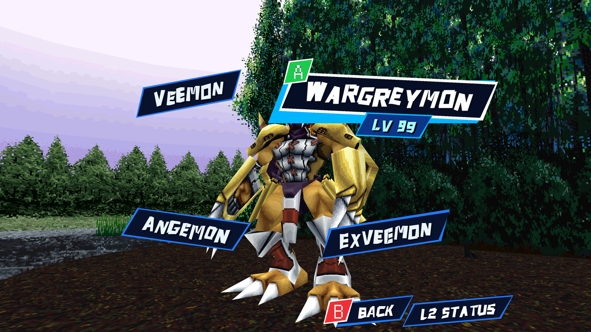
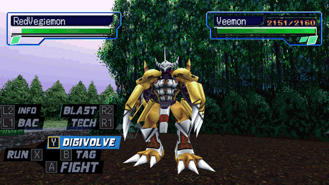
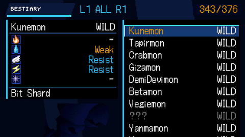
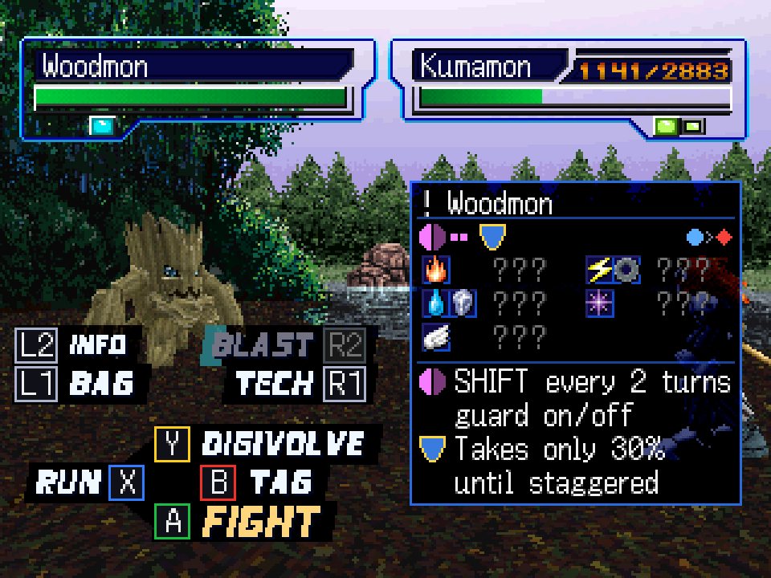
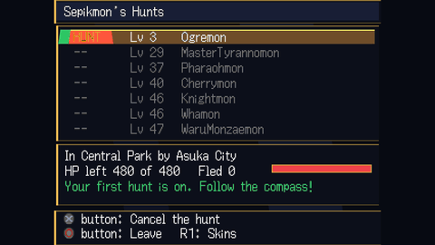

<a href="README.md">English</a> · <b>Português (Brasil)</b> · <a href="README.fr.md">Français</a> · <a href="README.de.md">Deutsch</a> · <a href="README.it.md">Italiano</a> · <a href="README.es.md">Español</a>

<a href="https://dw3-definitive.pages.dev/">Site do Digimon World 3: Definitive Edition</a>

  <b>Digimon World 3, como poderia ter sido.</b> 
  Um remaster feito por fã que roda nativamente, sem emulador, em portáteis RK3326, celulares Android e no PC.

  <b>Grátis</b> · <b>sem emulador</b> · <b>traga o seu próprio disco</b> (o <i>Digimon World 2003</i> europeu) ·
  English, Português (Brasil), Français, Deutsch, Italiano, Español · versão para PortMaster em testes

  <a href="#comece-aqui">Comece aqui</a> ·
  <a href="#batalhas-que-pedem-estratégia">Combate</a> ·
  <a href="#uma-jornada-que-respeita-o-seu-tempo">Progressão</a> ·
  <a href="#a-caçada">A caçada</a> ·
  <a href="#a-velvet-room">Velvet Room</a> ·
  <a href="#uma-história-que-escuta">História</a> ·
  <a href="#blast-e-a-chosen-evolution">Blast</a> ·
  <a href="#caçadas-super-rare">Super Rares</a> ·
  <a href="#jogue-em-qualquer-lugar">Plataformas</a> ·
  <a href="#o-que-falta">O que falta</a>

<a href="https://recomplauncher.com/game/digimon-world-3-definitive-edition"><picture><source media="(prefers-color-scheme: dark)" srcset="https://recomplauncher.com/assets/press/launcher/badge-light.svg"></picture></a>

---

Em 2002, *Digimon World 3* nos deu um Mundo Digital inteiro para explorar, um time de parceiros para criar e um sistema
de batalha que, no fim das contas, só pedia que você apertasse Fight até o grind acabar. Muita gente largou o jogo por
volta do nível 40, bem antes da reta final.

A **Definitive Edition** mantém a jornada e reconstrói tudo o que a cerca. As batalhas giram em torno de fraquezas
elementais, no espírito de *Persona*: ache a brecha, atordoe o inimigo, ganhe mais uma ação, passe o bastão. A reta
final chega justamente onde os jogadores costumavam desistir. Cada região esconde presas que valem a caçada, e o que
você traz de volta paga por equipamentos que nenhuma loja jamais vendeu. Uma misteriosa sala azul se abre nas
pousadas conforme a história avança, com convidados, sonhos e uma escolha ou outra só sua. Você pode jogar como
**Kail**. E o seu save antigo continua funcionando.

Uma técnica de Thunder encontra uma fraqueza: <b>WEAK!</b>, o inimigo fica atordoado e o turno volta a ser seu.

<table>
<tr>
<td width="50%" valign="top">

**⚔️ Lutas em que você pensa** 
Sete elementos em cinco famílias, só na magia. Acerte uma fraqueza, atordoe, ganhe mais uma ação e encadeie.

</td>
<td width="50%" valign="top">

**⏳ Menos grind, a mesma jornada** 
A reta final chega por volta do nível 40-50. As formas sobem de nível 14× mais rápido e o grupo inteiro cresce junto.

</td>
</tr>
<tr>
<td valign="top">

**🧭 Um motivo para explorar** 
Sequências de vitórias fazem aparecer o Rare Target de cada região. Os materiais alimentam a forja, o Black Market e o DRI Gauntlet.

</td>
<td valign="top">

**🚪 A Velvet Room** 
Uma sala entre mundos que cresce com a história: um anfitrião que lê o futuro dos seus parceiros, um mestre das caçadas, um negociante.

</td>
</tr>
<tr>
<td valign="top">

**🔥 Blast e a Chosen Evolution** 
Um poder amaldiçoado que cobra seu preço, uma missão para purificá-lo e um parceiro que conquista uma forma Mega só dele.

</td>
<td valign="top">

**🎮 Jogue em qualquer lugar** 
Portáteis, Android e PC, widescreen 16:9, renderizador de GPU e shaders, e saves na nuvem com cross-play, de graça.

</td>
</tr>
</table>

> [!IMPORTANT]
> **Este repositório não contém nenhum dado do jogo.** Você precisa da sua própria cópia de *Digimon World 2003 (Europe) (En,Fr,De,Es,It)*,
> em `.bin` + `.cue` brutos, MODE2/2352, 692,146,560 bytes, SHA-1 `457cb233349ba841e03b33d8060f8fbcadd45cb3`.
> Este projeto não é afiliado nem endossado pela Bandai, pela Bandai Namco ou pela Sony.

## Comece aqui

**Portáteis (PortMaster)**

> [!NOTE]
> **A versão para PortMaster está a caminho**: o port está em fase de testes no Discord do PortMaster. Ele ainda não está
> no catálogo do PortMaster, mas já rodou, sob emulação, em todas as custom firmwares da matriz de testes.

1. Baixe o `dw3.zip` nas [releases](https://github.com/al4xdev/digimon-world-3-definitive-edition/releases) e
   descompacte na pasta `ports` do seu PortMaster.
2. Copie a imagem do seu disco para `ports/dw3/game/`.
3. Abra o *Digimon World 3* pelo menu de ports.

Dispositivos testados, detalhes de instalação e problemas conhecidos: [`.ci-cd/portmaster/README.md`](.ci-cd/portmaster/README.md).

**Android (arm64, Android 7 ou mais novo)**

1. Baixe o `dw2003-*-android-arm64-v8a.apk` nas
   [releases](https://github.com/al4xdev/digimon-world-3-definitive-edition/releases) e instale (permita instalar pelo
   navegador ou pelo gerenciador de arquivos).
2. Toque em **JOGAR** e escolha o seu `.bin` (e o `.cue`) no seletor de arquivos do sistema: o app copia os dois.
3. As setas no canto superior direito movem e redimensionam os controles de toque; o botão do canto esquerdo esconde
   os controles. Um controle físico também funciona, e o toque sai da frente enquanto ele está conectado.

**PC (Linux e Windows)**

1. Descompacte a versão para PC (um AppImage no Linux, um `.zip` no Windows), ou rode `./launcher/dw3-launcher --sdl`
   a partir de um checkout já compilado.
2. Escolha o seu `.cue` / `.bin` na primeira execução (dá para trocar quando quiser em `GAME > DISC IMAGE`).
3. Abra `VIDEO` para ativar **Widescreen** (segue o formato da sua tela, até 16:9), **Fullscreen**, a escala **`FILL`
   ou `INTEGER`**, a **resolução** interna (3X por padrão), o renderizador por **GPU** ou por software e os **filtros**
   de tela. O launcher se atualiza sozinho quando sai uma versão nova.

**Vindo de uma versão antiga?** O seu save abre e funciona. Para dar a ele as novas tabelas de MP e TP, rode uma vez
`tools/convert_save_mp.py card1.mcd` (ele guarda um backup). O launcher atualiza sozinho as suas configurações e o
save de expansão ao lado do cartão (`card1.def.json`), guardando o arquivo antigo como backup.

---

## Batalhas que pedem estratégia

Todo inimigo tem fraquezas e resistências em **cinco famílias de elementos**: Fire, Water + Ice, Wind,
Thunder + Machine e Dark. Elementos pareados sempre compartilham o mesmo valor, então uma família inteira é fraca,
neutra ou resistente de uma vez.

**Só a magia tem elemento.** Físico é só físico: uma técnica física ou um ataque normal nunca acerta fraqueza nem dá ONE
MORE; contra um inimigo atordoado, ele recebe o bônus fixo de "qualquer outro golpe" logo abaixo (+0.2). Se você conhece
o jogo original, os golpes físicos elementais de lá (Hot Head e afins) aqui são magia elemental. As listas de técnicas
mostram isso de relance: onde o jogo desenhava as marcas vermelha (físico) e azul (magia), agora aparece um soco para
golpe físico e o desenho do elemento para magia.

- **Acerte uma fraqueza** com magia elemental: um **WEAK!** inclinado, o inimigo **fica atordoado** e você ganha
  **ONE MORE** ação. Cada família fraca rende uma vez por rodada, então duas fraquezas encadeiam várias ações seguidas.
- **Enquanto ele está atordoado**: acerte outra fraqueza, troque de parceiro com um **Baton Pass** gratuito e mantenha
  o seu turno (uma vez por rodada), ou desfira qualquer outro golpe por um bônus que encerra o atordoamento.
- **OVERFINISH**: nocauteie um inimigo com um golpe que dá mais uma ação e ele continua caído para recebê-la. Cada
  golpe nele rende Bits.
- **Você abre a luta**, a não ser que seja emboscado. Um inimigo duas vezes mais rápido age duas vezes, e a fila de
  turnos do painel INFO mostra isso; o seu lado precisa de quatro vezes a velocidade dele, então suas ações extras vêm do One More.
- **Você também ouve**: um som diferente para fraqueza, para golpe neutro e para golpe resistido.

<table>
<tr>
<td width="50%" align="center"> <b>Baton Pass</b>: uma troca gratuita que mantém o seu turno</td>
<td width="50%" align="center"> <b>OVERFINISH</b>: o inimigo fica no chão, e cada golpe rende</td>
</tr>
<tr>
<td width="50%" align="center"> <b>Tag</b>: as formas do parceiro, depois Switch ou Baton Pass</td>
<td width="50%" align="center"> <b>Digivolve</b>: as formas num anel, com prévia 3D ao vivo</td>
</tr>
</table>

**Conheça o seu inimigo.** Nada fica escondido, mas você precisa descobrir. O **INFO** (`L2`) mostra as cinco
famílias do inimigo conforme você as descobre, `???` até lá, e quem age em seguida; o **Libra** revela todas de uma
vez; o **Bestiary**, uma tela própria com cada Digimon girando em 3D, guarda o que você aprendeu sobre cada espécie,
Rare Target, Super Rare e linha DRI, com os seus Hunt Materials. Toda lista de técnicas marca cada técnica (um soco, ou o seu elemento), e cada descrição foi reescrita a partir do que a técnica realmente faz ("Magia de fogo. Chance de
sono.").

 O Bestiary, numa tela só dele: abas por tipo, fraquezas conforme você descobre, cada Digimon girando em 3D.

**Os seus atributos mudaram de função.** Os antigos atributos de "tolerância" elemental do seu Digimon viraram
**afinidade**: eles não defendem mais, e sim reforçam os seus ataques daquele elemento contra uma fraqueza ou um
inimigo atordoado. A **Defense** agora protege contra magia, e o **Spirit** é puramente o seu ataque mágico.

**Buffs que viram plano.** Buffs e debuffs vêm em três níveis fixos e nunca se acumulam: vale o mais forte.
Debuffs pegam em cheio nos chefes: o **Resist Down** e o **Mega Break** conseguem abrir uma fraqueza que não existia.
Quatro técnicas foram refeitas para isso (Libra, Relay, Resist Down, Mega Break), e os rookies que passavam fome de MP
não passam mais.

**Status que vale um turno.** Poison, Sleep e Confusion pegam mais quanto mais a sua **Sabedoria** (Wisdom) passa a do
alvo, e muito mais num alvo **atordoado**. Chefes não são mais imunes: recebem esses status com chance reduzida
(Paralysis continua nunca pegando num chefe). O **veneno** agora morde todo turno um valor fixo, feito da técnica, da
sua Sabedoria, do seu Spirit e da sua afinidade de Wind, até 8% do HP máximo de um inimigo por turno. Sleep e Confusion
seguram um inimigo por dois turnos: use para curar ou preparar o atordoamento. As regras e um exemplo com números estão
na [referência de combate](docs/definitive-edition/combat.md#status-and-poison-for-the-player).

**Inimigos com regra própria.** Rare Targets, Super Rares, as linhas DRI, alguns chefes da história e, a partir do
nível 10, cerca de metade das espécies comuns trazem uma pegadinha: uma **guarda** que só deixa passar 30% do seu dano
até você atordoá-lo, uma **guarda vermelha** que só um golpe na fraqueza atravessa, um **SHIFT** que troca a fraqueza
(e as cores) a cada poucos turnos, uma **velocidade** de duas ou três vezes a sua, ou resistência a tudo com a Defense
mole. O INFO marca esses inimigos com um `!` e desenha uma figura por regra, explicada em palavras simples no rodapé.
O que você descobre de um fica salvo, e na próxima vez que o encontrar, o INFO lembra.

**Um HUD de batalha com um botão para cada ação**, desenhado como o seu controle e reconfigurável pelo launcher. Tech
e Bag se desdobram como uma folha ao lado do INFO do inimigo, Tag e Digivolve abrem um close no seu parceiro com um
anel de opções e uma prévia em 3D, o botão do Blast é o próprio gauge, e o Run pergunta antes de você fugir. Ele lembra
a sua última técnica e o último item, guarda os comandos apertados cedo demais, e o texto de batalha nunca interrompe a
luta.

<b>Os números, para os curiosos</b>

| O golpe | Multiplicador |
|---|---|
| Elemento resistido | 0.5 |
| Elemento neutro | 1.0 |
| Fraqueza | 1.5 + affinity |
| Elemento neutro, alvo atordoado | 1.2 + affinity |
| Fraqueza, alvo atordoado | 1.7 + 2 × affinity |
| Sem elemento, alvo atordoado | 1.2 |

A afinidade cresce com o quadrado do atributo e chega a 0.4 para Fire e Wind e a 0.8 para os pares e Dark, então o golpe mais forte é 2.5 ou 3.3.
Os níveis de buff são +20 / +35 / +50% e os de debuff −15 / −25 / −35%. O cálculo completo, passo a passo e com um
exemplo prático, está na [referência de combate](docs/definitive-edition/combat.md).

## Uma jornada que respeita o seu tempo

- **Mais pontos de treino, mais cedo.** No nível 50, um Digimon já ganhou mais TP do que o original dava até o nível 99
  (613 contra 490), e os níveis 41 a 50 são onde você molda os atributos dele.
- **Treino garantido.** Três sessões sem resultado perfeito e a quarta dá certo em todas as rodadas.
  O treino de resistência não custa mais um atributo.
- **Formas sobem de nível 14× mais rápido**, então experimentar uma nova digivolução é divertido em vez de tarefa chata.
- **O grupo cresce junto**: um parceiro no banco ganha a mesma experiência, e as três formas escolhidas de cada
  Digimon ganham experiência de forma, tenham lutado ou não.
- **Requisitos na tela**: o Digi-Lab mostra o que cada próxima forma exige e o quanto você já avançou ("Greymon Lv 5 (3/5)").
  Forma que sobe rápido não pula a jornada: uma forma Perfect espera o nível 20 do seu Digimon, uma Mega o nível 40.
  A animação de digivolução toca completa uma vez e depois em versão curta; segure um botão para pulá-la.
- **Card boosters caem de 15 em 15**, então montar um deck não exige uma segunda jogada completa.
- **Hard Mode**, escolhido em New Game: o seu grupo tem dois Digimon em vez de três, durante o jogo inteiro.
- **Super Hard**, a qualquer momento: leve o Demon Bell da Velvet Room e os inimigos ganham 50% mais velocidade e batem
  25% mais forte, e os seus golpes causam metade, mas pagam o dobro de Bits e de experiência e o triplo de materiais
  comuns. Devolva-o para desligar.

## A caçada

Opcional e aberta durante o jogo inteiro. Cada batalha aleatória que você vence soma na **hunt chain** da região onde
você está. Depois de cinco vitórias, o próximo encontro pode ser o **Rare Target** da região: um chefe recolorido e mais
forte, sozinho em campo, garantido na décima vitória. Cada uma das 71 regiões tem a sua própria espécie, e cada uma
solta o seu próprio **Core** para a sua coleção.

- **Hunt Materials**: dezesseis comuns por faixa de nível, do Bit Shard ao Obsidian Digizoid, e 71 Cores raros. O
  Bestiary diz quem solta o quê.
- **A forja**: as armas, armaduras e acessórios de cada loja pedem os materiais das regiões ao redor. A descrição
  mostra o que você tem e o que falta.
- **41 variantes de equipamento** construídas em torno de um estilo: armas de Speed, equipamentos Elemental que
  aumentam a sua afinidade, armaduras Tank, acessórios Trade-off.
- **O Black Market**: troque um Core por doze comuns, ou os Cores de dois chefes por uma das 32 **réplicas** que
  nenhuma loja vende, dos acessórios Power S a cinco armas supremas (e, no fim da lista, uma marca que todo caçador
  quer).
- **O DRI Gauntlet**: os DRI Agents reencenam batalhas clássicas de Tamers, dezesseis linhas ao todo. Uma luta,
  quatro etapas, de Rookie a Champion a Ultimate a Mega, com um **DIGIVOLVE!** entre elas, e um acessório Power para o
  Champion, o Ultimate e o Mega que você derrubar. Um acessório Power soma 60, 120 ou 200 ao atributo do seu elemento:
  mais afinidade.
- **Os preços** dos equipamentos avançados subiram e o valor de revenda caiu, então um achado de sorte já não vende por
  uma fortuna e os Bits do OVERFINISH têm onde ser gastos.

As réplicas do Black Market: os Cores de dois chefes e os Bits, e o equipamento é seu.

<b>As dezesseis linhas do DRI Gauntlet</b>

| Agente | Linha | Etapas e níveis (de Rookie a Mega) | Recompensas |
|---|---|---|---|
| Ken | Kotemon | Kotemon 21, Dinohumon 24, Kyukimon 27, Marsmon 30 | Wind Power 1, 2, S |
| Yang | Monmon | Monmon 25, Hookmon 28, Armormon 31, GuardiAngemon 34 | Water Power 1, 2, S |
| Yuji | Kumamon | Kumamon 29, Grizzmon 32, GrapLeomon 35, Cannondramon 38 | Metal Power 1, 2, S |
| Bob | Veemon | Veemon 33, ExVeemon 36, Paildramon 39, Imperialdramon 42 | Bolt Power 1, 2, S |
| Kazuki | Patamon | Patamon 37, Angemon 40, MagnaAngemon 43, Seraphimon 46 | Wind Power 1, 2, S |
| Michael | Renamon | Renamon 41, Kyubimon 44, Taomon 47, Sakuyamon 50 | Ice Power 1, 2, S |
| Johann | Agumon | Agumon 45, Greymon 48, MetalGreymon 51, WarGreymon 54 | Fire Power 1, 2, S |
| Jimmy | Guilmon | Guilmon 49, Growlmon 52, WarGrowlmon 55, Gallantmon 58 | Dark Power 1, 2, S |
| Ken | Musyamon | Kotemon 53, Musyamon 56, Knightmon 59, MetalGarurumon 62 | Ice Power 1, 2, S |
| Yang | Terriermon | Hagurumon 57, Guardromon 60, Antylamon 63, MegaGargomon 66 | Metal Power 1, 2, S |
| Yuji | Kuwagamon | Kunemon 61, Kuwagamon 64, Okuwamon 67, GranKuwagamon 70 | Bolt Power 1, 2, S |
| Bob | Wormmon | Kunemon 65, Stingmon 68, Paildramon 71, Imperialdramon-F 74 | Bolt Power 1, 2, S |
| Kazuki | Devimon | DemiDevimon 69, Devimon 72, Myotismon 75, MaloMyotismon 78 | Dark Power 1, 2, S |
| Michael | Angewomon | Kiwimon 73, Angewomon 76, MagnaAngemon 79, Phoenixmon 82 | Water Power 1, 2, S |
| Johann | Agumon (dark) | Agumon 77, Greymon 80, SkullGreymon 83, BK WarGreymon 86 | Fire Power 1, 2, S |
| Jimmy | Impmon | Goburimon 81, Flarerizamon 84, Megadramon 87, Beelzemon 90 | Dark Power 1, 2, S |

As linhas estão da mais fácil para a mais difícil. O Rookie não dá recompensa; o Power 1 vem do Champion, o 2 do
Ultimate e o S do Mega, cada um na primeira vez que você o alcança. Perder não é game over: você volta ao campo como
estava, com HP e MP restaurados (os itens gastos continuam gastos). Os custos de desbloqueio, as receitas da forja e
todas as variantes estão na [referência da caçada](docs/definitive-edition/hunt-and-economy.md).

## A Velvet Room

<table>
<tr>
<td width="50%" align="center"> Uma luz azul suave numa pousada, e o caminho se abre</td>
<td width="50%" align="center"> A sala no auge, com o Kail como herói</td>
</tr>
</table>

Em algum lugar do Mundo Digital, uma sala azul espera entre os servidores. No começo, as portas estão fechadas. Então
um boato começa a correr por Seiryu City e, em cada pousada, uma suave **luz azul** começa a pulsar sobre um pedaço
do cenário. Fique parado nela, aperte Circle, e pronto: você está lá dentro.

A sala **cresce com a história**. Os convidados chegam um a um:

| Convidado | O que faz |
|---|---|
| **Igor**, o anfitrião | lê as formas de DNA dos seus parceiros e o que ainda falta para elas; de vez em quando, sonha com você |
| **O Sepikmon** | o mestre das caçadas: caçadas Super Rare, os cristais delas e as skins de herói que desbloqueiam |
| **Gennai** | a missão do Blast e a Chosen Evolution |
| **Guilmon** | guarda o Demon Bell, o Super Hard sob demanda |
| **Etemon** | ao piano. Ele já ouviu esta música em outro jogo, e toca os seus próprios arquivos MIDI nas batalhas aleatórias, cada um no seu volume |
| **O porco** | um ator que o jogo trouxe e nunca usou, finalmente no palco; move 100 pontos de um status (ou Afinidade) de um parceiro para outro, por um preço que sobe a cada troca (1.000 Bits na primeira, 100.000 a partir da décima) |
| **Oikawa** | atrás do balcão, quando você tiver merecido: o Black Market |

A sala tem o seu próprio arranjo da música, e uma **rede de Guardromons** liga as pousadas: salve ou teleporte-se
de qualquer Guardromon para os que você já encontrou.

## Uma história que escuta

A Definitive Edition não muda para onde a história vai. Ela muda como é contada e dá a você uma voz nela.

- **Cada um tem o seu tempo.** As pessoas que você encontra vivem as próprias histórias, e elas andam junto com a
  campanha principal, com você ou sem você. Aproveite o tempo com elas enquanto dá: você não vai criar laço com todo
  mundo, e nem é para criar. Quem ficar para trás segue sem você, e você vai ver onde isso deu.
- **Os sonhos do Igor.** Em alguns pontos de virada, ele puxa você sozinho para a sala e pergunta alguma coisa. Não
  existe resposta errada, e ele se lembra do que você disse.
- **As suas escolhas, e os ecos delas.** 111 cenas agora deixam o herói responder com as próprias palavras, e umas 600
  falas posteriores mudam conforme o que você escolheu.
- **Um roteiro reescrito** (em inglês e em português): as falas infantilizadas ficaram adultas, a ordem e as missões
  ficaram intactas, e o herói foi escrito para quem estiver jogando. Em português, boa parte da zoeira fala como as
  dublagens clássicas de anime dos anos 90: rival provocando, vilão se gabando, os amigos tirando sarro.
- **Uma figura encapuzada** bloqueia o caminho no Bug Maze, e **uma sala onde o tempo para** espera antes do ponto sem
  volta, para garantir que você está pronto.
- **A última batalha não termina onde terminava.** Mais do que isso, só jogando.

## Blast e a Chosen Evolution

Vença a caçada Super Rare do tutorial e um novo poder desperta. Lutar bem enche o **Blast Gauge**: fraquezas,
atordoamentos, OVERFINISH. Quando ele está cheio, `R2` libera a **forma sombria** do seu parceiro. É poder, e tem um
preço: a batalha termina com HP e MP em 1, atributos reduzidos até a próxima pousada e um parceiro superaquecido
demais para digivolver. Alguém na Velvet Room sabe como purificá-lo, se você puder confiar nessa pessoa. No fim dessa
estrada, um parceiro conquista a **Chosen Evolution**: uma forma Mega só dele, sem maldição.

## Caçadas Super Rare

O quadro do Sepikmon lista **doze Digimon Super Rare** (e um Ogremon de tutorial para aprender), do nível 29 ao 61,
liberados um depois do outro. Cada um se esconde num mapa aleatório do seu território, e uma **bússola de temperatura**
avisa quando você está esquentando. Machuque-o e ele foge, mantendo o dano e voltando mais forte. Cada um que você
derrota paga um cristal e desbloqueia uma **skin de herói**.

 O quadro de caçadas e um Target Dossier: onde o alvo anda, quanto vale o cristal, a skin que ele libera.

## O seu herói, do seu jeito

**Girls Power**: em New Game, escolha **Kail** ou **Junior** como herói. Os papéis se invertem nos sprites de campo,
nas cutscenes, nas ações de campo e nos menus, com cada frame que o Kail não tinha desenhado à mão, e o texto da
história acompanha a troca. Treze **skins de herói** das caçadas Super Rare recoloram o cabelo e a roupa do seu herói.

## Conforto e qualidade de vida

- **GUIDE**: o passo atual da missão principal, as missões secundárias abertas e todos os dezesseis leilões da Asuka,
  com um atalho direto para um que esteja aberto. Um banner desliza na tela quando um objetivo muda.
- **Overlevel Rush**: quando o seu Digimon mais forte está 3 ou mais níveis acima de todos os inimigos de uma batalha
  aleatória, o jogo oferece pular a luta enquanto você continua andando, e as recompensas deslizam no alto da tela.
- **Texto de batalha que não interrompe a luta**, um marcador de objetivo no mapa, avanço rápido (também um botão no
  touch pad do Android), glifos de botões que combinam com o seu controle (Xbox, Nintendo, PS1) e remapeamento completo.
- **60 Hz por padrão**: o disco europeu roda a 50 Hz; o modo de 60 Hz do próprio jogo, com a velocidade compensada, já
  vem ligado (`GAME > REFRESH RATE` volta para 50 Hz).

<table>
<tr>
<td width="50%" align="center"> <b>Overlevel Rush</b>: pule a luta fácil, fique com as recompensas</td>
<td width="50%" align="center"> <b>GUIDE</b>: para onde ir agora, numa frase</td>
</tr>
</table>

## Jogue em qualquer lugar

| Onde | O que você leva |
|---|---|
| **Portáteis RK3326** via PortMaster (o XF35H, o R36S e dispositivos parecidos) | ajustado de ponta a ponta num XF35H de verdade: framebuffer direto, renderizador GLES, vídeos em velocidade total, a barra de LED. Todas as custom firmwares da matriz de testes rodaram sob emulação; relatos de dispositivos reais são bem-vindos |
| **PC Linux e Windows** | renderizador de GPU SDL3 (Vulkan, D3D12), **widescreen** nas batalhas e no campo que segue a sua tela (16:10 ou 16:9), resolução interna de 1X (PS1) a 8X (3X por padrão) com vértices 3D suaves, tela cheia HighDPI com escala `FILL`, filtros `SHARP` / `SCANLINES` / `CRT` / `SMOOTH`, avanço rápido de até 8×, e um launcher que se atualiza sozinho |
| **Android** (arm64) | um APK com **widescreen 16:9**, controles de toque grandes que você move e redimensiona na tela (ou esconde), qualquer controle USB ou Bluetooth, e um seletor de disco que copia sua imagem para dentro do app |

**Saves com cross-play.** O **Cloud Sync** gratuito mantém o seu memory card em dia entre um portátil, um celular Android e um PC: pareie um
dispositivo com um código de 6 dígitos, resolva conflitos, revogue um aparelho perdido e guarde até 100 snapshots
locais, com restauração em um botão. Um launcher pensado para console cuida do disco, do vídeo, dos controles, do HUD
de batalha e dos saves, e ainda exibe um joguinho de corrida com Kumamon, Guilmon e Agumon enquanto o seu disco é
verificado.

Se você testar em outro dispositivo, um relato no
[issue tracker](https://github.com/al4xdev/digimon-world-3-definitive-edition/issues) ajuda muito.

## O que falta

O jogo é jogável do começo ao fim, e todos os sistemas descritos acima estão implementados. Ele também é jovem: parte
dele só foi jogada algumas vezes, então espere arestas e hotfixes frequentes. O que resta:

- **Revisão das traduções.** O texto novo é escrito em inglês, e português do Brasil, francês, alemão, italiano e
  espanhol cobrem os textos próprios da Definitive Edition (traduzidos com ajuda de máquina, ainda não lidos no jogo por
  falantes nativos: espere frases desajeitadas e alguns rótulos largos demais para a caixa). A história reescrita só existe
  em inglês e português; nos outros quatro idiomas roda a campanha original do disco.
- **O equilíbrio geral do jogo.** Até agora ele foi balanceado só por cálculo. Estou jogando em paralelo e lançando
  hotfixes pelo caminho, a Chosen Evolution e as batalhas secretas do fim do jogo incluídas.

Nada mais está planejado: daqui em diante o trabalho são hotfixes. Bugs vão para o
[issue tracker](https://github.com/al4xdev/digimon-world-3-definitive-edition/issues).

## Por baixo do capô

Isto é construído sobre a [decompilação do Digimon World 2003](https://github.com/gascarcella/dw2003recomp) e o port
dela para PC, que são trabalho do projeto original: todo arquivo do jogo é reconstruído byte a byte idêntico a partir de
C equivalente. Este fork acrescenta o caminho para portáteis e a Definitive Edition.

- **Como a Definitive Edition funciona**, cada regra, número, arquivo e decisão de design:
  [`docs/definitive-edition/`](docs/definitive-edition/README.md).
- **A decompilação e o port**, formatos, desempenho, o trabalho de GPU: [`docs/`](docs/README.md).

| Para | Comando | Detalhes |
|---|---|---|
| O binário e o pacote para portáteis ARM | `.ci-cd/portmaster/build_arm.sh` | [`docs/HANDHELD.md`](docs/HANDHELD.md#building) |
| O zip do PortMaster | `.ci-cd/portmaster/make_release.sh` | [`.ci-cd/portmaster/PUBLISHING.md`](.ci-cd/portmaster/PUBLISHING.md) |
| O port para PC e os testes | veja o guia | [`docs/BUILDING.md`](docs/BUILDING.md) |

## Contribuindo e suporte

Leia primeiro o [`docs/CONTRIBUTING.md`](docs/CONTRIBUTING.md). Tire dúvidas no
[issue tracker](https://github.com/al4xdev/digimon-world-3-definitive-edition/issues).

**Para relatar um bug:** no launcher abra DEBUG, ponha REGISTROS em COMPLETO, reproduza o problema e use DEBUG > ENVIAR LOGS. Ele envia os registros e o seu save (dados de RPG) e mostra um código de report; abra um [bug report](https://github.com/al4xdev/digimon-world-3-definitive-edition/issues/new?template=bug_report.yml) e digite o código (ou tire uma foto dele). O formulário exige. Detalhes: [`docs/CONTRIBUTING.md`](docs/CONTRIBUTING.md#reporting-issues).

## Créditos e licença

A decompilação e o port para PC são obra do [projeto original](https://github.com/gascarcella/dw2003recomp).
Este fork acrescenta a Definitive Edition e o caminho para portáteis: o present direto no framebuffer, a geração de
código para Cortex-A35, o trabalho de vector span, o layout de linhas da VRAM, o medidor de frames e os extras para
portáteis, o renderizador GLES, o trabalho de áudio e o pacote. O trabalho próprio do projeto está sob a
[licença MIT](LICENSE); o jogo continua sendo propriedade da sua publisher.

Obrigado ao juandav e ao [ReGame-Labs/dw3_decomp](https://github.com/ReGame-Labs/dw3_decomp), a outra decompilação de Digimon World 3, cujos nomes e formas
de função ajudaram a fechar as últimas funções; cada ideia aproveitada está listada em
[`docs/THIRD_PARTY.md`](docs/THIRD_PARTY.md).

A Velvet Room é uma homenagem à série *Persona*, da Atlus, e as caçadas (Rare Targets, materiais, a forja) a
*Monster Hunter*, da Capcom. *Digimon* pertence à Bandai / Bandai Namco, *Persona* à Atlus e *Monster Hunter* à
Capcom; este projeto de fã não tem ligação com nenhuma delas nem o apoio delas.
