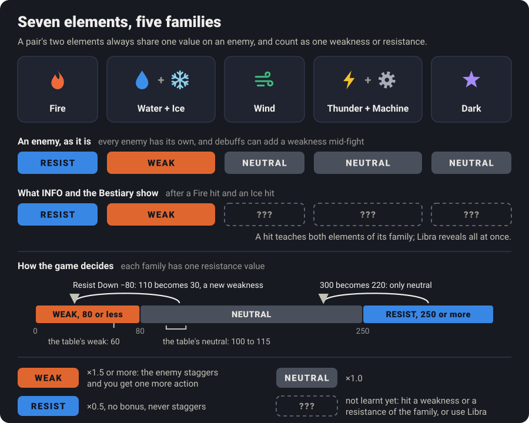
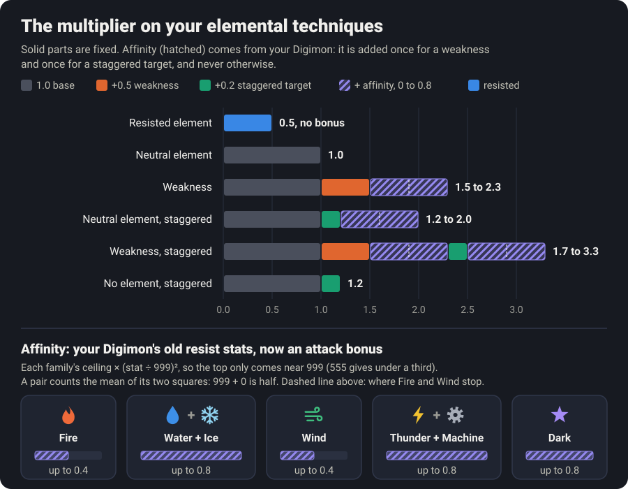

# Combat

[Technical reference index](README.md) · [Player README](../../README.md)

## Combat

### Weaknesses

Seven elements in five families: **Fire**, **Water + Ice**, **Wind**, **Thunder + Machine** and **Dark**. The two
elements of a pair always share one value on an enemy (both weak, both neutral or both resisted), so a pair counts as
one weakness or one resistance. Every enemy has its own, counted in families:

- most enemies are weak to two families and resist one;
- about one in five enemies up to level 30 is a "wall", weak to a single family and resisting two: find the weakness
  or struggle;
- from level 45 on, enemies are weak to two families and resist two, and so are bosses;
- the final boss is weak to one family and to Dark, and resists three;
- Dark is rare on both sides: only a handful of enemies are weak to it, and as few resist it. The four other families
  come out about even: of the 193 species, 93 are weak to Fire, 87 to Water + Ice, 94 to Wind and 93 to Thunder +
  Machine.

Each family has one resistance value: 80 or less is a weakness, 250 or more is resisted, anything between is neutral
(the enemy table uses 60 for a weakness and 100 to 115 for neutral). There is no cap on weaknesses, and they are read
at the moment of the hit, so a debuff that takes a neutral family to 80 or less adds one in the middle of a fight (see
[Buffs and debuffs](#buffs-and-debuffs)).

### Stagger and One More

**Only magic carries an element.** Every elemental physical technique the player can learn became magic, its power
recalibrated to the magic table (MP costs unchanged), so a physical technique or a basic attack is purely physical.
The technique lists show it where the game drew its red (physical) and blue (magic) class marks: a fist for a physical
technique, the element's picture for elemental magic, the Spirit picture for magic with no element; healing and support
keep the game's mark. An enemy using one of these techniques casts it as magic too.

Hitting a weakness with elemental magic **staggers** the enemy (it takes its tired pose) and gives you **one
more** action. Each weak family gives its extra action once per round (a round starts with each normal action; an
extra one does not start a new round), so two weaknesses can chain into several actions in a row, but Ice after Water
gives none. Hitting a weakness again keeps the enemy staggered. Any other blow ends it, and still gets the stagger
bonus unless it hits a resistance; the enemy's own action ends it too. A blow with no element, or the element a crest
lends a basic attack, never staggers.

- **Baton Pass**: while the enemy is staggered, the Tag menu offers a free switch that keeps your turn (once per round).
  A plain switch still costs the turn, unless Relay made it free.
- **OVERFINISH**: a blow that knocks the enemy out and earns one more action leaves it lying there for that action.
  Every hit on it then shows **OVERFINISH!** and pays Bits worth 10% of its damage, added to the battle's.
- **You hear and see how a technique landed**: a slanted **WEAK!** or **RESIST!** over the enemy, and a distinct
  sound for a weakness, a neutral hit and a resisted one.
- **You open the fight** unless you are ambushed. Speed no longer decides who starts. An enemy twice as fast as your
  active Digimon acts twice (the disc's rule), and the HUD shows "Enemy x2"; a faster party counts only the square root
  of its lead, so it needs four times the enemy's speed to act twice every time (`def_turn_speeds`, in
  `fightstg_events_get_delay`; owner, 2026-11-22): the party's extra actions are One More's and Baton Pass's.

### Damage

Damage is still the game's own formula. The Definitive Edition replaces the one step where the original read
elemental resistances, and adds a stagger bonus for blows with no element.

**The multiplier.** When your elemental technique hits an enemy:

| The hit | Multiplier |
|---|---|
| Neutral element | 1.0 |
| Weakness | 1.0 + 0.5 + affinity |
| Neutral element, staggered target | 1.0 + 0.2 + affinity |
| Weakness, staggered target | 1.0 + 0.5 + 0.2 + 2 × affinity |
| Resisted element | 0.5, no bonus, staggered or not |
| A blow with no element, staggered target | 1.0 + 0.2, no affinity |

**Affinity** is what your Digimon's old elemental "tolerance" stats became: they no longer defend, they strengthen your
attacks of that element. It is added once for a weakness and once for a staggered target, and never otherwise: on a
neutral hit against an enemy that is not staggered it does nothing. Each family has a ceiling, scaled by the stat's
share of its maximum, 999: Fire and Wind count on their own, up to 0.3; Water with Ice and Thunder with Machine count as
pairs, on the two stats' sum out of 1998, up to 0.6 (a Water and an Ice technique get the same affinity); Dark counts on
its own, up to 0.6. The strongest hit there is, a weakness on a staggered target with full affinity, is 2.3 for Fire or
Wind and 2.9 for the pairs and Dark.

One stat defends against everything: enemy magic is resisted by your **Defense**, and Spirit is purely your magic
attack. Your elemental stats no longer cut the damage enemy elements do to you.

#### The whole calculation

In the order the game runs it, all integer maths (every original step in full is in
[`docs/MECHANICS.md`](../MECHANICS.md), section 2):

1. **Base.**
   - Physical: `power × Strength ÷ Defense`.
   - Magic: `power × (Spirit × 50 ÷ D + 50) ÷ 100`, kept between half and twice the power. D is the enemy's Spirit
     when you attack, and your Defense when it attacks.
   - An enemy's power is first scaled by its battle's stat scale (`× stat_scale ÷ 16`).
   - Buffs and debuffs: physical ones act on Strength and Defense, as in the original. For magic, the attacker's Spirit
     is scaled by its Strength modifier and a defending enemy's Spirit by its Defense modifier (the final boss keeps
     its own); your Defense already carries yours.
2. **Field, type, boosts.** A field of the technique's element adds `field power ÷ 128` of the damage, the opposite
   element loses `field power ÷ 256`. A type match adds 50% (in magic, after steps 3 and 4). Physical blows add the
   attacker's power boost (`× power_up ÷ 64`).
3. **Element: the Definitive step.**
   - Your elemental technique on an enemy: `× the multiplier` above.
   - An enemy's elemental technique on you: physical `+ damage × element power × 2 ÷ 100`, magic unchanged. Both are
     the original formulas with your resistance fixed at the neutral 100, so your elemental stats no longer count.
   - A crest's element on your basic attack keeps the original bonus, read against the enemy's resistance.
4. **No element, staggered**: a blow with no element on a staggered enemy, `× 1.2`.
5. **Critical and crests**: a multi-hit crest `× 0.4` (physical), a critical hit adds about 50% to 150%, a Guard crest
   takes off a flat amount.
6. **Caps**: never more than 5 × the base, never more than 9999.

**A worked example**, checked against the port's code. Your Digimon has Spirit 180 and a Fire stat of 333. It casts a
Fire technique of power 100 at an enemy that fights with Spirit 120 and is weak to Fire; no field, no type match, no
critical hit.

| Step | Calculation | Result |
|---|---|---|
| Base | 100 × (180 × 50 ÷ 120 + 50) ÷ 100 = 100 × (75 + 50) ÷ 100 | 125 |
| Affinity | 0.3 × 333 ÷ 999 | 0.1 |
| First hit, a weakness | 125 × (1.0 + 0.5 + 0.1) = 125 × 1.6 | **200** |
| The One More: the same technique on the staggered enemy | 125 × (1.0 + 0.5 + 0.1 + 0.2 + 0.1) = 125 × 1.9 = 237.5 | **237** |
| The same hit if Fire were neutral, or resisted | 125 × 1.0, or 125 × 0.5 = 62.5 | 125, or 62 |

The second hit gives no further action (Fire already gave this round's), but it keeps the enemy staggered. The other
way round, an enemy's magic of power 100 (stat scale 16, so × 1) with Spirit 150 against your Defense 120 does
100 × (150 × 50 ÷ 120 + 50) ÷ 100 = 100 × (62 + 50) ÷ 100 = **112**, whatever your elemental stats.

### Buffs and debuffs

- An **attack buff** raises physical and magic damage alike; a **defense buff or debuff** counts against both kinds of
  hit. A magic party gets as much from them as a physical one.
- **Bosses are immune to status** (poison, sleep and the like) **but not to debuffs**: lowering a boss's defense or
  elemental resistance is part of the plan.
- **Resist Down** lowers the enemy's resistance to your strongest family (the one with your highest affinity, a pair
  counting both its elements) by 80, and **Mega Break** your two strongest families by 100 each, for three of the
  enemy's turns. On a neutral family that opens a weakness that was not there; a resisted one (300) only drops to
  neutral. In an enemy's hands 202, 203 and 207 all act as Resist Down (80, your best family) and 208 as Mega Break
  (100, your two best), for 3 turns; Libra and Relay mean nothing to an enemy (owner's choice; `def_tech_effect`).
- The HUD shows every active buff and debuff as an up or down arrow beside the Digimon, on both sides; a lowered
  elemental resistance shows as a down arrow in the element's colour, one per family.

### Knowing your enemy

- **Inspect** (a seventh button on the battle HUD, L2 by default) and **Start** show the enemy's five element families,
  but only what you have found out: hitting a weakness or a resistance with an elemental technique teaches both
  elements of its family, everything else shows `???`. In Inspect a family you know shows its current state (weak,
  neutral or resisted, with a Resist Down or Mega Break already counted), not the state it had when you learnt it.
- **Libra** reveals all of an enemy's elements at once.
- The **Bestiary** (field menu) keeps what you learnt of every species, saved with your game, and lists its Hunt
  Materials: the common one with how many you hold, and its rare items as a collection (see [The hunt](hunt-and-economy.md#the-hunt)).
- Every list of a Digimon's techniques shows each technique's element picture after its name: the battle's technique menu, the battle's Tag and digivolve status pages, the field status screen's digivolve page and the Digi-Lab's three technique screens (`def_tech_icon`). A technique with no element (a physical blow, a support) shows none. It and the status screens keep the seven element pictures.

### Techniques and MP

- Remade techniques: **Libra** (was Speed Up), **Relay** (was Mega Boost: the next switch is free, 50 MP), **Resist
  Down** (was Slow Down) and **Mega Break**.
- More techniques carry a secondary effect, so each form has its own role in a fight.
- Every technique description was rewritten from what the technique actually does, effect first: "Fire magic. Sleep
  chance."
- MP matters now, so the rookies that were starved of it are not any more: Kotemon, Kumamon, Monmon and Guilmon start
  with 140 MP and grow at the same pace as the others.

### Battle HUD

A direct-button HUD replaces the battle's list menu: each action has its own button in a pad-shaped layout (**Item** on `L1` left, **Tech** on `R1` right, **Fight** on `B`, **Run** on `X`, **Digivolve** on `Y`, **Tag** on `A`, **Inspect** on `L2`, **Blast** on `R2`), rebindable from `BATTLE HUD` in the launcher. It remembers the last technique and item, buffers presses made just before the menu opens, and skips battle message boxes by default (`BATTLE TEXT: SKIP`). Controls use the modern **Circle ↔ Triangle** rotation by default (`Confirm` at the bottom, `Back` on the right), with selectable **Xbox / Nintendo / PS1** button glyphs.

### The combat layers, with the owner's decisions

The combat PRD was built in layers 0-10 (the older PRDs 2 and 3 added layers A-J and the mod-to-native move):

- **0** closed without a baseline table; the battle log (`DW3_BATTLE_LOG`) is enough to measure.
- **1** text override: hooks `font_get_entry` (`src/main/font.c`), so any text can be replaced from
  `tools/text_override/`.
- **2-3** weakness table and stagger/chain (the multiplier and the Baton Pass above).
- **4** turn order: the player opens unless ambushed; the enemy's first turn comes after its full delay.
- **5** the Overfinish (10% of the damage in Bits, `DEF_OVERFINISH_BITS_PCT`).
- **6** the four remade techniques: Libra (202), Relay (203), Resist Down (207), Mega Break (208).
- **7** Defense defends against magic; the old "Tolerance" texts became "Affinity".
- **8** the MP table: Kotemon, Kumamon, Monmon and Guilmon 140 MP, gain 57; Veemon 150; Guilmon gain 60.
- **9** the bestiary save.
- **10** balance: the owner tunes it.
- PRD 3: the launcher mods `evo_buff`, `party_xp` and `xp_boost` were removed and became the game's own rules.

### Constants worth knowing

`DEF_WEAK_MAX` 80, `DEF_RESIST_MIN` 250 (a family's resistance: weak at 80 or less, resisted at 250 or more). Resisted
hits are a fixed 0.5. Affinity ceilings: single 0.3, pair 0.6, Dark 0.6. Weak +0.5, stagger +0.2. The player's reference
resistance is 100. Relay costs 50 MP. Resist Down is a delta of 80 and Mega Break 100, for 3 enemy turns. The Baton Pass
is free (`DEF_BATON_PASS_MP` 0) and offered only while the enemy is staggered. **Overlevel gap 3** (`DEF_OVERLEVEL_GAP`,
it was 15). The Rush question lasts 300 ticks, the Rush panel 175 ticks and 10 rows.

Their names: multipliers and affinities are fixed point in thousandths (`DEF_MULT_ONE` 1000): `DEF_MULT_WEAK` 500,
`DEF_MULT_STAGGER` 200, `DEF_MULT_RESISTED` 500, `DEF_AFF_SINGLE_MAX` 300 (Fire, Wind; resist 999), `DEF_AFF_PAIR_MAX`
600 (Water+Ice, Thunder+Machine; the pair's sum 1998), `DEF_AFF_DARK_MAX` 600. `DEF_PLAYER_REF_RESIST` 100 is what an
enemy's element is measured against when it hits the player. Resist Down / Mega Break: `DEF_BREAK_SLOW_DELTA` 80,
`DEF_BREAK_MEGA_DELTA` 100, `DEF_BREAK_TURNS` 3; on a boss the original made immune, a stat debuff is scaled by
`DEF_BOSS_DEBUFF_PCT` (100). `DEF_RELAY_MP` 50. TP: `DEF_TP_GAIN_LV_2_20` 7, `DEF_TP_GAIN_LV_21_40` 9,
`DEF_TP_GAIN_LV_41_50` 30, `DEF_TP_GAIN_LV_51_UP` 0, `DEF_TP_CAP` 99. Short digivolution: hold Circle or Cross
`DEF_EVO_SKIP_HOLD_FRAMES` (4) frames (the PRD's switch `DEF_EVO_ANIM_SKIP` never existed in code).

### Combat design record (details from the PRDs that the sections above summarise)

Working rules of the PRDs (kept because they explain why the code looks as it does):

- **Not a mod.** Always on, no `mod.json` option, no `port_mod_*` flag. Game C is touched only under `#ifdef PC_PORT`
  with short hooks; new battle state goes into `game_savestate` (`port/game/game_mods.c`). Disc data is never edited or
  versioned: enemies (`SDIGIEDT.PRO`) and texts (`ES*.BIN`) change through port override tables, techniques and Digimon
  (`src/main/records.c`, matching source) through a patch applied at port boot. Fractions are fixed point (the game uses
  no float). Removing a file: move it to `/tmp`, never `rm`.
- **Vocabulary.** Elements, fixed order: Fire, Water, Ice, Wind, Thunder, Machine, Dark = `resists[0..6]`. In a technique
  `RecordsTechnique.defense_stat` 2..8 is the element (`resists[defense_stat - 2]`), 1 = none; `RecordsTechnique.element`
  is the class (2 physical, 3 magic, 4 heal, 5 buff/debuff, 6 field). Stats: `stats[0]` Strength, `[1]` Defense, `[2]`
  Spirit, `[3]` Wisdom, `[4]` Speed. `side == 0` is the player attacking; `fightstg_rules.stats[0]` is the attacker and
  `[1]` the target. Only the final boss has `state.type == 6`; other bosses are recognised by `records_state.blocked[]`.
- **Layer 0 decision (2026-11-12):** closed without a baseline table, no autoplay and no `DW3_FORCE_BATTLE`; the owner
  balances by playing. Rule checks are host tests with calculation, not play. Layer 10 (balance) is the owner's, done on the
  constants of `definitive.h`. The owner's guidance for it: if a boss falls in 2-3 turns, **raise boss HP first** (a
  constant multiplier on `RecordsEnemy.hp` of boss fights) and only then touch magic; only if the magic team still loses
  badly to the physical one revisit the `[power/2, 2 x power]` clamp of `get_special_damage`.
- **The battle log (`DW3_BATTLE_LOG=<file>`, layer 0's measuring tool).** One plain-text line per event (`definitive.c`
  `LOG`): `battle` (id, kind, type) with a line per party member and per enemy (digimon, level, HP, MP, scale); `turn`
  (side, number, member); `action` (side, kind, technique, class, element, power, MP); `damage` (value, the target's HP
  before and after) with a `mult` line (the multiplier and its terms: weak, open, resisted, affinity); `end battle`
  (result, party turns, enemy turns); plus the definitive events: `hit target N weak W stagger S -> S' extra_pending E`,
  `extra action granted`, `baton pass`, `relay swap`, `stagger closed by the enemy's turn`, `libra`, `resist down`,
  `overfinish damage`, `twice E Pe P` (the "Enemy x2" test), `blast gauge`, `mod` lines. The battle code calls
  `def_log_begin`, `def_log_turn`, `def_log_action` (`fightstg_80086A00.c`, `wfightmn_800A6440.c`) and `def_log_end`.
  The PRD's acceptance checks of layers 2-4 (chain, window, close, free swap) were read from this log. The first plan
  of measuring 4-6 bosses with a physical and a magic team (`baseline.md`) was dropped.
- **Layer 2 (HUD, Inspect, sound, "Enemy x2").** The HUD became mandatory (the list menu is unreachable). Three distinct
  sounds (weak, neutral, resisted) are picked from effects the battle already loads. The "Enemy x2" indicator shows when
  `E + Pe < P`, where E is the enemy's remaining turn delay in the queue, Pe = `get_delay(0x10, 0)` and P the player's
  remaining delay after the current action (`get_delay(0, 0)`); `get_delay` of type 0 draws nothing but **overwrites
  `fightstg_rules.stats[]`**, so call it only with the command menu open, never in the middle of a damage calculation.
- **Layer 3 (enemy table), the generator's rules** (`tools/gen_enemy_weaknesses.py`, fixed seed 20261112, `--apply` writes
  `port/game/definitive_enemies.c`, a readable proposal goes to `.dumps/tasks/persona/fraquezas.md`):
  - archetypes by family: plain 2 weak + 1 strong, wall 1 + 2 (about 20% of the mobs of level <= 30), late 2 + 2 (level >=
    45), boss 2 + 2 and final boss 1 + 3 (plus its Dark mark); the original asked 2 + 3 for bosses but only four
    families exist outside Dark, so it did not fit. Weak = 60, strong = 300 (or the disc's own value from 250), neutral
    100..115 (the current value when already there), the same for both elements of a pair;
  - the "house" family of a species (the family of its techniques' commonest element, else of its one high resist, else
    of its type) is never a weakness and is the natural strong resistance; a plain species that already has exactly two
    weak families keeps them, otherwise they are filled by opposition to the house element, then by balance, so the
    count per family evens out and two species of one battle do not share a pair;
  - **Dark:** weak only to Dark: BK Seraphimon, MagnaAngemon, Knightmon, Taomon (ids 447, 452, 178, 453); Dark as an extra
    weakness: Valkyrimon and the three Galacticmon phases (269, 442, 466, 467); the only eight that resist Dark:
    Armageddemon, VenomMyotismon, LadyDevimon, Phantomon, Mummymon, Ghoulmon, Gargoylemon, Apokarimon. The rule: resisting
    Dark is as rare as being weak to it so Dark stays a useful element;
  - `def_weakness_mask` marks the whole family when one of its values is at `DEF_WEAK_MAX` (80) or less, with **no median
    and no cap**: a Break that creates a third weakness hides no natural one. (The first design used a median and
    `DEF_WEAK_GAP` / `DEF_WEAK_COUNT`; they are gone.)
  - where the table enters: `fightstg_enemy_get_record` (`fightstg_8008D3B4.c`, found by `fightstg_enemy_find_record` in
    file 0x1CF) calls `def_enemy_override` on the record in memory, so the disc's SDIGIEDT is never edited; the field's
    own SDIGIEDT reads call it too (`definitive.c`), and a purification's dark form (no disc record) comes from
    `def_purify_record`. A row of `def_enemy_rows[]` is `{species id, 7 resists, dark}`; `dark` is the Dark mark, kept
    in the port's table because the disc record has no such field (`dark_mark`), and `def_weakness_mask(resists, dark)`
    adds Dark as an extra weakness outside any count. Stagger and chain state is a `DefChain` in `definitive_mask.c`
    (`staggered[3]`, `extra_pending`, `next_extra` / `cur_extra`, `window_used`, `swap_used`, `relay`); a Baton Pass or
    a Relay swap sets `extra_pending`, so the free swap keeps the turn.
- **Layer 4 (stagger).** One flag per enemy (`def_staggered[3]`), unrelated to HP. It opens when the player hits a weakness
  with an elemental technique (`defense_stat >= 2`); a physical blow with no element and a crest's element (`attack_element`)
  never open it. It closes when the staggered enemy takes the next player blow (which still gets the bonus) or acts. A
  multi-hit technique counts as one blow. The next player turn is rescheduled at command time (`wfightmn_party_turn`, end of
  step 2), before the blow resolves, so on a hit set `extra_pending` and when the action ends find the player's turn in the
  queue (`fightstg_events.find(2)`) and zero its delay (check the tie rule of `fightstg_events_take_next`). With 2 actions
  from speed and 2 weaknesses the chain is up to 6 actions: that is design, not a bug. The chain is the player's only; the
  PRD flagged "does the enemy get an extra action" as to confirm with the owner; the code answers no (checked 2026-11-18:
  `def_action_resolved` returns at `side != 0`, `def_chain_enemy_acts` only closes the stagger, and `extra_pending` is set
  only by the player's hits and free swaps in `definitive_mask.c`). The staggered pose comes from the flag on the enemy side (never from HP;
  the low-HP pose is removed on the player side), and the final boss shows its tired pose when `final_phase || staggered`.
  The Tag button shows a different icon while a free swap is available. A save state in the middle of a chain restores equal.
- **Layer 5 acceptance cases** used by the host test: neutral 1.0; weakness 1.5; weakness + stagger with full Fire affinity
  1.0 + 0.5 + 0.2 + 0.3 + 0.3 = 2.3; the Water + Ice pair with 999 + 0 gives 0.3 of affinity. The magic clamp
  `[power/2, 2 x power]` was deliberately not changed. Status rolls still read the player's resists as before.
- **Layer 5 hook points.** With `def_on` the multiplier replaces the element step of `fightstg_rules_scale_damage`
  (physical, `def_scale_physical`) and the resist bands of `fightstg_rules_get_special_damage` (magic, `def_scale_magic`)
  when the player attacks. When an enemy's element hits the player the old scale stays, with the player counted at
  `DEF_PLAYER_REF_RESIST` (100): physical `value + value * power * 2 / 100`, magic unchanged (the old bands at resist 100
  are 100%). Layer 7's Defense against magic is `def_magic_defense` in the same function. The staggered pose is set
  through `wfightmn_update_idle_anim`; the Baton Pass is a row of the swap menu (`fightstg_switch_menu_update`).
- **Layer 6 (techniques).** `records_techniques[]` is global: re-aiming a technique changes every form and enemy that uses
  it, so list who uses an ID first (`.dumps/tasks/persona/techs.txt`, regenerate with `tools/venv/bin/python
  .dumps/tasks/persona/dump.py`). Remade: 202 Speed Up -> Libra, 203 Mega Boost -> Relay (50 MP), 207 Slow Down -> elemental
  resist debuff, 208 Mega Break -> stronger or wider. Inheritance stays as it was (Digi-Lab mark, +20% MP, no new limit).
  Candidates the PRD listed to become elemental techniques (the owner approves before any is applied): 129, 130 (empty);
  194, 195 (no form learns them); 146, 148, 204, 211, 212 (enemy only: do not change the record); 131-136 (Busters per
  type); 213-219 (Fields); 190, 192; 127, 128. Goal: every evolution line reaches at least 2 elements and none all 6
  (unverified how far this went; see `definitive.c` `patch_techniques` and `def_mod_tech_spec`).
- **Layer 7 texts.** The status menu's "Tolerance" of the 7 elements became affinity; text that described Spirit as defence
  was corrected (`ESSTATUS` 92-98, `ESTRAINI` 29+).
- **Layer 8 originals** (start MP -> new, gain per level -> new): Kotemon 100 -> 140 and 55 -> 57; Kumamon 10 -> 140 and 30 ->
  57; Monmon 80 -> 140 and 45 -> 57; Veemon 150 (gain 50 -> 57); Guilmon 130 -> 140 (gain 60). Forms have no MP of their own:
  MP is the rookie's (`RecordsDigimon.start_mp`, `hp_mp_gains[1]`). It is applied by a patch at port boot (`def_mp_hook`);
  `tools/convert_save_mp.py` uses the same table, keep both in sync.
- **Layer 9 (bestiary save), original reasoning:** the card file has 4 blocks and the game used up to 0x7800, the last 0x800
  were never written, so one 0x100 record per slot went there; absent, unknown version or bad checksum reads as all zero.
  The slot tail is not usable: 0x26C4..0x26EB is the `global_save`, 0x26EC..0x26EF the MP converter marker. Start (bit 0x8,
  free in battle) opens the battle memory; Inspect respects the same table. Wiring: part 5 of `memcard.c`
  (`DEF_BESTIARY_PART`), read by STGMCARD step 0x48 (`def_bestiary_record_read`; any failure reads as an empty table,
  never an error screen) and written by step 0x36 after the slot (`def_bestiary_record_write`); the record is "BEST",
  version, XOR checksum and the 193-byte table (bits 0..6 = element learnt).
- **Boss immunity (PRD 2 layer A).** `records_state.blocked[12]` per fight: indexes 0-4 and 7 are status and still count;
  8, 9, 10 are Strength, Defense and Speed reductions, which the definitive edition ignores (the effect enters, scaled by
  `DEF_BOSS_DEBUFF_PCT / 100`, see `def_stat_blocked`); do not touch 5, 6 and 11 (11 is "no escape"). The hunt's boss-fight
  Rare Targets may carry `blocked[11]`, which is why the flee roll is forced before checking it.
- **Buff reaching magic (PRD 2 layer B).** The engine has 3 modifiers per member (`modifiers[0]` Strength, `[1]` Defense,
  `[2]` Speed); Spirit has none. The fix is in `get_special_damage`, not `get_stats` (for an enemy Spirit is magic attack
  and defence at once): the attacker's Spirit is scaled by the Strength modifier ratio, the target's magic-defence stat
  (Defense on the player, Spirit on an enemy) by the Defense modifier ratio; the player's Defense already comes modified, so
  it is not applied twice; the final boss (`type == 6`) keeps its own Defense/Spirit adjustments.
- **Training facts (PRD 2 layers E and I).** A round succeeds with chance 75 (+3 or +6 with the training item). Trainings
  below id 13 have 3 rounds and an automatic bonus round if all 3 hit; from 13 on, 5 rounds with an optional bonus of chance
  50 (0 if the previous bonus was won). The pity counter is RAM only (not saved: it resets when the game closes), one for all
  Digimon, "perfect" = every normal round hit (resets the counter, anything else adds 1), at `DEF_TRAIN_PITY_AFTER` the next
  session hits every round (and the bonus round, `DEF_TRAIN_PITY_BONUS`) and the counter resets; it only applies to a
  session in which TP was spent; the screen shows filled marks (e.g. 2/3) and a clear notice when the next is guaranteed.
  Resistance trainings (types 8..14) have a second stat (`entry->stat_2`); when it is 1..5 each round had a 50% chance of
  taking points from it (`stgtrain_session_lower_stat`, `stgtrain_stat_losses` = {1, 2+r3, 4+r3},
  `src/stgtrain/stgtrain_800861BC.c`). `DEF_TRAIN_NO_STAT_LOSS` zeroes the loss and hides the line; `stat_2` 15/16 raise max
  HP/MP and stay. The original draws one random number for the loss (plus one for the amount); with the switch on,
  `stgtrain_session_lower_stat` returns before any `pad_random.next()`, so a definitive session simply draws fewer
  numbers, and a scripted replay (`def_on()` off) draws as before.
- **TP retroactive for old saves** (`tools/convert_save_mp.py`, `retroactive_tp`): old TP = (new total up to the current
  level, capped at level 50) - (5 x levels gained up to 50), never negative, respecting the 99 cap; what does not fit is
  lost and `--dry-run` says so. Marker at slot + 0x26EC: `MPV1` is MP only, `DFV2` is MP and TP; the converter is idempotent
  and upgrades `MPV1` to `DFV2` keeping the MP. Original TP: +5 per level (`stfgtrep_add_exp`, `stfgtrep_80082E70.c`).
- **Blast gauge was a bug of the original:** `records_state.gauges[8]` (s16, 0..1000 per Digimon) lived only in RAM and was
  cleared at the title (`records_clear_gauges`, `stdwtitl_80085CD4.c`); the port saves it in the slot tail at +0x26F0 (an
  out-of-range value reads as 0, an old save loads with 0, a new game still zeroes it; also in `game_savestate`).
- **Digivolution requirements (PRD 2 layer J).** Each partner has a list of 44 forms (`stfgtrep_learn_lists[digimon]`,
  `StfgtrepLearn`): up to two required forms with a minimum level (`requires[i] = {form, level}`) and one minimum stat
  (`stat` 1-6 the six stats, 7 the Digimon's level, 8-14 resistances; `min`), checked in `stfgtrep_learn_technique`. The
  Digi-Lab panel is read only, shows one step ahead (`DEF_EVO_HINT_DEPTH` 1; 0 off, 99 all), and the form is still learned
  at the next level-up as in the original; the numbers were checked against `stfgtrep_learn_lists` for Kotemon and Kumamon.
  The panel lists the forms in reach with their requirements met / total ("Ready" in green when all are met), and for
  the chosen form one block per requirement with its current value against the goal, green when met (`EH_PAL_MET`).
- **Second pass on techniques (PRD 2 layer H, now `def_mod_tech_spec`).** The player had only 13 buff/debuff techniques in 55
  forms and no attack reduction (technique 204 existed only for enemies); the table "form, technique, current effect,
  proposed effect, MP" went to `.dumps/tasks/persona/tecnicas-v2.md` for the owner, with the goals one identity per form, at
  least one attack reduction for the player, and nothing that gives an extra turn (the chain already does). Damage techniques
  with a side debuff are tier 1 for 2 turns; dedicated single-target ones tier 2 for 3-4 turns;
  strong or group ones tier 2 for the group or tier 3 on a single target.
- **Native XP rules (PRD 3), what each launcher mod became.** `party_xp` share 100 (`knocked_out` and `catch_up` removed:
  a knocked-out member gets no shared XP, no level-gap bonus); `xp_boost` EXP and Bits 1x (path removed), form EXP 14x
  (disables the original form-EXP cap), all forms on, card boosters 15 per drop (`DEF_XP_PARTY_SHARE`, `DEF_XP_FORM_MULT`,
  `DEF_XP_ALL_FORMS`, `DEF_CARD_BOOST_PACKS`); `evo_buff` removed with no leftover
  (`grep -ri "evo_buff\|evo buff\|evo_shield"` outside `.plan/` and `.dumps/` must stay empty). An old `settings.json`
  with those keys still works (unknown keys are ignored). `all_forms` credits the three chosen forms of each member
  (the old mod text said "every digivolution the member owns", `LAUNCHER.md` said "the three chosen forms"; the code and
  the README line are the three chosen). Rules moved to `docs/MECHANICS.md` section 6.
- **OVERFINISH Bits** were "maybe 0.1" in the PRD, the owner will lower it if it turns out high; the red callout reuses the
  WEAK!/RESIST! creation flow.
- **Teleport fix** (PRD 3 roadmap, done): the Guardromon teleport used to spawn the player outside the map with inverted
  controls; the destination now uses each map's standard start coordinates.

## Buff and debuff tiers (no stacking)

A stat buff or debuff is one of three **fixed tiers**, a percentage of the stat's base value (kinds: attack, defense,
speed), not an accumulating sum:

| Tier | Buff | Debuff |
|---|---|---|
| 1 | +20% | -15% |
| 2 | +35% | -25% |
| 3 | +50% | -35% |

- Duration is in **turns of the affected Digimon**: 2 (short), 3 (base) or 4 (long); a damage technique with a side
  debuff is tier 1 for 2 turns.
- **No stacking.** Same sign: the stronger tier wins and the same or a weaker tier only refreshes the turns. Opposite
  sign: the new effect overwrites the old.
- Per-technique specs live in `def_mod_tech_spec` (`definitive.c`): 198 and 200 are +2 for 4 turns, 199 and 201 are +3,
  194, 205, 134, 81 and 136 are -2, 195, 204 and 206 are -3, and 132, 108 and 131 are -1 for 2 turns. Only technique IDs
  with the enemy bit clear are changed, so enemy techniques keep their roles.
- Bosses are immune to status but not to debuffs (`DEF_BOSS_DEBUFF_PCT` 100).
- Every description in `SKLINF` states effect, tier and turns (34 characters at most), e.g. "User Atk+2 (phys/mag), 3
  turns.".
- Tests: `tests/port/definitive_buffs.py` (+ driver) checks the tiers, the no-stack rule and the expiry.

## Status, Poison and revive rework

Measured in `.plan/tasks/status-balance-report.md` (a level-50 Digimon has median Wisdom 338, Spirit 316 and max HP 3383;
training gives about 4.1 points per TP).

- **Chance** = value + (attacker Wisdom - target Wisdom) / 8 - resist_sum / 8, out of 128. On a boss x0.6
  (`DEF_BOSS_STATUS_PCT` 60); on a staggered target x1.5 + 24; a boss cap of 100/128; the result is clamped to 1..127.
- **Poison** damage per turn = power / 2 + Wind affinity / 6 + Wisdom / 4 + Spirit / 4, capped at max HP / 4 and, on
  enemies, at 8% of max HP.
- **Sleep and Confusion** hold an enemy for 2 turns and end on a hit (`def_wake_on_hit`). A sleeping enemy regenerates 6%
  per turn. After confusion ends the enemy gains Attack +2 for 3 turns.

### Revive items

| Item | Chance | HP returned | Rated max HP | Price |
|---|---|---|---|---|
| Revive Disk (item 67) | 60% | 30% | 1500 | 400 buy, 200 sell |
| Life Disk (item 70) | 85% | 60% | 4000 | 2500 buy, 1250 sell |
| Max Charge (item 46) | 100% | 100% | 9999 | 3000 sell |

The chance scales down by rated max HP / the target's max HP when its max HP is above the rating (never under 20%,
`DEF_REVIVE_MIN_CHANCE`; `def_revive_chance`). By the fallen ally's max HP (computed from that rule, not measured):

| Max HP | Revive Disk | Life Disk |
|---|---|---|
| 300 | 60%, 90 HP | 85%, 180 HP |
| 800 | 60%, 240 | 85%, 480 |
| 1500 | 60%, 450 | 85%, 900 |
| 2000 | 45%, 600 | 85%, 1200 |
| 3000 | 30%, 900 | 85%, 1800 |
| 4000 | 22%, 1200 | 85%, 2400 |
| 6000 | 20% (floor), 1800 | 56%, 3600 |

Max Charge is 100% at any max HP. On a 3000 max HP ally a success costs about 1330 Bits in Revive Disks (3.3 of them)
or 2940 in Life Disks (1.2).

### Balance measurements behind the status rework (`status-balance-report.md`, simulated from the disc tables and the port's formulas)

Names: Power, Guard, Spirit (`stats[2]`), Wisdom (`stats[3]`, the game's "precision" and the heal's stat), Boost (speed).
Poison reads Wisdom + Spirit + Wind affinity.

- **A level-50 Digimon by level-ups alone** (8 party species x 40 rolls, no gear, no training): Wisdom p10/median/p90/max
  305 / 338 / 371 / 401; Spirit 204 / 316 / 382 / 409; max HP 2644 / 3383 / 4629 / 4693.
- **Training:** pure stat trainings (ids 1-5, below 13: 3 rounds, bonus after 3 wins, `stat_2` = 0 so nothing is lost) with
  round chance 75 + item (0/3/6) succeed 76/79/82 in 100; cost 1 / 5 / 10 TP per session at trainer level 0 / 1 / 2. About
  **4.1 points per TP whatever the trainer** (the three tiers are balanced on purpose): 4.09 at 76%, 4.33 at 79%, 4.59 at 82%.
  The report assumed the original +5 TP per level (245 TP, about 1001 points); with the Definitive TP table (613 by level 50)
  there is more to spend. Reaching 999 Wisdom from the median 338 costs 661 points = 161 TP of the original 245 (66%), the rest
  buys about 340 Spirit or Wind resist (153 TP for the best-growth species): 999 Wisdom is reachable at 50 but eats most TP.
  Profiles used: casual (Wis 250 / Spirit 250), focused (600 / 400), pure (999 / 656, Wind resist about 300 -> affinity 90).
- **Bosses** (kind 2 with at least 9 of 12 `blocked` flags): 48 battles, 47 at level >= 30, 41 at >= 45. Level >= 30: HP p10/
  median/p90 1776 / 3120 / 5040, precision (Wisdom x scale) 400 / 738 / 1053, median poison resist sum 163. Level >= 45: HP
  2052 / 3360 / 5040, precision 552 / 750 / 1053, resist sum 164.
- **Poison damage** (technique powers [80, 88, 96, 127]; tick = power/2 + Wind affinity/6 + Wisdom/4 + Spirit/4, capped at
  max HP/4 by `def_poison_dot_calc` / `def_poison_cap`; a boss ticks 10 times): casual 164-187 per tick (5.3-6.0% of a median
  3120 HP boss, 53-60% over 10 ticks), focused 300-323 (96-100%), pure 468-491 (100%); on the p90-HP boss (5040) 10 ticks do
  33-37% / 60-64% / 93-97%.
- **Chance to land a status on a boss**, medians over bosses of level >= 30 (chance = effect_chance + (my Wisdom - boss
  precision)/8 - boss resist sum/8, x0.6 on a boss, then x1.5 + 24 if staggered, boss cap 100/128 = 78%): Poison with the
  best technique (127): casual 19% normal / 47% staggered, focused 39% / 77%, pure 62% / 78%; with the 72 technique casual 1% /
  8%. Sleep best (127): casual 20% / 48%, focused 40% / 78%, pure 63% / 78%. Confusion best (127): 19% / 47%, 39% / 77%,
  62% / 78%. Worst boss with the best technique: casual 1%, focused 5% poison (26% staggered), pure 28% (61% staggered).
- **The report's full cells** (chance %, normal / staggered, medians over bosses of level >= 30; base chances: Poison
  [72, 80, 96, 112, 127], Confusion [80, 127], Sleep [80, 96, 127]):

  | Profile | Poison 72 / 96 / 127 | Confusion 80 / 127 | Sleep 80 / 96 / 127 | Worst boss, best tech (P / C / S) |
  |---|---|---|---|---|
  | casual, normal | 1 / 4 / 19 | 1 / 19 | 1 / 5 / 20 | 1 / 1 / 1 |
  | casual, staggered | 8 / 24 / 47 | 14 / 47 | 15 / 26 / 48 | 1 / 1 / 1 |
  | focused, normal | 13 / 24 / 39 | 17 / 39 | 18 / 26 / 40 | 5 / 1 / 1 |
  | focused, staggered | 38 / 55 / 77 | 45 / 77 | 45 / 57 / 78 | 26 / 19 / 19 |
  | pure, normal | 37 / 48 / 62 | 41 / 62 | 41 / 49 / 63 | 28 / 23 / 23 |
  | pure, staggered | 73 / 78 / 78 | 78 / 78 | 78 / 78 / 78 | 61 / 54 / 54 |

  Training per session (ids 1-5): trainer level 0 / 1 / 2 costs 1 / 5 / 10 TP and gives 4.1 / 20.4 / 40.9 points at a
  76% round chance, 4.3 / 21.7 / 43.3 at 79%, 4.6 / 23.0 / 45.9 at 82%; the 5-round trainings from id 13 pay more at
  the same cost and were left out, so these numbers are the safe side. The boss with the lowest HP of the set (912) dies
  to 10 poison ticks at every profile. Generator: `.dumps/tasks/status_balance_sim.py` (local, gitignored), from the
  disc tables and the port's formulas (`def_poison_dot_calc`, `def_poison_cap`, `def_revive_hp`,
  `fightstg_rules_get_heal`); it assumed the original +5 TP per level.
- **Would it be annoying?** Sleep and Confusion last at most 2 boss turns (`DEF_STATUS_BOSS_TURNS`) and end on any direct hit
  (`def_wake_on_hit`), so control is for healing and setup, not the damage turn. A sleeping boss regains 6% max HP a turn
  (12% over 2 turns). Expected attempts for the best Sleep: casual 5.1 normal / 2.1 staggered, focused 2.5 / 1.3, pure 1.6 / 1.3.
- **Revive for a pure healer:** the report's table used rated HP 400 (Revive Disk) and 1500 (Life Disk); **the code now rates
  them at 1500 and 4000** (`DEF_REVIVE_T1_RATED_HP`, `DEF_REVIVE_T2_RATED_HP`), so the tables under "Revive items" above are
  the current ones and the report's numbers are older. Expected cost per success on a 3000 max HP ally in the report: Revive Disk 20% (about 5 items,
  2000 Bits), Life Disk 42% (about 5952 Bits). Heal = power x 64 + Wisdom x power / 8 (`fightstg_rules_get_heal`, cap 9999),
  so Wisdom is the healer's stat too: technique 0xB8 (power 8, 16 MP) heals 762 / 1112 / 1511 at Wisdom 250 / 600 / 999; 0xB9
  (32, 74 MP) 3048 / 4448 / 6044; 0xBA (127, 120 MP) 9999 at any of them; 0xBB (32, 188 MP) like 0xB9; 0xBC (64, 240 MP) 6096 /
  8896 / 9999; 0x190 (8, 0 MP) like 0xB8.

## Turn order, stagger, chain, XP, training, digivolution: the numbers

- The player opens unless ambushed; the enemy's first turn comes after its full delay.
- Stagger and chain: one extra action per family per window.
- TP per level: 7 for levels 2-20, 9 for 21-40, 30 for 41-50, 0 from 51 (cap 99 in hand). Totals 313 by level 40 and 613
  by level 50 (original 195, 245 and 490).
- **Training pity**: 3 non-perfect trainings, then the 4th is guaranteed (the bonus round included). The counter lives in
  RAM and is shared by all Digimon (`tests/port/definitive_pity.py`, `definitive_train_loss.py`, `definitive_tp.py`).
- XP: party share 100%, form XP x14 (cap skipped), every chosen form earns XP, card boosters x15.
- Rare Booster: 1 pack, items 0x186..0x18A; 01 below level 25, then one more per 15 levels (05 from 70).
- Short digivolution animation: a "seen" bitset in RAM; hold Circle or Cross for `DEF_EVO_SKIP_HOLD_FRAMES` (4) frames to
  skip (`tests/port/definitive_evo_anim.py`); the hold works even on a form's first digivolution (`def_evo_skip_update`
  in `fightstg_80086A00.c` checks no "seen" bit); the seen set is RAM only.
- Digi-Lab "Next Forms" panel (`DEF_EVO_HINT_DEPTH` 1), opened with Square (`definitive_evohint.c`).
