> [!WARNING]
> **This is a release candidate, not a stable release.** It is **part 1 of 2** of 0.9.3 and it is here to be tested, not to be played through. If you do not know what a release candidate is, **stay on [v0.9.2](https://github.com/al4xdev/digimon-world-3-definitive-edition/releases/tag/v0.9.2)** (the latest stable one).

**v0.9.3-rc1** is the first half of 0.9.3, and it is about one thing: the **loading screens**.
Part 2 will bring the **HUD glyph fixes** and **support for more symbols** that were asked for.

## What I need from you

Every map change used to take about **5 seconds** of loading, and the game changes maps constantly. It now takes about
**200 ms** on a modern PC. The original full-screen location title (the name drawn letter by letter) would cover the
screen again on every change, so it became a **small corner card in the same old style**.

**This is a deliberate change of rhythm, and it will feel different from the original, even to me.** I cannot tell from
my side whether it came out right, so this candidate is a calibration. Play it, then tell me:

- Do you **miss the original location screen**, or do you prefer the speed?
- Is the corner card enough to know where you are after a map change?
- Did any transition feel **too abrupt** (a screen you could not read, a cut that startles)?
- Which device are you on (PC, handheld or Android)? The 200 ms is a modern PC figure; slower devices hold the black
  cover until the view is drawn.

If it feels too different for enough of you, **a legacy option may come in a later release** (0.9.4 or 0.9.5), so you
are not voting to remove the old screen. Nothing is promised: it depends on the feedback. Answer in a [discussion or issue](https://github.com/al4xdev/digimon-world-3-definitive-edition/issues/new?template=bug_report.yml);
"too fast", "just right" and "slower, please" are all useful answers.

Saves from 0.9.2 carry over, but **keep a copy of yours before trying a candidate**.

## Downloads

Bring your own disc image of **Digimon World 2003** (PS1, Europe, SLES-03936, raw `.bin` + `.cue`). These files hold no game data.

| Platform                                 | File                                     | How                                                                                                                                           |
| ---------------------------------------- | ---------------------------------------- | --------------------------------------------------------------------------------------------------------------------------------------------- |
| **Linux** x86_64                         | `dw2003-0.9.3-rc1-x86_64.AppImage`       | `chmod +x` it, then run it. glibc 2.39 or newer (Ubuntu 24.04, Fedora 40, Debian 13 or later)                                                 |
| **Windows** x86_64                       | `dw2003-0.9.3-rc1-windows-x86_64.zip`    | unzip, run `dw2003-launcher.exe`. Unsigned: SmartScreen's "More info", "Run anyway". Windows 10 or newer; tested on Windows 11 and under Wine |
| **PortMaster** (RK3326, armhf + aarch64) | `dw3.zip`                                | unpack into `ports/`, put your `.bin` + `.cue` in `ports/dw3/game/`                                                                           |
| **Android** arm64                        | `dw2003-0.9.3-rc1-android-arm64-v8a.apk` | sideload it                                                                                                                                   |

The `.debug` file and the `-symbols.zip` are debug info for crash reports, not needed to play. `SHA256SUMS*` check the downloads.

## What's new

### Loading screens (the point of this candidate)

- **Map changes are instant.** The map cuts at once and holds a black cover only until the tiles in view are drawn,
  then a small, non-blocking **corner card** names the sector and map (it replaces the original full-screen location title).
- The field loads with **unlimited fast-forward** (audio is not muted) and the field is revealed with a short
  ease-out window centered on the player.
- **No more fake loading bars:** the memory card's progress bars and the overlays' duplicated fades are cut down.
- The field menu wipe is about 200 ms, the overlays' exit fades are 5 frames.
- **Faster battle entry:** the screen shatter runs 8x faster and the stage opens from black in 15 frames instead of 60.
  The CD loading waits and the sound are untouched.
- Guide notices wait while the map corner card is up.

### Launcher

- **VIDEO screen on handhelds** (PortMaster) with **REFRESH RATE**, **RENDERER** (auto, software, gles) and
  **VIDEO PATH** (auto, fbdev, sdl2). PC and handhelds now share one VIDEO screen.
- **FMV AUTOCROP** toggle on VIDEO (#9).
- **TURBO** is a toggle (TAB on the PC, a pad button or chord set in CONTROLS > TURBO) (#26).
- **BATTLE TEXT** is SKIP or ASYNC; async text goes through the HUD notice queue (GAME option). An old OFF reads as SKIP.
- The gamepad is released before the game opens it (#14); dialogue choice and gamepad axes are hardened.
- Save schema 3: saves from before 0.9.1 are no longer migrated.

## What comes next

**Part 2 (0.9.3 final):** the **HUD glyph** improvements and **support for more symbols**, plus whatever this
candidate's feedback says about the loading. Then the plan goes on as in the README: weekly updates up to 0.9.5.

**Full Changelog**: https://github.com/al4xdev/digimon-world-3-definitive-edition/compare/v0.9.2...v0.9.3-rc1
